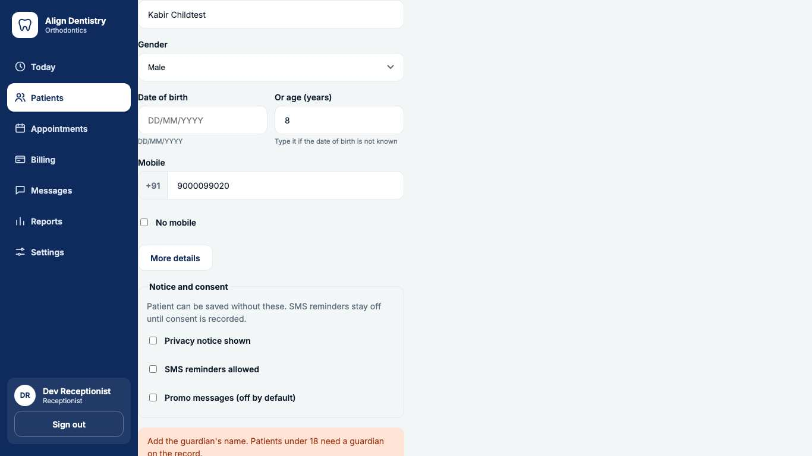
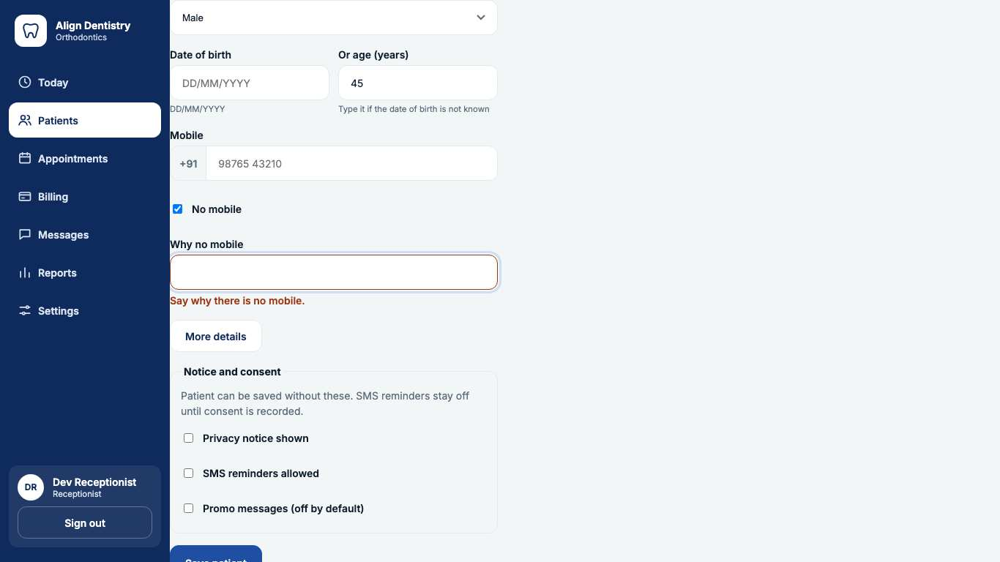
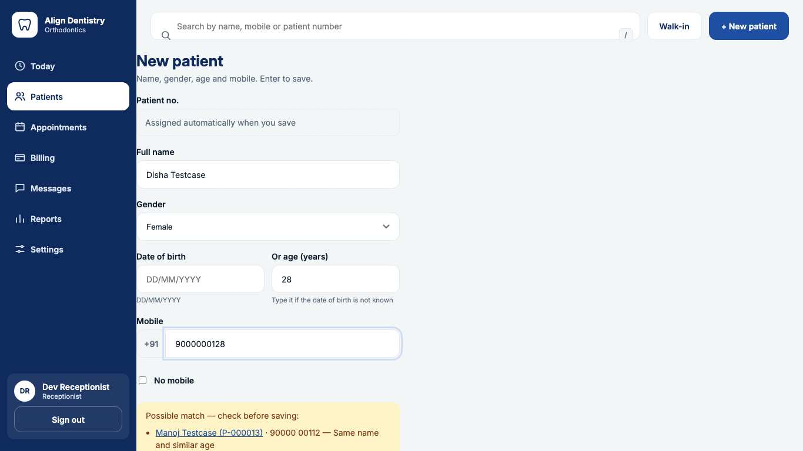
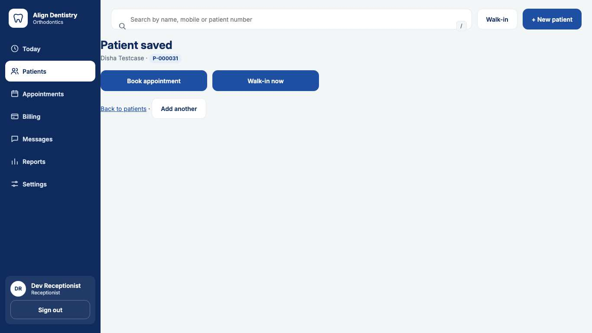
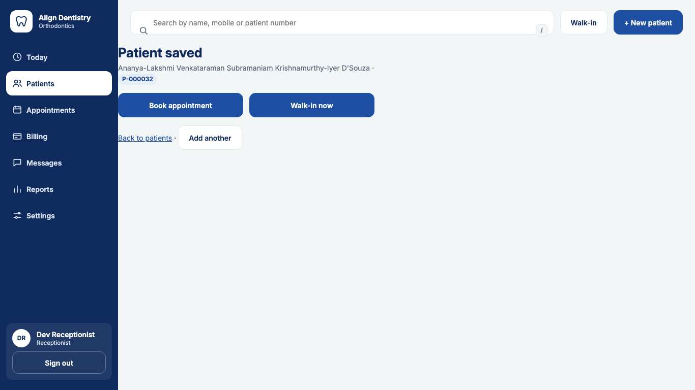
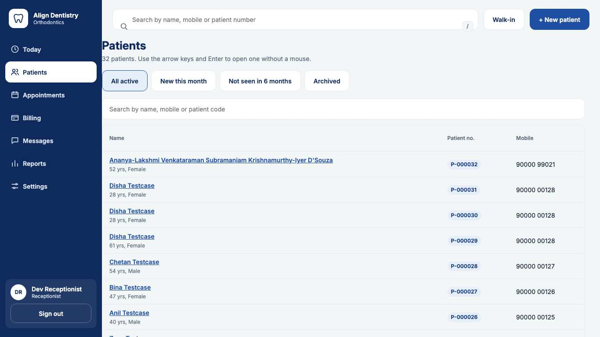
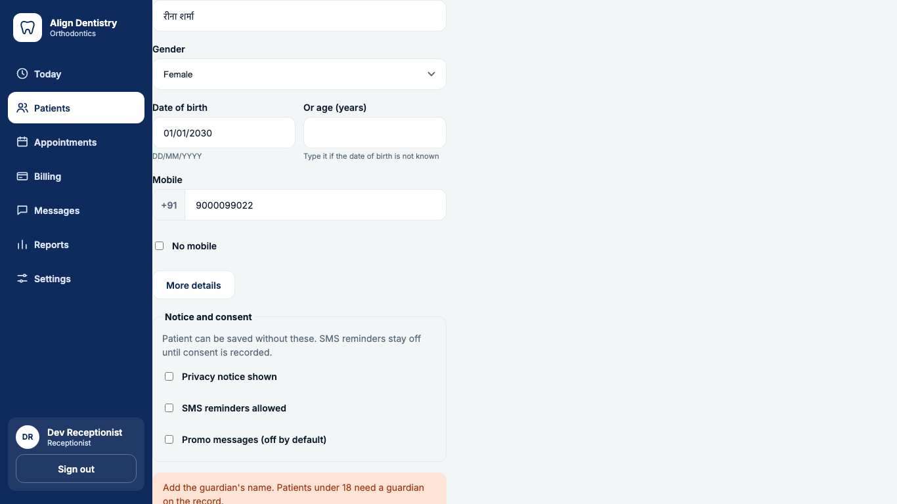

# A02-register-edge-cases: Registering patients: child, no mobile, wrong mobile, duplicate, very long name, future date of birth

**Aim:** Try the awkward registrations that happen every week: a child who needs a guardian, an adult with no mobile, a typo in the mobile, someone who is already in the system, a very long name, a nonsense date of birth. See whether the form protects the clinic and whether the messages tell the receptionist what to do.

**Who / device:** Receptionist, laptop. Each case starts from a fresh New patient screen.. Browser: Chromium 1366 px. Fake data only.

**Starting state:** Fresh local database with 30 fake patients (all surname Testcase; two patients share the mobile 90000 00128).

**Result: WORKS, with several confusing messages.** The form blocks the clear mistakes (child without guardian, no mobile without a reason, 9-digit mobile) and shows a yellow 'Possible match' box for likely duplicates. But the messages are placed far from the field they talk about, the guardian field is hidden when it is required, the duplicate box does not stop or even ask for a second confirmation, and a future date of birth is reported as 'under 18'.

| Measure | Value |
|---|---|
| Steps recorded | 44 |
| Clicks / key presses to finish | 7 |
| Fields typed or chosen | 22 |
| Distinct pages used | 2 (/app/patients/new, /app/patients) |
| Calls that would fail for a real user because of bug C1 | 0 (the test harness repaired them so the flow could continue) |
| Failed server calls | 400 /api/staff/patients; 400 /api/staff/patients/duplicate-check; 400 /api/staff/patients; 400 /api/staff/patients |

## Problems found in this flow

| # | Priority | Step | Problem | Why it matters | Suggested fix |
|---|---|---|---|---|---|
| A2-1 | High | 6 | Child (age 8) without a guardian: the red message 'Add the guardian's name. Patients under 18 need a guardian on the record.' appears at the very bottom of the form. The guardian fields are inside the collapsed 'More details' section, so the user sees no field to fill. | The receptionist reads the message, scrolls up, and does not know where the guardian is. The form should open the section that needs input. | When age is under 18, open the guardian fields automatically (or show them inline) and focus the first one. |
| A2-2 | Medium | 27-29 | A yellow box 'Possible match — check before saving' lists existing patients, but pressing Save still saves a new patient (P-000031) at once with no 'I checked, this is a different person' step. | A busy receptionist presses Save and creates a duplicate record; duplicates then split history, bills and messages. (The box listed Manoj Testcase first for a typed name Disha Testcase, probably because every fake patient has the same surname; the exact match with the same mobile was not visible in the first screen.) | Put the exact-mobile match first and make Save ask 'Same person? Open existing / Save as new patient'. |
| A2-3 | Medium | 20 | Nine-digit mobile: 'Enter a valid mobile number, or leave it blank.' But a blank mobile is not allowed either; the field's own rule says 'Enter a mobile number, or tick No mobile'. | Two different messages for the same field. 'Leave it blank' leads to the next error. | One sentence: 'Enter 10 digits, or tick No mobile.' |
| A2-4 | Medium | 39-44 | A date of birth in the future (01/01/2030) is not reported as a date problem. The form answers 'Add the guardian's name. Patients under 18 need a guardian on the record.' | Misleading: the real mistake is the year. | Reject a date after today with 'The date of birth is in the future.' |
| A2-5 | Low | 13 | Adult with no mobile: 'Say why there is no mobile.' appears if the reason is left empty. (Checked in flow G08: the 'Why no mobile' box opens as soon as 'No mobile' is ticked, so this is fine.) | Good rule, but not seen whether the reason field opens by itself. | None needed. |
| A2-6 | Low | 36-38 | A 70-letter name with an apostrophe and hyphens saved correctly. The long name's look in the Patients list was captured (screenshot) but not judged for wrapping on phone. | - | Check the list at 360 px with long names (flow J1). |

## Worked well

- Form messages are plain sentences and name the rule (guardian, mobile, reason).
- The Patient saved screen appears with Book appointment / Walk-in now for the next step.
- Names with hyphens and apostrophes are accepted.
- The duplicate box links to the existing patient so the receptionist can open it.

## Not covered by this run

- Hindi name (the run stopped at the DOB error before saving).
- Typing a date of birth by keyboard in other formats; the age-from-date behaviour (FIXES #5 says done, not re-checked).
- A guardian entered through More details, and the guardian as contact owner for messages (flow G08).
- Phone widths.

## Step by step (what the user does, and what the screen did)

Evidence labels: every line is [seen] in the browser unless marked otherwise. Screenshots exist only where the screen changed.

**1.** CASE 1: a child (age 8) with no guardian entered `/app/patients/new`

**2.** Name `/app/patients/new`
**3.** Gender `/app/patients/new`
**4.** Age 8 `/app/patients/new`
**5.** Mobile `/app/patients/new`
**6.** Save without a guardian `/app/patients/new`  
   → error shown: Add the guardian's name. Patients under 18 need a guardian on the record.; server replied: 400 /api/staff/patients

Note: Result for child without guardian: Add the guardian's name. Patients under 18 need a guardian on the record. `/app/patients/new`
**8.** CASE 2: adult with no mobile (tick 'No mobile') `/app/patients/new`

**9.** Name `/app/patients/new`
**10.** Gender `/app/patients/new`
**11.** Age 45 `/app/patients/new`
**12.** Tick No mobile `/app/patients/new`
**13.** Save `/app/patients/new`  
   → error shown: Say why there is no mobile.

Note: Result no mobile: Say why there is no mobile. `/app/patients/new`
**15.** CASE 3: mobile with only 9 digits `/app/patients/new`

**16.** Name `/app/patients/new`
**17.** Gender `/app/patients/new`
**18.** Age `/app/patients/new`
**19.** 9-digit mobile `/app/patients/new`  
   → server replied: 400 /api/staff/patients/duplicate-check
**20.** Save `/app/patients/new`  
   → error shown: Enter a valid mobile number, or leave it blank.; server replied: 400 /api/staff/patients

Note: Result 9 digits: Enter a valid mobile number, or leave it blank. `/app/patients/new`
**22.** CASE 4: same name and mobile as an existing patient (Disha Testcase, 90000 00128) `/app/patients/new`

**23.** Name `/app/patients/new`
**24.** Gender `/app/patients/new`
**25.** Age `/app/patients/new`
**26.** Same mobile as an existing patient `/app/patients/new`  
   → toast: Possible match — check before saving: Manoj Testcase (P-000013) · 90000 00112 — Same name and similar age Disha Testcase (P-000029) · 90000 00128 — Same mobile and a matching name Disha Testcase (P-000030) · 90000 00128 — Same mobile and a matching name
**27.** Is there a duplicate warning before saving? `/app/patients/new`  
   → toast: Possible match — check before saving: Manoj Testcase (P-000013) · 90000 00112 — Same name and similar age Disha Testcase (P-000029) · 90000 00128 — Same mobile and a matching name Disha Testcase (P-000030) · 90000 00128 — Same mobile and a matching name

**28.** Save `/app/patients/new`

**29.** What happened on Save with a duplicate? `/app/patients/new`

Note: Result duplicate: Patient saved / Disha Testcase · P-000031 / Book appointment / Walk-in now / Back to patients · Add another `/app/patients/new`
**31.** CASE 5: very long name with special characters `/app/patients/new`

**32.** Long name `/app/patients/new`
**33.** Gender `/app/patients/new`
**34.** Age `/app/patients/new`
**35.** Mobile `/app/patients/new`
**36.** Save `/app/patients/new`

Note: Result long name: Patient saved / Ananya-Lakshmi Venkataraman Subramaniam Krishnamurthy-Iyer D'Souza · P-000032 / Book appointment / Walk-in now / Back to patients · Add another `/app/patients/new`
**38.** See how the long name and the new patients look in the list `/app/patients`

**39.** CASE 6: Hindi name and a date of birth in the future `/app/patients/new`

**40.** Hindi name `/app/patients/new`
**41.** Gender `/app/patients/new`
**42.** Mobile `/app/patients/new`
**43.** Save `/app/patients/new`  
   → error shown: Add the guardian's name. Patients under 18 need a guardian on the record.; server replied: 400 /api/staff/patients

Note: Result future DOB: Add the guardian's name. Patients under 18 need a guardian on the record. `/app/patients/new`
