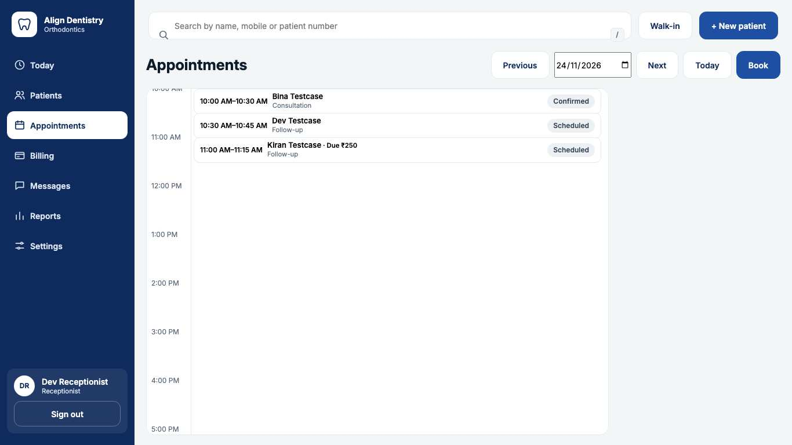
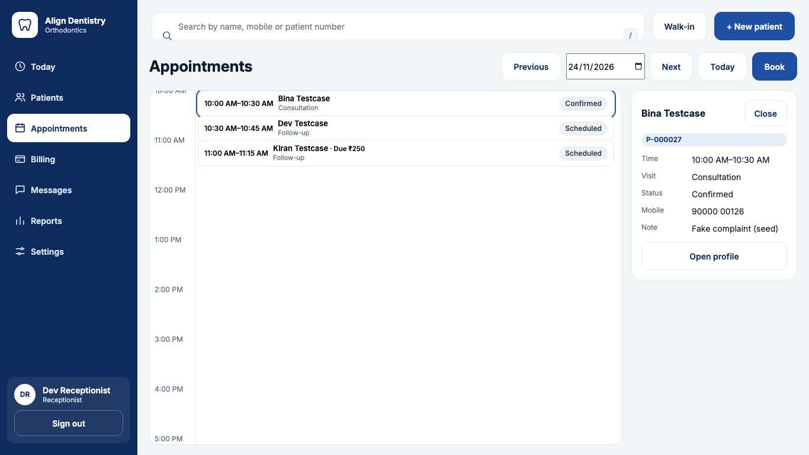
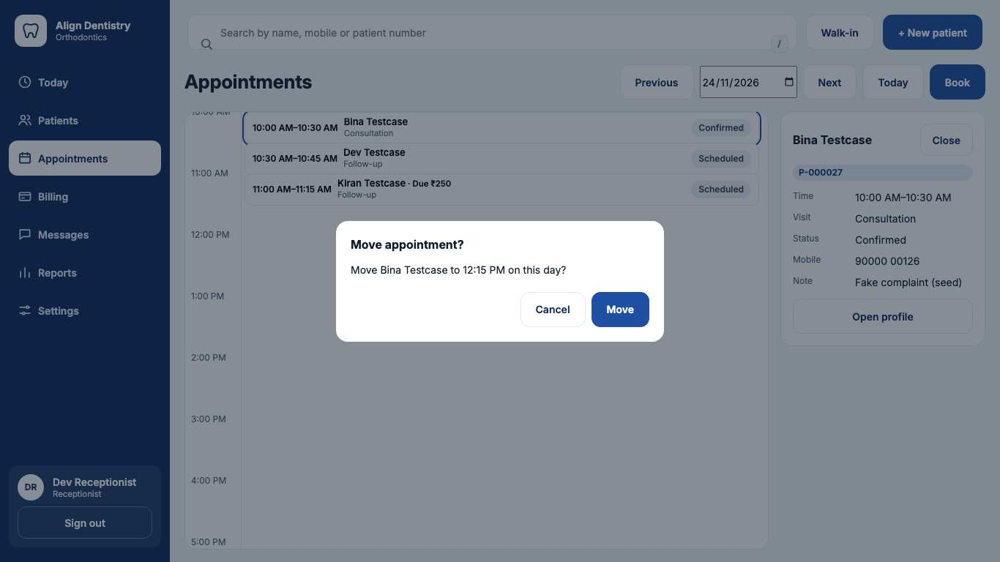
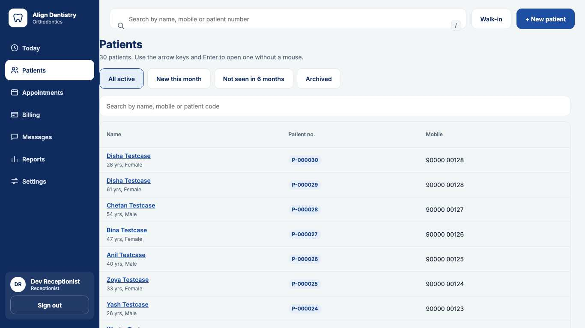
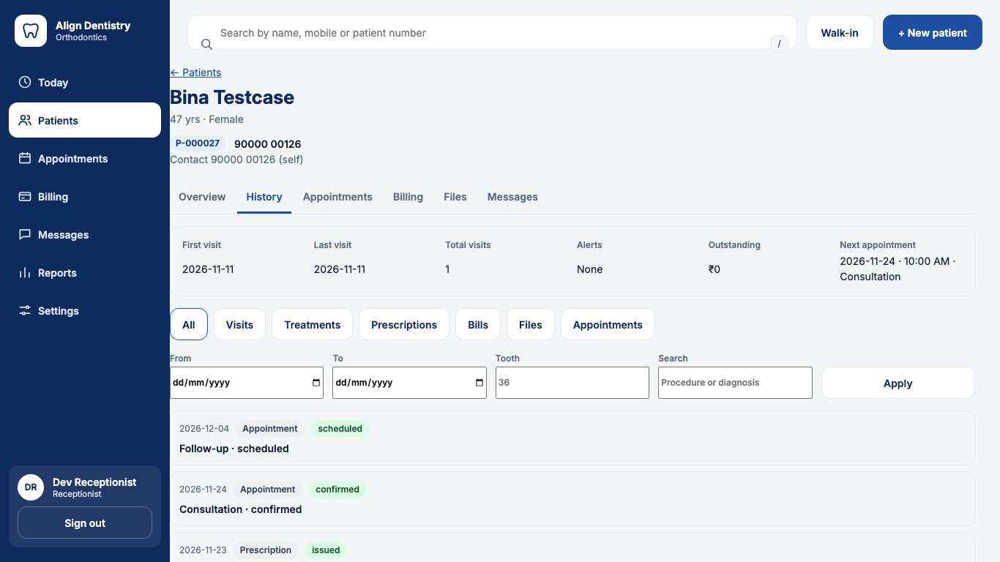
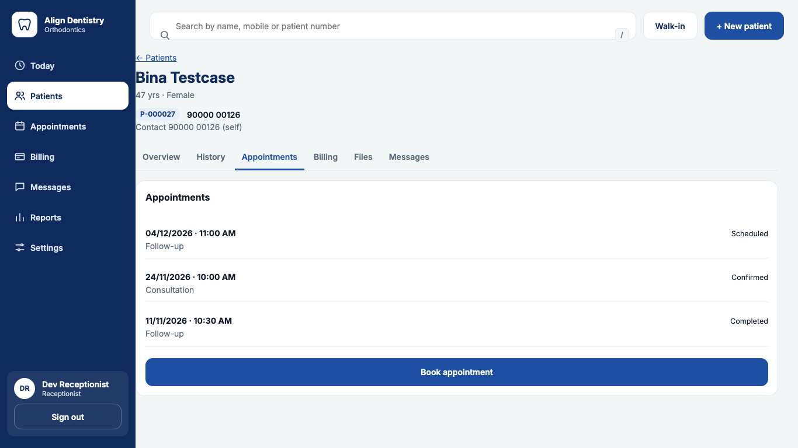

# B02-reschedule-or-cancel-a-future-booking: A patient phones to move or cancel tomorrow's booking

**Aim:** Check how a receptionist changes or cancels an appointment that is not today. This is a daily call in a clinic. Look for the buttons, the confirmation, and where a user would get lost.

**Who / device:** Receptionist, laptop. Browser: Chromium 1366 px. Fake data only.

**Starting state:** Fresh local database. Bina Testcase (P-000027) has a Confirmed 10:00 AM consultation on tomorrow, Tue 24 Nov 2026.

**Result: BROKEN for cancel, HIDDEN for reschedule.** Clicking the appointment opens a side panel with only 'Open profile' and 'Close'. The profile's Appointments tab lists appointments with no actions. There is no Cancel, No-show or Reschedule button for a future booking anywhere in these two places. The only way to move it is to drag the block on the calendar (nothing on screen says so); then a clear 'Move appointment?' question appears. The Cancel button exists only on today's rows in Today.

| Measure | Value |
|---|---|
| Steps recorded | 9 |
| Clicks / key presses to finish | 3 |
| Fields typed or chosen | 0 |
| Distinct pages used | 3 (/app/appointments, /app/patients, /app/patients/:id) |
| Calls that would fail for a real user because of bug C1 | 0 (the test harness repaired them so the flow could continue) |
| Failed server calls | none |

## Problems found in this flow

| # | Priority | Step | Problem | Why it matters | Suggested fix |
|---|---|---|---|---|---|
| B2-1 | High | 2-3 | No Cancel (or No-show) for an appointment that is not today. The detail panel has only 'Open profile' and 'Close'; the profile Appointments tab has only a list and 'Book appointment'. | When the patient phones to cancel, the receptionist cannot record it. The slot stays blocked, the reminder may still be sent, and the day's numbers are wrong. Cancel exists only in Today (same day). | Add Reschedule and Cancel (with a reason) to the detail panel and to each row of the profile's Appointments tab. |
| B2-2 | High | 4-6 | Rescheduling is only possible by dragging the block to another time. Nothing tells the user. The question 'Move appointment? Move Bina Testcase to 12:15 PM on this day?' is good, but the move can only stay within the same day. | Not discoverable, not possible on touch phones, and a patient who wants another day cannot be moved at all. | A Reschedule button that opens the Book dialog with the patient prefilled and the old slot released on save. |
| B2-3 | Medium | 8 | The profile Appointments tab shows dates as 27/11/2026 · 11:00 AM, while the History tab shows 2026-11-27 and Today shows '23 November'. Three styles for the same appointment. | Inconsistent, slows reading. | One date helper (AUDIT M1). |
| B2-4 | Medium | 2 | Calendar names are cut off ('Bina Testcas…') in the clickable list at laptop width and the timeline starts scrolled so the 10:00 AM label is clipped. | Small readability problem; the first hour looks cut off. | Show full name; start the grid at the first opening hour with the label visible. |

## Worked well

- The detail panel is clean: patient number chip, time, visit, status, mobile, note, Open profile.
- The drag move asks for confirmation with the patient, the new time and the day.
- The call-and-patient flow (open calendar, click block, Open profile) is short.

## Not covered by this run

- Dragging on a phone or tablet (touch).
- What the confirmation does to a reminder that was already queued (flow H5).
- Cancel of today's appointment (Cancel on the Today row, seen in G01 screenshots but not run).

## Step by step (what the user does, and what the screen did)

Evidence labels: every line is [seen] in the browser unless marked otherwise. Screenshots exist only where the screen changed.

**1.** Receptionist opens tomorrow's calendar (a patient phones to move or cancel their booking) `/app/appointments?date=2026-11-24`

**2.** Click the patient's appointment block `/app/appointments?date=2026-11-24`
**3.** Detail panel: what can the receptionist do here? `/app/appointments?date=2026-11-24`

**4.** Before the drag `/app/appointments?date=2026-11-24`

**5.** After trying to drag the block lower (reschedule by dragging) `/app/appointments?date=2026-11-24`  
   → dialog open: Move appointment? / Move Bina Testcase to 12:15 PM on this day? / Cancel / Move

**6.** Try the patient's profile instead `/app/patients`

**7.** Open Bina's profile `/app/patients/01M84FVDQPQ43DZC7YTJG1JAAM`

**8.** Open the Appointments tab `/app/patients/01M84FVDQPQ43DZC7YTJG1JAAM`
**9.** Profile Appointments tab: is there a Cancel or Reschedule? `/app/patients/01M84FVDQPQ43DZC7YTJG1JAAM`

