# D02-refund-and-cancel-a-bill: The patient says the bill is wrong: take payment, refund, cancel the bill

**Aim:** Follow a correction the way a clinic really has one: the patient paid ₹500 on a bill and then the bill turns out to be wrong. Who can cancel it, what the screens say, whether a refund fixes the balance, and whether the old bill stays visible. Money rules from the project: payments are never edited; a paid bill must be refunded first; only the doctor refunds or cancels.

**Who / device:** Receptionist (payment, looks for a way to fix the bill), then Doctor (cancel attempts, refund, cancel again), laptop. Browser: Chromium 1366 px. Fake data only.

**Starting state:** Fresh local database. Neha Testcase (P-000014) has one issued bill SB-2627-000014 of ₹2,500, nothing paid.

**Result: CONFUSING, and the numbers look WRONG after a refund.** The receptionist, who is the one at the desk, has no way to cancel or fix the bill: the bill page shows only 'Patient account' and 'Print bill'. The doctor can cancel, with a mandatory reason, but a part-paid bill must be refunded first and the screen says so only after pressing Confirm. After a ₹500 refund the History tab lists the refund, but Outstanding stays ₹2,000, the printed statement still lists the ₹500 payment and no refund, and cancelling still answers 'Refund or move the payments on this bill before cancelling it'. So the bill could not be cancelled in this run.

| Measure | Value |
|---|---|
| Steps recorded | 36 |
| Clicks / key presses to finish | 17 |
| Fields typed or chosen | 6 |
| Distinct pages used | 5 (/app/patients, /app/patients/:id, /app/bills/:id, /app, /app/print/statement/:id) |
| Calls that would fail for a real user because of bug C1 | 0 (the test harness repaired them so the flow could continue) |
| Failed server calls | 400 /api/staff/bills/01M84FVHAGGGNJKKDBS6FDRGZ4/cancel; 400 /api/staff/bills/01M84FVHAGGGNJKKDBS6FDRGZ4/cancel |

## Problems found in this flow

| # | Priority | Step | Problem | Why it matters | Suggested fix |
|---|---|---|---|---|---|
| D2-1 | High | 7 | The receptionist's view of an issued bill has no Cancel and no way to ask the doctor to cancel it. Only 'Patient account' and 'Print bill'. | The tester script (docs/TESTING.md task 10) expects the receptionist to 'fix a wrong bill'. She cannot, and no message tells her to call the doctor. | Show a quiet 'Ask the doctor to cancel' with a reason, or a line 'Only the doctor can cancel a bill'. |
| D2-2 | High | 27, 35-36 | After a ₹500 refund (SF-2627-000002) the History feed shows both the payment and the refund, but Outstanding stays ₹2,000 (should be back to ₹2,500 if the refund returns the money), the bill row still says 'Due ₹2,000', and the printed account statement lists the ₹500 payment but no refund. | The balance the receptionist quotes to the patient and the paper statement disagree with the history. The bill then cannot be cancelled. Either the balance rule or the screen is wrong; for money this must be checked first. | Decide the rule (refund re-opens the due amount), show refunds on the statement, and test: pay 500, refund 500, outstanding returns to 2,500. |
| D2-3 | Medium | 18-19 | Cancel bill: pressing 'Confirm cancel' on a part-paid bill answers with a plain sentence at the top of the page ('Refund or move the payments on this bill before cancelling it.'). The explanation 'Paid bills must be refunded first' is shown in the panel only after the doctor has opened it. | It is good that the system refuses; but the rule is learnt by failing, and the refund lives on a different screen (patient Billing tab). | If the bill has payments, show a 'Refund first' button in the panel that opens the refund form with this bill's payment preselected. |
| D2-4 | Medium | 12 | The doctor's Billing tab stacks: Take payment form, a Refund (doctor) panel and bill list. The refund needs 4 inputs (payment select, amount, mode, reason), shown as bare controls like the payment form. | Easy to refund the wrong payment; looks unfinished (see AUDIT H2). | Refund as a dialog opened from a payment row, with amount defaulted to the payment and a required reason. |
| D2-5 | Medium | 15, 17 | 'Confirm cancel' has the same look and weight as 'Back'; the reason box is a bare input. | Final irreversible-looking action without emphasis or warning. | Use a destructive style for the final button and a labelled textarea. |

## Worked well

- Cancelling needs a reason (empty reason is refused) and only the doctor sees the Cancel bill button.
- The system refuses to cancel a bill that still has payments and says what to do.
- The patient history records payment, refund and bill with who did it (Dev Doctor, Dev Receptionist).
- Refund panel lists only refundable payments with the maximum amount ('up to ₹500 (cash)').

## Not covered by this run

- A successful cancel (it could not be reached, see D2-2) and the 'cancelled' filter, and creating the replacement bill.
- Discount request and approval (draft bill, G01 shows the form).
- A bill paid in two modes, partial refund, or a refund bigger than the payment.
- Day close after a refund.

## Step by step (what the user does, and what the screen did)

Evidence labels: every line is [seen] in the browser unless marked otherwise. Screenshots exist only where the screen changed.

**1.** Receptionist opens Patients `/app/patients`

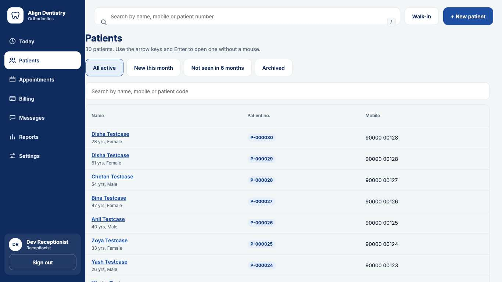

**2.** Open Neha Testcase (one issued bill of ₹2,500, unpaid) `/app/patients/01M84FVD7HF5AE7M79J4VTRK5M`

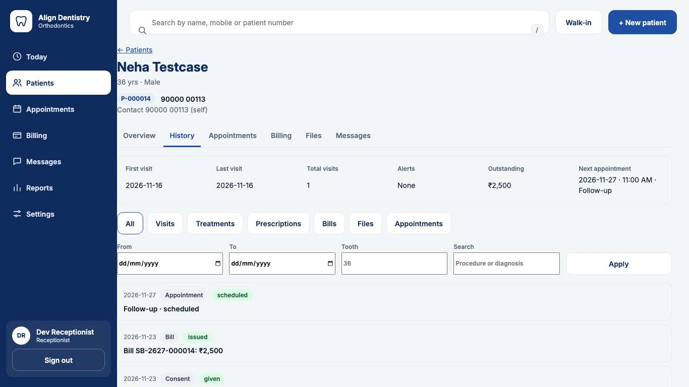

**3.** Open Billing tab `/app/patients/01M84FVD7HF5AE7M79J4VTRK5M`
**4.** Type amount 500 `/app/patients/01M84FVD7HF5AE7M79J4VTRK5M`
**5.** Record a ₹500 cash payment `/app/patients/01M84FVD7HF5AE7M79J4VTRK5M`
**6.** Open the bill (patient says: the bill is wrong, cancel it) `/app/bills/01M84FVHAGGGNJKKDBS6FDRGZ4`

**7.** Receptionist's view of an issued bill: is there a way to cancel or fix it? `/app/bills/01M84FVHAGGGNJKKDBS6FDRGZ4`

**8.** Switch to the doctor (only the doctor may cancel or refund) `/app`

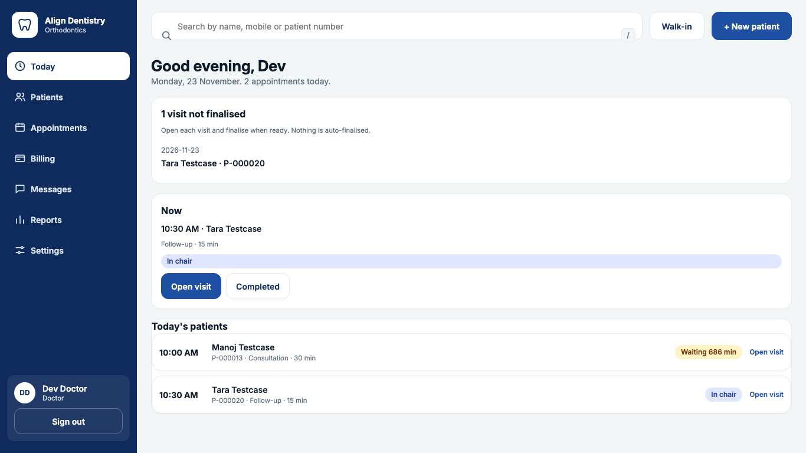

**9.** Doctor opens Patients `/app/patients`

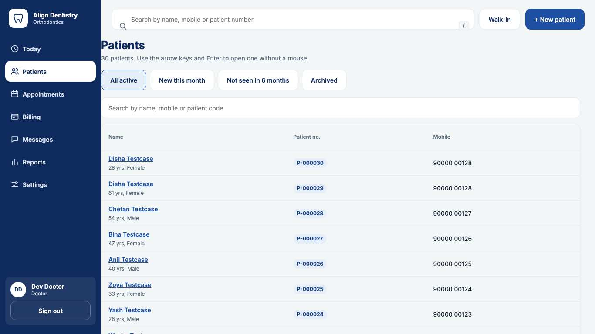

**10.** Open Neha Testcase `/app/patients/01M84FVD7HF5AE7M79J4VTRK5M`

**11.** Open Billing tab `/app/patients/01M84FVD7HF5AE7M79J4VTRK5M`
**12.** Doctor's Billing tab: payment form and a Refund (doctor) panel `/app/patients/01M84FVD7HF5AE7M79J4VTRK5M`

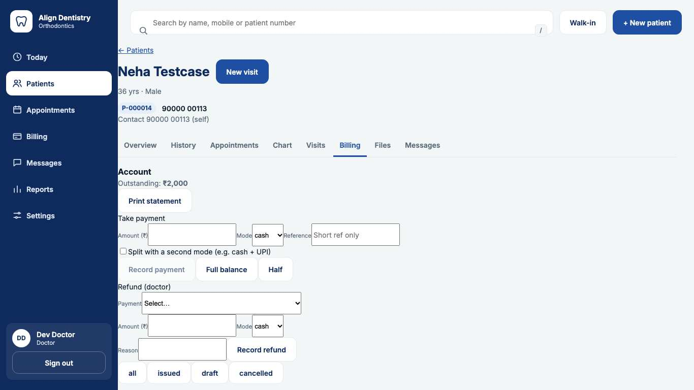

**13.** Open the bill `/app/bills/01M84FVHAGGGNJKKDBS6FDRGZ4`

**14.** Click Cancel bill `/app/bills/01M84FVHAGGGNJKKDBS6FDRGZ4`
**15.** Cancel panel opens inline below the buttons `/app/bills/01M84FVHAGGGNJKKDBS6FDRGZ4`

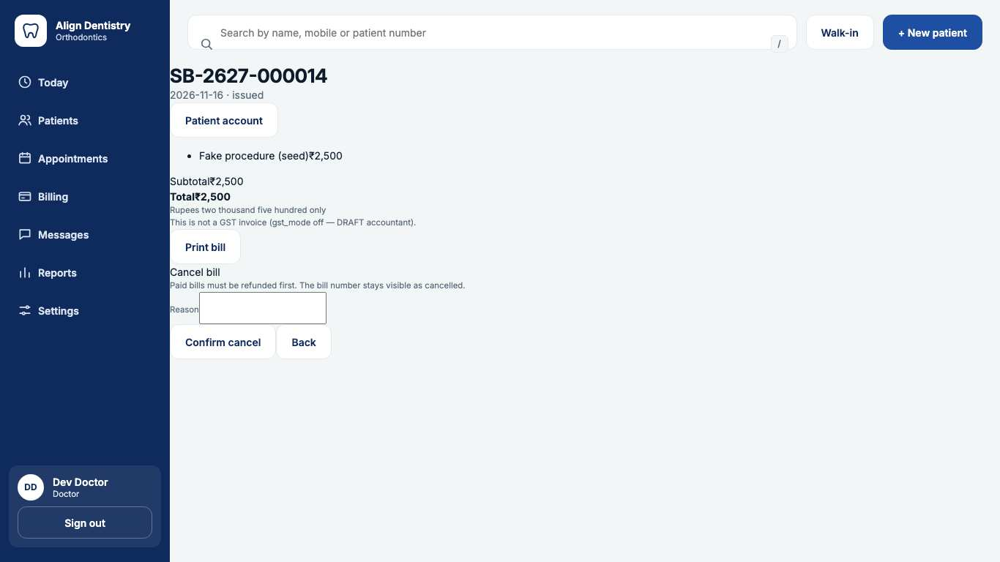

**16.** Click Confirm cancel with no reason `/app/bills/01M84FVHAGGGNJKKDBS6FDRGZ4`
**17.** Type the reason `/app/bills/01M84FVHAGGGNJKKDBS6FDRGZ4`
**18.** Confirm cancel while ₹500 is paid `/app/bills/01M84FVHAGGGNJKKDBS6FDRGZ4`  
   → server replied: 400 /api/staff/bills/01M84FVHAGGGNJKKDBS6FDRGZ4/cancel
**19.** Result of cancelling a part-paid bill `/app/bills/01M84FVHAGGGNJKKDBS6FDRGZ4`

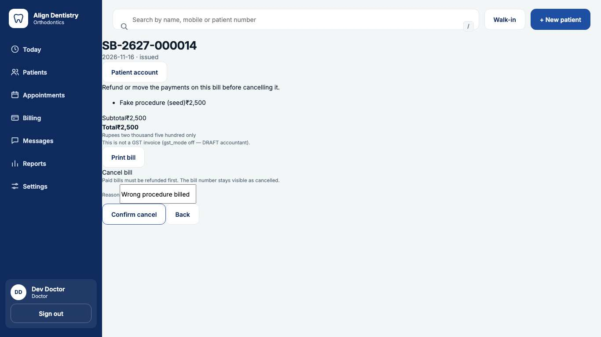

**20.** Back to Patients to refund first `/app/patients`

**21.** Open Neha Testcase `/app/patients/01M84FVD7HF5AE7M79J4VTRK5M`

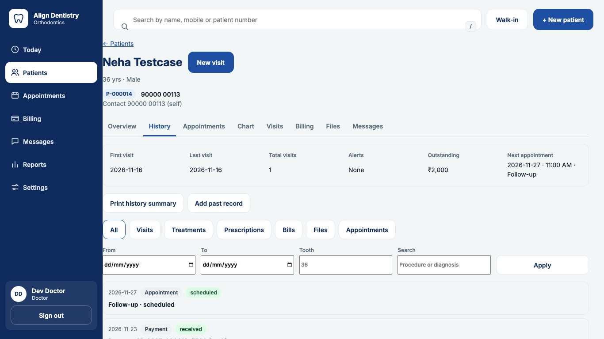

**22.** Billing tab `/app/patients/01M84FVD7HF5AE7M79J4VTRK5M`
**23.** Choose the ₹500 payment to refund `/app/patients/01M84FVD7HF5AE7M79J4VTRK5M`
**24.** Type refund amount 500 `/app/patients/01M84FVD7HF5AE7M79J4VTRK5M`
**25.** Type refund reason `/app/patients/01M84FVD7HF5AE7M79J4VTRK5M`
**26.** Click Record refund `/app/patients/01M84FVD7HF5AE7M79J4VTRK5M`
**27.** After the refund `/app/patients/01M84FVD7HF5AE7M79J4VTRK5M`

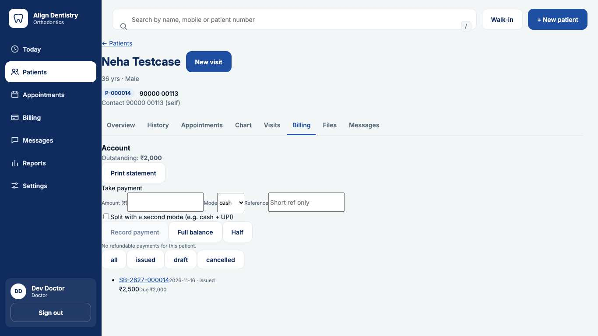

**28.** Open the bill again `/app/bills/01M84FVHAGGGNJKKDBS6FDRGZ4`

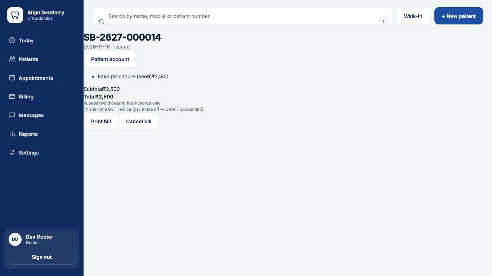

**29.** Click Cancel bill `/app/bills/01M84FVHAGGGNJKKDBS6FDRGZ4`
**30.** Type the reason `/app/bills/01M84FVHAGGGNJKKDBS6FDRGZ4`
**31.** Confirm cancel (nothing paid now) `/app/bills/01M84FVHAGGGNJKKDBS6FDRGZ4`  
   → server replied: 400 /api/staff/bills/01M84FVHAGGGNJKKDBS6FDRGZ4/cancel
**32.** Bill cancelled `/app/bills/01M84FVHAGGGNJKKDBS6FDRGZ4`

**33.** Open Neha again to compare the numbers after the refund `/app/patients`

**34.** Open Neha Testcase `/app/patients/01M84FVD7HF5AE7M79J4VTRK5M`

**35.** Profile History tab: the refund is listed, what does Outstanding say? `/app/patients/01M84FVD7HF5AE7M79J4VTRK5M`

**36.** Print the account statement: does it show the refund? `/app/print/statement/01M84FVD7HF5AE7M79J4VTRK5M`

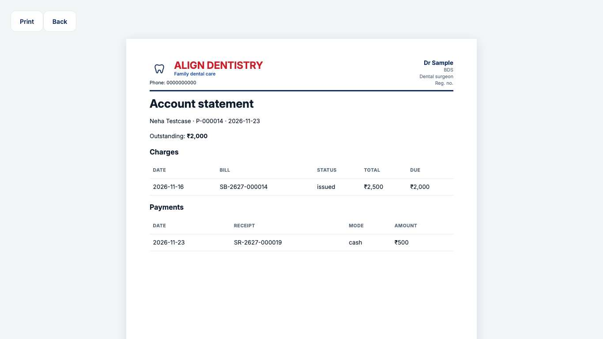

## Gate A re-run (2026-11-24)
Re-run without harness repair after Part 2 and Part 3: passed. Evidence: `GATE-A-d02/`. Summary and what changed: [GATE-A.md](GATE-A.md). The findings above describe the app before Phase Q.
