# D03-payments-advance-split-part-and-mistakes: Taking money: advance, split (cash + UPI), part payment, and typing mistakes

**Aim:** Test the receptionist's daily money screen on the cases that happen at the desk: a patient who wants to pay in advance, a payment split across two modes, an amount with paise, a negative or zero amount, and a slip of the finger that types ten times the due amount. Check what the screen allows, what it warns about, and whether the numbers afterwards make sense.

**Who / device:** Receptionist, laptop (Billing tab of the patient profile). Browser: Chromium 1366 px. Fake data only.

**Starting state:** Fresh local database. Neha owes ₹2,500, Om ₹750, Kiran ₹250, Vikram ₹2,000. A brand-new patient (Adv Paytest) has no bill.

**Result: WORKS for normal payments, DANGEROUS for mistakes, advance not possible on purpose.** Split payment and part payment work and update the balance. The form accepts any amount above the due without a warning: ₹20,000 against ₹2,000 was recorded at once and turned into 'Advance ₹18,000'. A patient with nothing due has no payment form at all, so an advance cannot be taken on purpose (the only way to create one is to overpay by mistake). Zero and negative amounts are blocked, but the button just stays grey with no sentence saying why.

| Measure | Value |
|---|---|
| Steps recorded | 40 |
| Clicks / key presses to finish | 15 |
| Fields typed or chosen | 6 |
| Distinct pages used | 8 (/app/patients/new, /app/patients, /app/patients/:id, /app/print/statement/:id) |
| Calls that would fail for a real user because of bug C1 | 0 (the test harness repaired them so the flow could continue) |
| Failed server calls | none |

## Problems found in this flow

| # | Priority | Step | Problem | Why it matters | Suggested fix |
|---|---|---|---|---|---|
| D3-1 | High | 6-11 | For a patient with no bill (Outstanding ₹0) the Billing tab shows only 'No bills yet. Create one from a visit.' and no Take payment form. The form is hidden whenever nothing is due (PaymentTakeForm returns nothing when due is 0). | The tester script (docs/TESTING.md task 3, 'Take an advance for a patient with no bill') cannot be done. Patients who want to pay before treatment cannot. | Show a 'Take advance' option when nothing is due, with a clear label and the same receipt. |
| D3-2 | High | 34-39 | Typing ₹20,000 for a ₹2,000 due is accepted with no warning or confirmation. The header then reads 'Outstanding: ₹0 · Advance: ₹18,000'. A payment cannot be edited, only reversed by the doctor with a refund. | One extra zero records ₹18,000 of cash that was never received, and the doctor has to correct it. | If amount is more than the due, ask 'This is ₹18,000 more than the due. Record the extra as advance?' with Cancel as the default. |
| D3-3 | Medium | 30-32 | With a negative amount or 0 typed, 'Record payment' becomes grey and does nothing. No sentence says what is wrong. | The user presses a dead button and does not know why. | Show 'Enter an amount above 0' under the field. |
| D3-4 | Low | 21-26 | Paise are accepted (100.50 recorded; Outstanding becomes ₹649.50) but the rest of the app shows whole rupees (₹2,500). Money display switches style between screens. | Inconsistent look; a ₹649.50 balance next to whole-rupee bills. | One money format: always show paise when not zero, or never. |
| D3-5 | Medium | 13-19 | The split payment works (₹1,000 cash + ₹500 UPI, Outstanding ₹1,500) but the Billing tab shows no payment list or receipt afterwards, so the receptionist cannot confirm the two parts. (See AUDIT H13.) | No way to read back what was just recorded. | Payments list under the bills list. |

## Worked well

- Split payment: ticking the box shows a second mode and second amount; both are recorded in one step.
- Paise amounts are supported and the balance is exact.
- Zero and negative amounts cannot be recorded.
- The account header shows 'Advance' separately from 'Outstanding' when a patient has paid more.

## Not covered by this run

- Whether the advance is applied automatically to the next bill ('Apply patient advance' checkbox on a draft bill) and the receipt for an advance.
- Cheque, bank and card modes and the 'Reference' field rules.
- Day close totals after split, over-payment and refund (flow D05).

## Step by step (what the user does, and what the screen did)

Evidence labels: every line is [seen] in the browser unless marked otherwise. Screenshots exist only where the screen changed.

**1.** CASE 1: a patient who wants to pay in advance (no bill yet) `/app/patients/new`

**2.** Name `/app/patients/new`
**3.** Gender `/app/patients/new`
**4.** Age `/app/patients/new`
**5.** Mobile `/app/patients/new`
**6.** Save patient `/app/patients/new`

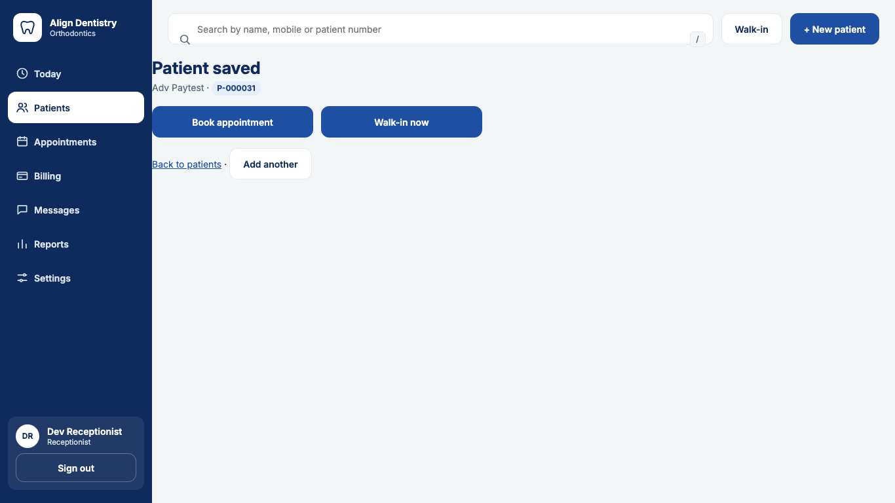

**7.** Patients list `/app/patients`

**8.** Open the new patient `/app/patients/01M84J4HVJJP7R3TX7YMZFNMYE`

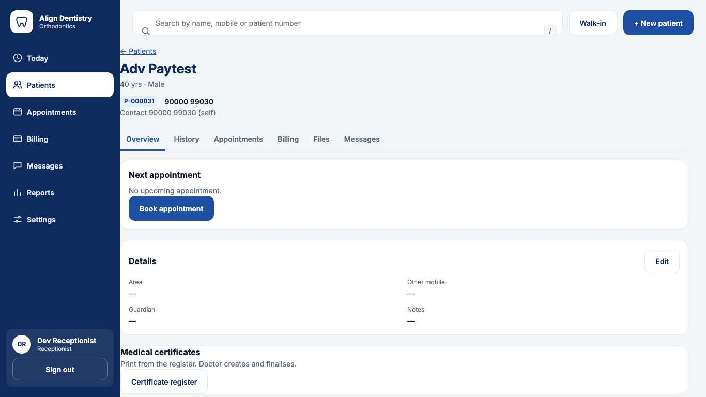

**9.** Open the Billing tab `/app/patients/01M84J4HVJJP7R3TX7YMZFNMYE`
**10.** Billing tab of a patient with no bill: where is Take payment? `/app/patients/01M84J4HVJJP7R3TX7YMZFNMYE`

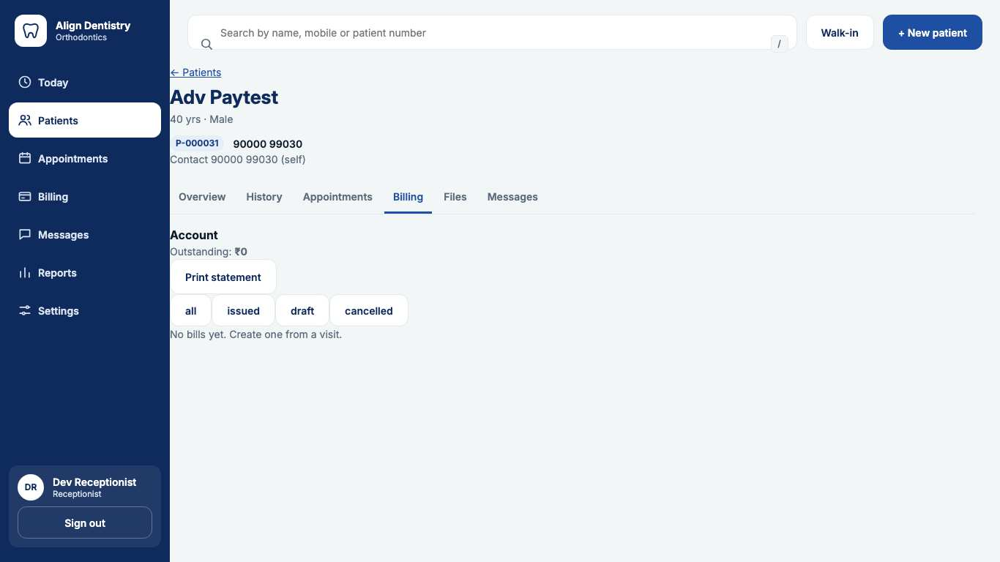

Note: Result: Outstanding: ₹0 / form present: 0 `/app/patients/01M84J4HVJJP7R3TX7YMZFNMYE`
**12.** Patients list `/app/patients`

**13.** CASE 2: Neha owes ₹2,500, pays ₹1,000 cash + ₹500 UPI (split) `/app/patients/01M84FVD7HF5AE7M79J4VTRK5M`

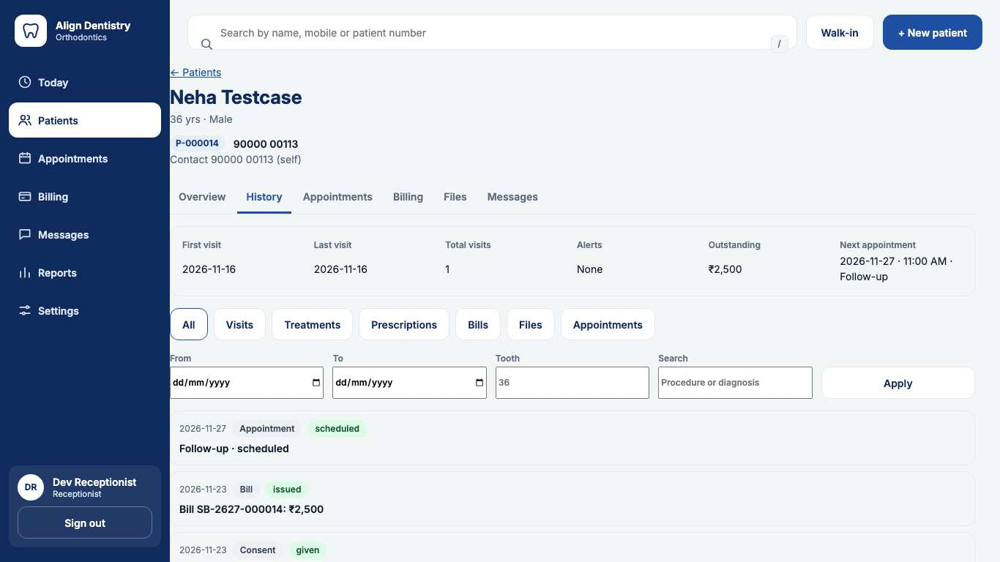

**14.** Open the Billing tab `/app/patients/01M84FVD7HF5AE7M79J4VTRK5M`
**15.** Tick 'Split with a second mode' `/app/patients/01M84FVD7HF5AE7M79J4VTRK5M`
**16.** Split form: second mode and second amount appear `/app/patients/01M84FVD7HF5AE7M79J4VTRK5M`

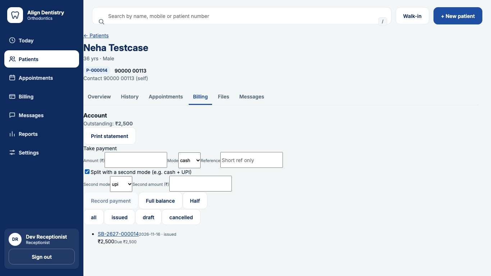

**17.** Record the split payment `/app/patients/01M84FVD7HF5AE7M79J4VTRK5M`
**18.** After the split payment `/app/patients/01M84FVD7HF5AE7M79J4VTRK5M`

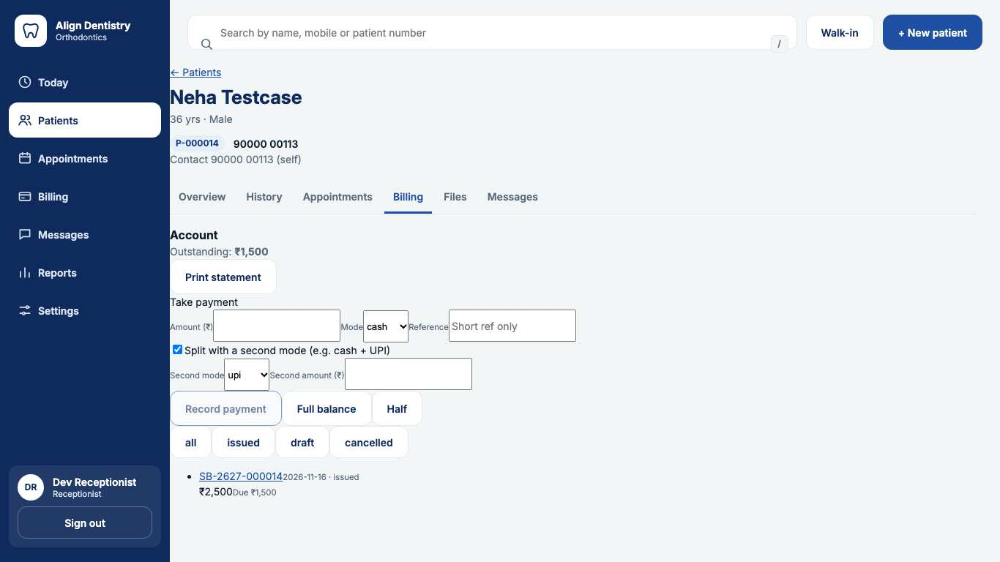

Note: Outstanding after split: Outstanding: ₹1,500 / `/app/patients/01M84FVD7HF5AE7M79J4VTRK5M`
**20.** Patients list `/app/patients`

**21.** CASE 3: Om owes ₹750; the receptionist types 100.50 `/app/patients/01M84FVD8QXGQPDH3EPNV07S4K`

**22.** Open the Billing tab `/app/patients/01M84FVD8QXGQPDH3EPNV07S4K`
**23.** Type 100.50 `/app/patients/01M84FVD8QXGQPDH3EPNV07S4K`
**24.** Record `/app/patients/01M84FVD8QXGQPDH3EPNV07S4K`
**25.** After 100.50 `/app/patients/01M84FVD8QXGQPDH3EPNV07S4K`

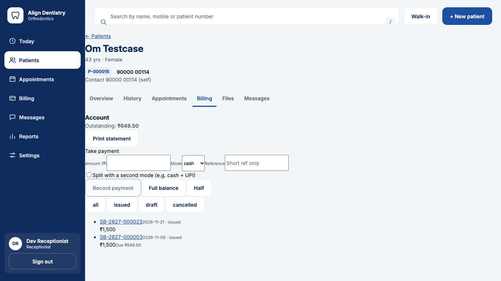

Note: Outstanding: Outstanding: ₹649.50 / msg: `/app/patients/01M84FVD8QXGQPDH3EPNV07S4K`
**27.** Patients list `/app/patients`

**28.** CASE 4: Kiran owes ₹250; types -50, then 0 `/app/patients/01M84FVD3N5A2NY0Q0QC78S4SX`

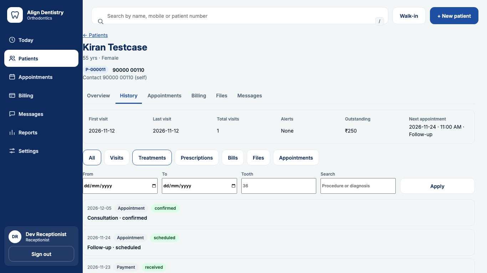

**29.** Open the Billing tab `/app/patients/01M84FVD3N5A2NY0Q0QC78S4SX`
Note: Record payment enabled for -50? false `/app/patients/01M84FVD3N5A2NY0Q0QC78S4SX`
Note: Record payment enabled for 0? false `/app/patients/01M84FVD3N5A2NY0Q0QC78S4SX`
**32.** Form with 0 typed `/app/patients/01M84FVD3N5A2NY0Q0QC78S4SX`

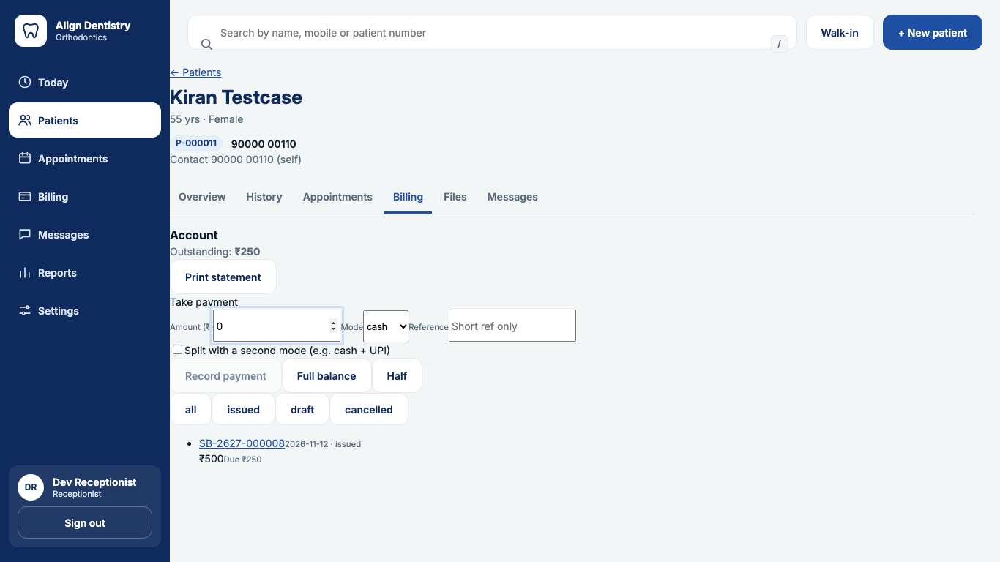

**33.** Patients list `/app/patients`

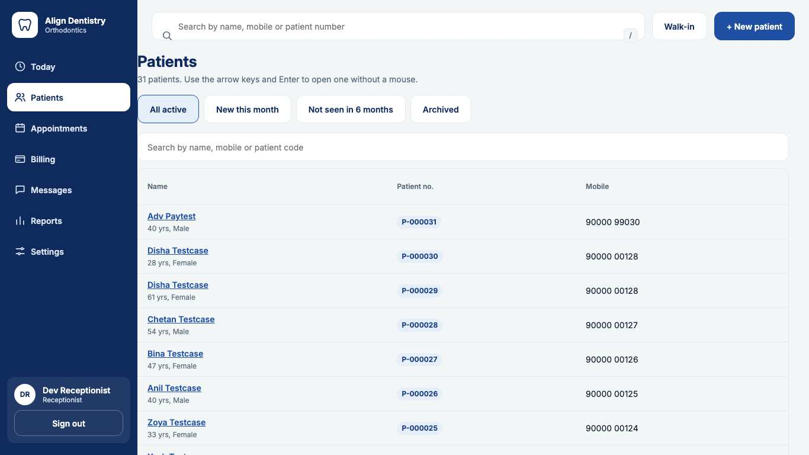

**34.** CASE 5: Vikram owes ₹2,000; a slip of the finger types 20000 `/app/patients/01M84FVDHA9ZEFP3G25EWF8ZQF`

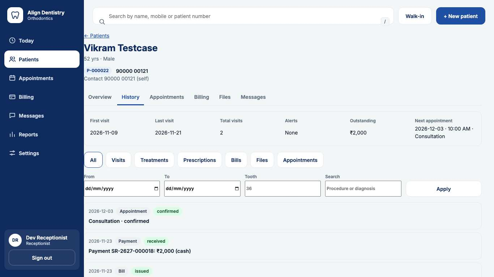

**35.** Open the Billing tab `/app/patients/01M84FVDHA9ZEFP3G25EWF8ZQF`
**36.** Type 20000 `/app/patients/01M84FVDHA9ZEFP3G25EWF8ZQF`
**37.** Record payment of ₹20,000 against ₹2,000 due `/app/patients/01M84FVDHA9ZEFP3G25EWF8ZQF`
**38.** Result of paying ten times the due `/app/patients/01M84FVDHA9ZEFP3G25EWF8ZQF`

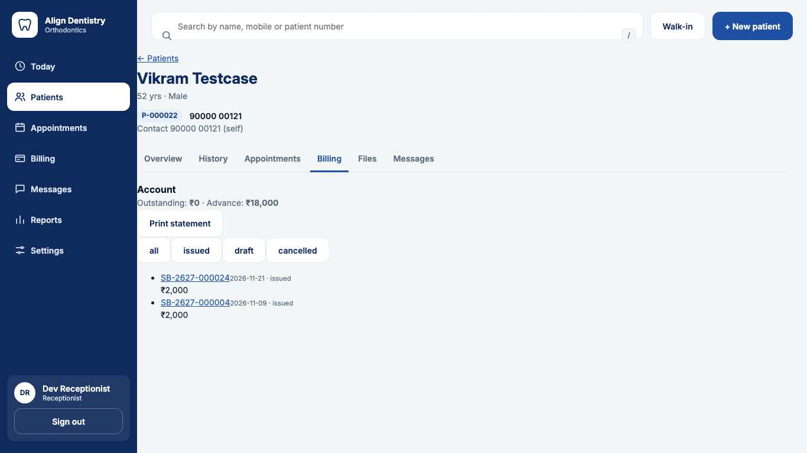

Note: Header now says: Outstanding: ₹0 · Advance: ₹18,000 / msg: `/app/patients/01M84FVDHA9ZEFP3G25EWF8ZQF`
**40.** Open the printed statement for Vikram `/app/print/statement/01M84FVDHA9ZEFP3G25EWF8ZQF`

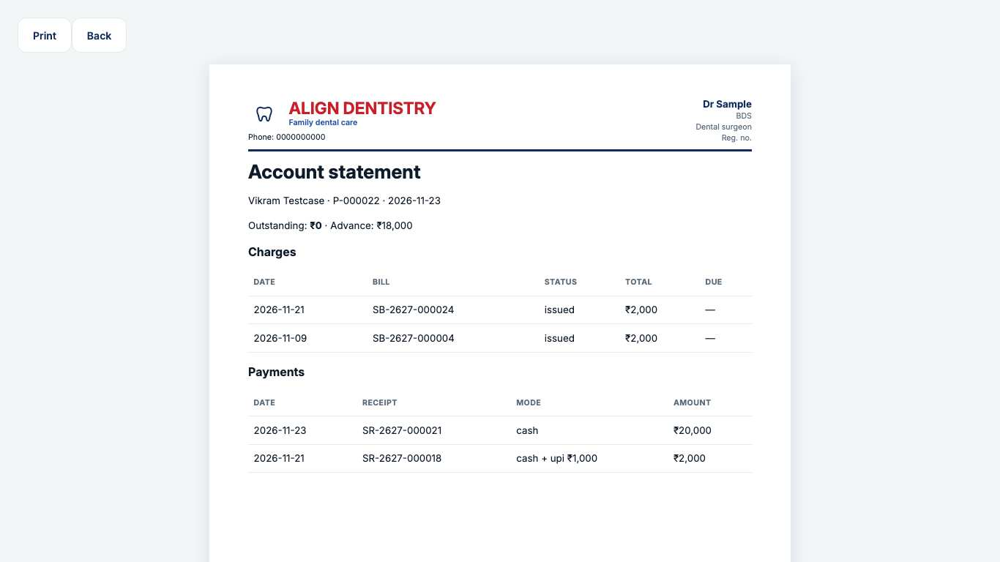

## Gate A re-run (2026-11-24)
Re-run without harness repair after Part 2 and Part 3: passed. Evidence: `GATE-A-d03/`. Summary and what changed: [GATE-A.md](GATE-A.md). The findings above describe the app before Phase Q.
