# D05-dues-reminder-and-daily-cash-close: End of day: chase unpaid dues, then count the cash and close the day

**Aim:** Do what the receptionist does at closing time. Part 1: use the dues list to leave a call note and send a payment reminder. Part 2: take a cash payment, try to close the day, clear the open appointments that block it, count the drawer with a difference, close, and then try to take another payment on the closed day. Check each message and how easy it is to know what to do next.

**Who / device:** Receptionist, laptop. Browser: Chromium 1366 px. Fake data only.

**Starting state:** Fresh local database. Dues list has 13 patients (₹13,500). Today has two stale rows from the seed: Manoj 10:00 AM 'Arrived' and Tara 10:30 AM 'In chair' (never finished). No payments yet today.

**Result: WORKS well, with a few dangerous or unclear spots.** Dues reminder and day close both work and give clear sentences: a payment-pending WhatsApp text with no amount, a required note when the counted cash differs, a closed-day result line with the difference, and a refusal of new payments on a closed day. The weak points: the blocking appointments are listed without patient names; Cancel on a Today row cancels at once with no question; and the 'late entry' that the closed-day message mentions cannot be found on screen.

| Measure | Value |
|---|---|
| Steps recorded | 42 |
| Clicks / key presses to finish | 14 |
| Fields typed or chosen | 4 |
| Distinct pages used | 5 (/app/billing, /app/patients, /app/patients/:id, /app) |
| Calls that would fail for a real user because of bug C1 | 0 (the test harness repaired them so the flow could continue) |
| Failed server calls | 400 /api/staff/day-close; 400 /api/staff/payments |

## Problems found in this flow

| # | Priority | Step | Problem | Why it matters | Suggested fix |
|---|---|---|---|---|---|
| D5-1 | High | 22-24 | The Cancel button on a Today row cancels the appointment immediately: no confirm, no reason, no undo. The patient (an 'Arrived' patient who had been waiting) disappears from the list, the stat 'Arrived' drops to 0 and the page says '1 appointments today'. Cancel sits right next to 'In chair' on the same row. | One mis-click removes a waiting patient from the queue. Cancelling is also not a no-show: the Call list stays empty, so the clinic does not know to call them back. | Ask 'Cancel Manoj's 10:00 AM appointment? Reason: [Patient cancelled / No-show / Other]' and put Cancel in a menu, away from In chair. Fix 'appointments' grammar. |
| D5-2 | Medium | 16-17 | The Close day panel says '2 open appointments must be finished, marked no-show, or cancelled before close.' and lists '• Consultation · arrived' and '• Follow-up · in chair' without patient names. 'No-show' is not an action on the Today rows (only In chair, Cancel, Completed). | The receptionist has to guess which appointments block the close, and the message offers an action (no-show) she cannot find. | List the names with a link to each row and add a No-show action. |
| D5-3 | Medium | 42 | After closing, a new payment is refused: 'This day is closed. Use a late entry or ask the doctor to reopen it.' No 'late entry' option exists on the payment form and the form gives no 'ask the doctor' button. | The sentence is clear but names a way out that the user cannot see. | Show a 'Record as late entry' choice with a reason, or a line 'Ask the doctor to reopen the day (Settings > ...)'. |
| D5-4 | Low | 16, 35 | Plural grammar: '1 payments', '1 appointments today'. | Small polish. | One plural helper. |
| D5-5 | Medium | 3-5 | 'Add call note' opens a single bare text field inside the dues row; the note's date and result are not shown anywhere afterwards in this list. | The receptionist cannot see that someone already called, so two people may call the same patient. | Show 'Called today: will pay Friday' under the name. |
| D5-6 | Low | 7 | The WhatsApp reminder opens WhatsApp at once for the first row clicked, with the text 'Dear Vikram, this is Align Dentistry. A payment is pending. Please call 0000000000 to arrange.' It is not listed in Messages. | Text is correct and keeps to the privacy rule (no amount), but there is no record in Messages that it was sent. The clinic phone is still the sample 0000000000. | Log it in Messages as 'Opened'. Block when the clinic phone is not set. |

## Worked well

- The dues message follows the privacy rule: first name, clinic name, 'a payment is pending', phone. No rupee amount, no treatment.
- A toast says 'WhatsApp opened with payment-pending text.'
- Day close: 'Write a note explaining the cash difference.' is clear; after closing the line reads 'Closed. Counted ₹450 · Difference -₹50 · Gave change from own pocket' and 'Print day close' appears.
- A payment on a closed day is refused with a sentence, and the dues balance stays unchanged.

## Not covered by this run

- Print of the day close, the monthly CSV export (button seen, not run), reopening a closed day (doctor), UPI totals on the close panel.
- A no-show appointment from a past date and how it appears in the call list.

## Step by step (what the user does, and what the screen did)

Evidence labels: every line is [seen] in the browser unless marked otherwise. Screenshots exist only where the screen changed.

**1.** PART 1: receptionist opens Billing to chase unpaid dues `/app/billing`

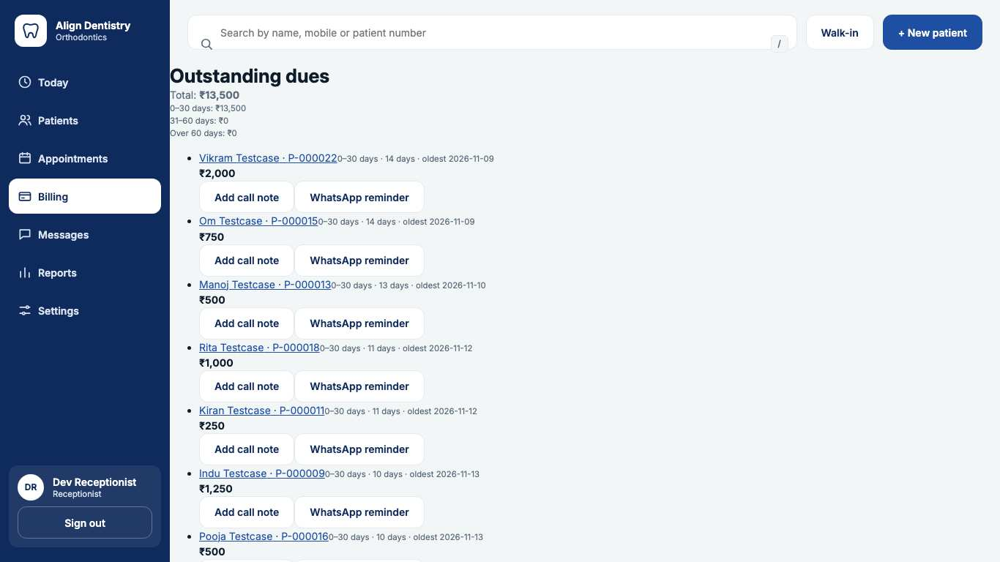

**2.** Click Add call note on the first patient `/app/billing`
**3.** Call note form opens inside the row `/app/billing`

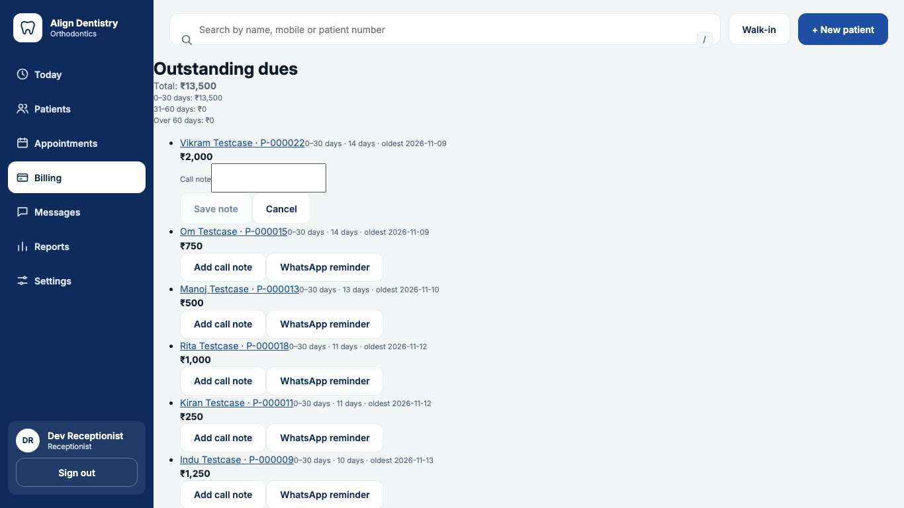

**4.** Typed the note `/app/billing`

**5.** Save the call note `/app/billing`
**6.** Click WhatsApp reminder `/app/billing`  
   → toast: WhatsApp opened with payment-pending text.

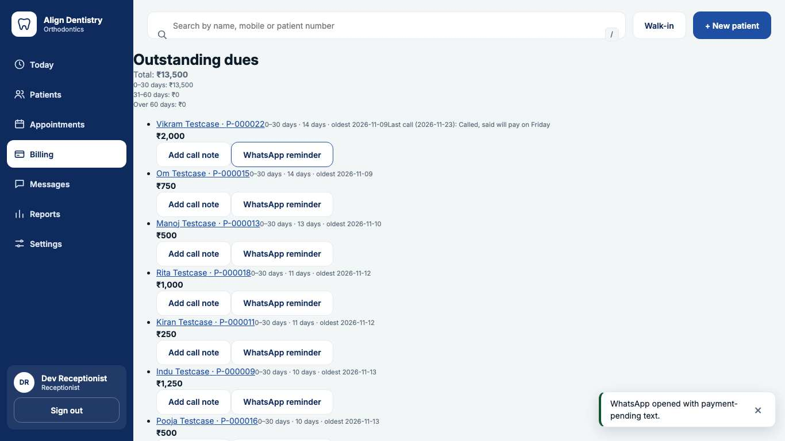

Note: WhatsApp text: https://api.whatsapp.com/send/?phone=919000000121&text=Dear Vikram, this is Align Dentistry. A payment is pending. Please call 0000000000 to arrange.&type=phone_number&app_absent=0 `/app/billing`
**8.** After WhatsApp reminder: toast `/app/billing`  
   → toast: WhatsApp opened with payment-pending text.

**9.** PART 2 starts: first take one cash payment today so the day has money in it `/app/patients`

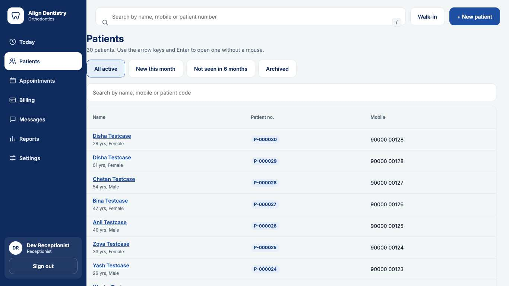

**10.** Open Neha Testcase `/app/patients/01M84FVD7HF5AE7M79J4VTRK5M`

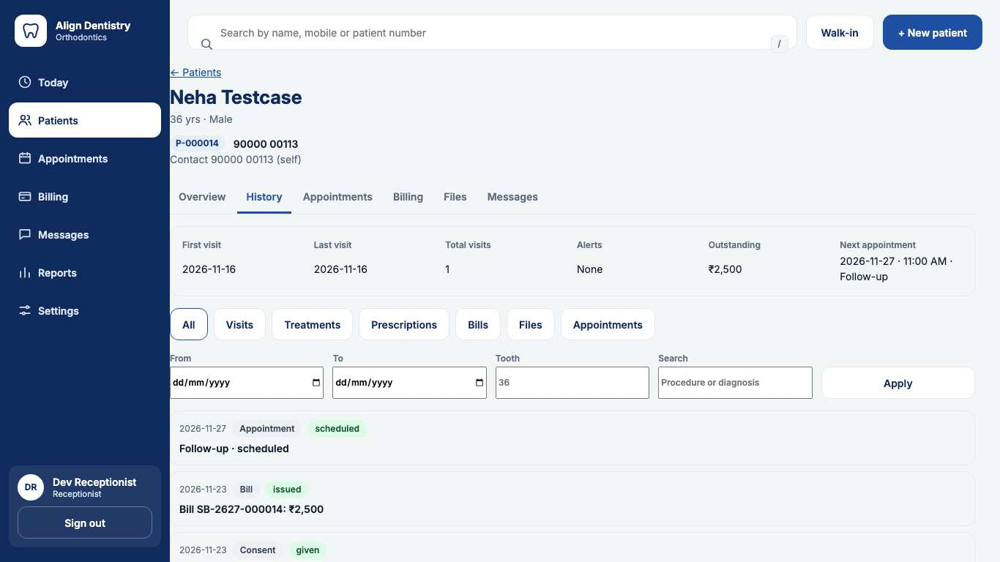

**11.** Billing tab `/app/patients/01M84FVD7HF5AE7M79J4VTRK5M`
**12.** Type 500 `/app/patients/01M84FVD7HF5AE7M79J4VTRK5M`
**13.** Record ₹500 cash `/app/patients/01M84FVD7HF5AE7M79J4VTRK5M`
**14.** End of day: open the Daily cash close panel `/app/billing`

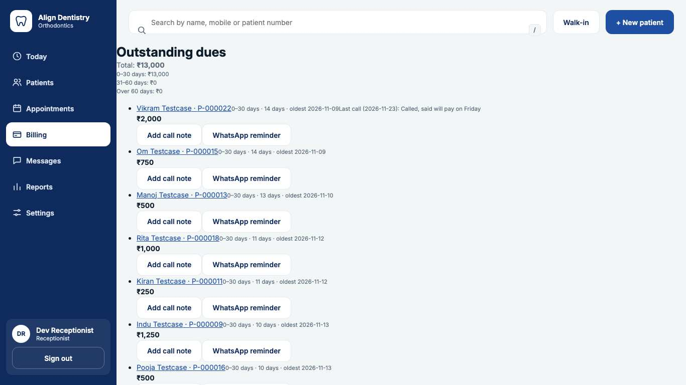

**15.** Daily cash close panel, scrolled into view `/app/billing`

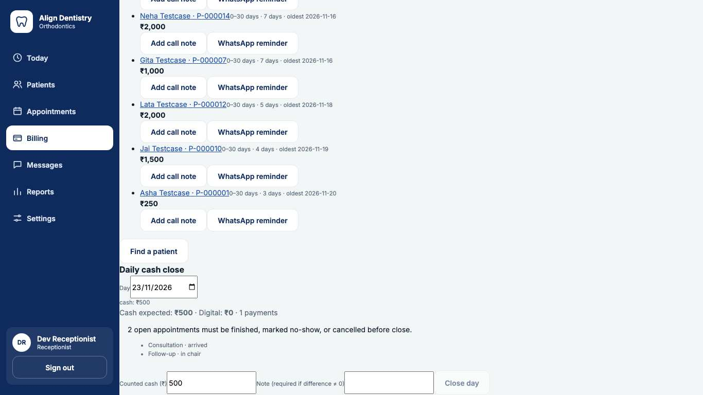

Note: Panel says: Daily cash close / Day / cash: ₹500 / Cash expected: ₹500 · Digital: ₹0 · 1 payments / 2 open appointments must be finished, marked no-show, or cancelled before close. / Consultation · arrived / Follow-up · in chair / Counted cash (₹)Note (required if difference ≠ 0)Close day `/app/billing`
Note: Close day is disabled `/app/billing`
**18.** After trying to close with open appointments `/app/billing`

**19.** Go to Today to finish the open appointments (one is 'Arrived', one 'In chair' from earlier) `/app`

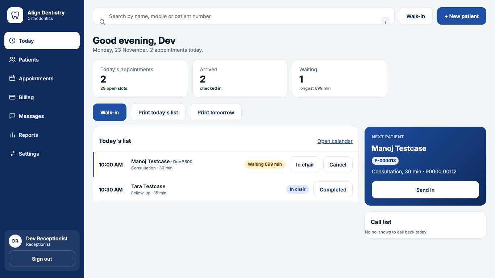

**20.** Today rows before cleanup `/app`

**21.** Mark the in-chair patient Completed `/app`
**22.** Cancel the patient who never came (Manoj, Arrived 10 AM) `/app`
**23.** After Cancel click: what does it ask? `/app`

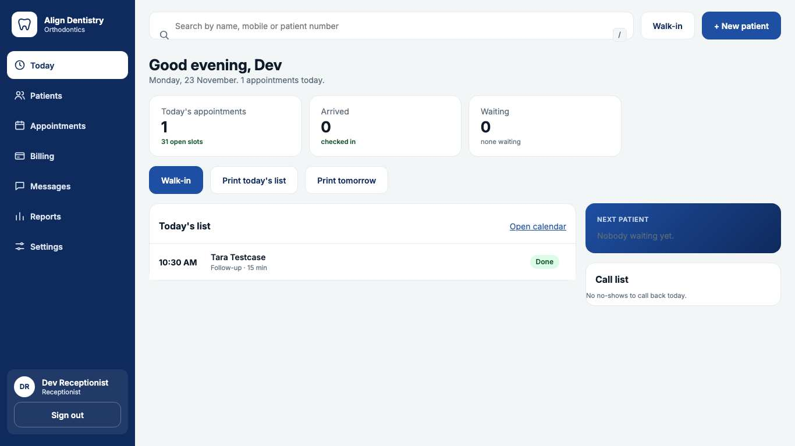

Note: Dialog after Cancel: none `/app`
**25.** Back to Billing, panel again `/app/billing`

**26.** Panel after the appointments were finished `/app/billing`

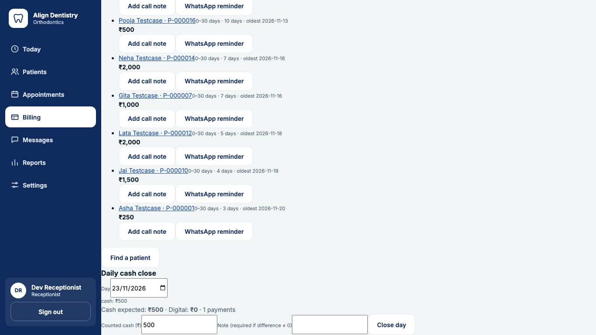

Note: Panel now says: Daily cash close / Day / cash: ₹500 / Cash expected: ₹500 · Digital: ₹0 · 1 payments / Counted cash (₹)Note (required if difference ≠ 0)Close day `/app/billing`
**28.** Count the drawer: ₹450 (₹50 less than expected) `/app/billing`
**29.** Click Close day with a difference and no note `/app/billing`  
   → server replied: 400 /api/staff/day-close
**30.** What does the panel say? `/app/billing`

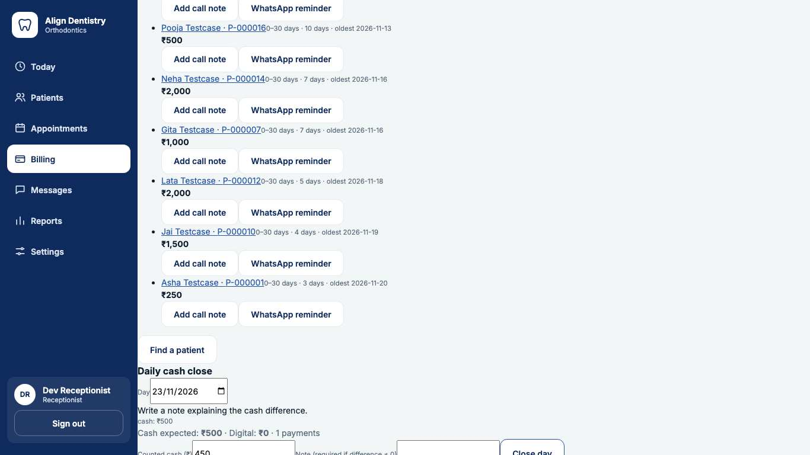

Note: Message: Write a note explaining the cash difference. / panel: Cash expected: ₹500 · Digital: ₹0 · 1 payments / Counted cash (₹)Note (required if difference ≠ 0)Close day `/app/billing`
**32.** Type a note `/app/billing`
**33.** Click Close day with the note `/app/billing`
**34.** Day closed? `/app/billing`

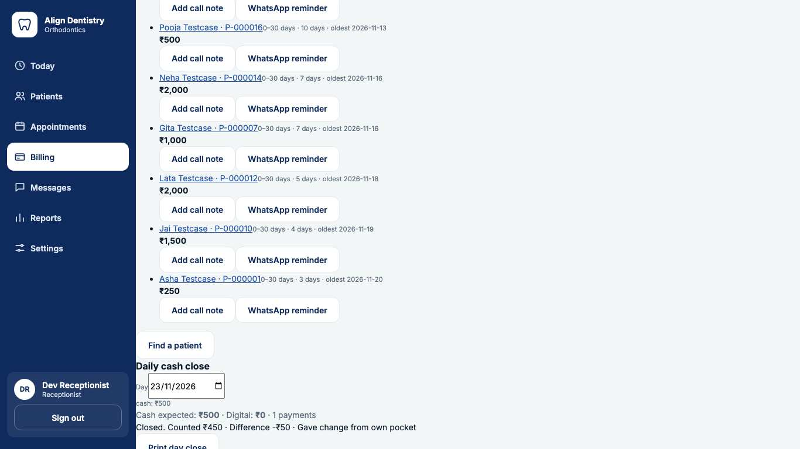

Note: After close: Daily cash close / Day / cash: ₹500 / Cash expected: ₹500 · Digital: ₹0 · 1 payments / Closed. Counted ₹450 · Difference -₹50 · Gave change from own pocket / Print day close `/app/billing`
**36.** Now try to take another payment for today `/app/patients`

**37.** Open Om Testcase `/app/patients/01M84FVD8QXGQPDH3EPNV07S4K`

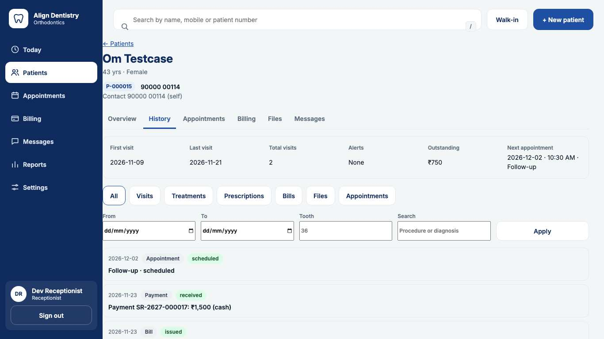

**38.** Billing tab `/app/patients/01M84FVD8QXGQPDH3EPNV07S4K`
**39.** Type 100 `/app/patients/01M84FVD8QXGQPDH3EPNV07S4K`
**40.** Record ₹100 after the day is closed `/app/patients/01M84FVD8QXGQPDH3EPNV07S4K`  
   → server replied: 400 /api/staff/payments
**41.** Result of a payment on a closed day `/app/patients/01M84FVD8QXGQPDH3EPNV07S4K`

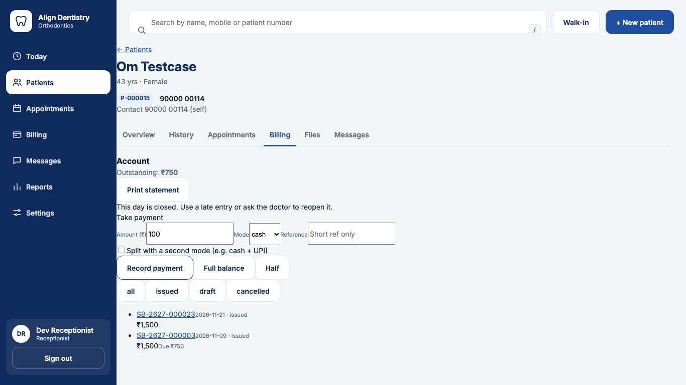

Note: Message: This day is closed. Use a late entry or ask the doctor to reopen it. / Outstanding: ₹750 `/app/patients/01M84FVD8QXGQPDH3EPNV07S4K`
