# D06-discount-request-and-approval: The patient asks for a discount: receptionist requests, doctor approves

**Aim:** The rule is that the receptionist cannot give a discount; only the doctor can. Test the hand-off: set up a draft bill, let the receptionist request a ₹300 discount, see what she can still do, find out how the doctor learns about the request, approve it, and issue the bill.

**Who / device:** Doctor (setup), Receptionist (request), Doctor (approve, issue), laptop. Browser: Chromium 1366 px. Fake data only.

**Starting state:** Fresh local database. The doctor finalises Tara's visit with one procedure (Scaling ₹1,500) and creates a draft bill. Setup uses the C1 repair in the test harness.

**Result: WORKS, but the doctor is never told and the total changes before approval.** The two-step rule is enforced: the receptionist can only request; the doctor sees an 'Approve discount' button; after approval the bill is issued with the discount (₹1,500 - ₹300 = ₹1,200). Weak points: the draft total already drops to ₹1,200 while the request is still 'waiting for doctor approval'; nothing on the doctor's Today or anywhere else says a request is waiting; and the screen is unstyled with internal text.

| Measure | Value |
|---|---|
| Steps recorded | 30 |
| Clicks / key presses to finish | 10 |
| Fields typed or chosen | 1 |
| Distinct pages used | 3 (/app, /app/visits/:id, /app/bills/:id) |
| Calls that would fail for a real user because of bug C1 | 3 (the test harness repaired them so the flow could continue) |
| Failed server calls | none |

## Problems found in this flow

| # | Priority | Step | Problem | Why it matters | Suggested fix |
|---|---|---|---|---|---|
| D6-1 | High | 16, 21 | The doctor is not told. After the receptionist's request the doctor's Today page has no mention of a discount (checked: no 'discount' text anywhere). The doctor only finds the request by opening that specific bill. | The patient waits at the desk while the receptionist walks to the doctor to say 'please open the bill'. The point of the approval step is lost. | Put 'Discount waiting: Tara Testcase ₹300' on the doctor's Today (and a count in the nav), with an Approve button. |
| D6-2 | High | 16 | As soon as the receptionist presses Request discount, the draft bill shows 'Discount -₹300' and 'Total ₹1,200', while the line below still says 'waiting for doctor approval'. | The receptionist may quote or even collect the lower total before the doctor said yes. The total should stay ₹1,500 until approval. | Show the requested discount in a separate line 'Requested (not approved): ₹300' and keep the total at ₹1,500. |
| D6-3 | Medium | 17 | With the request waiting, the receptionist's 'Issue bill' button is still on screen; an attempt to click it in an earlier run timed out, so it is probably disabled, but nothing says why. | A grey button without a reason. | Under the button: 'Waiting for the doctor to approve the discount.' |
| D6-4 | Medium | 13 | The draft bill screen is the unstyled one (bullets, bare inputs, bare select) and carries two internal sentences: 'This is not a GST invoice (gst_mode off — DRAFT accountant).' and 'Discounts are not advertised. Billing decision only (DCI).' | Staff-facing screen with legal and developer notes the receptionist cannot act on. | Build to mockup S09; move the notes to Settings > Billing. |
| D6-5 | Low | 27 | After 'Approve discount' there is no toast; the only change is the small line '₹300 · Hardship · approved'. | The doctor cannot tell at a glance that it worked. | Toast 'Discount approved'. |
| D6-6 | Low | 13 | Discount reason is a drop-down of four fixed reasons (Hardship, Staff or family, Courtesy, Other) with no space to write why when 'Other' is chosen. | The audit trail has no explanation for 'Other'. | Show a text box when 'Other' is chosen. |

## Worked well

- The rule holds: the receptionist can request, only the doctor can approve (Approve discount appears only for the doctor).
- The discount ends up on the issued bill: Subtotal ₹1,500, Discount -₹300, Total ₹1,200, number SB-2627-000025.
- Reason is required and shown with the request ('₹300 · Hardship · waiting for doctor approval').

## Not covered by this run

- Rejecting a discount, a discount bigger than the bill, a discount on an issued bill.
- Whether the receptionist can still edit items after requesting a discount.
- The audit log entry for the approval.

## Step by step (what the user does, and what the screen did)

Evidence labels: every line is [seen] in the browser unless marked otherwise. Screenshots exist only where the screen changed.

**1.** SETUP: the doctor finishes a visit so that a draft bill exists `/app`

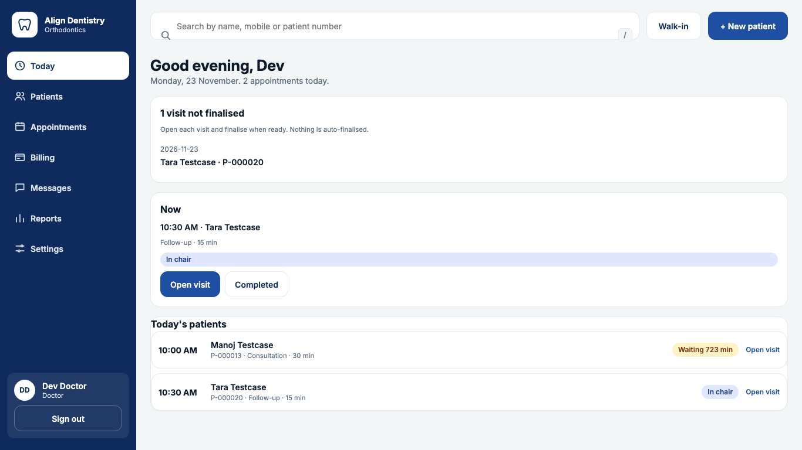

**2.** Open the visit in chair (Tara) `/app/visits/01M84FVM8RX59FPGK83NY5Q9YQ`  
   → toast: Saved

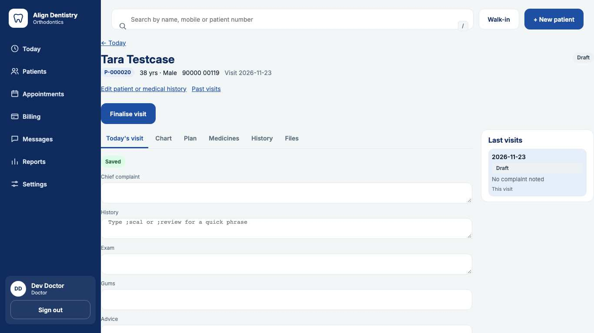

**3.** Chart tab `/app/visits/01M84FVM8RX59FPGK83NY5Q9YQ`

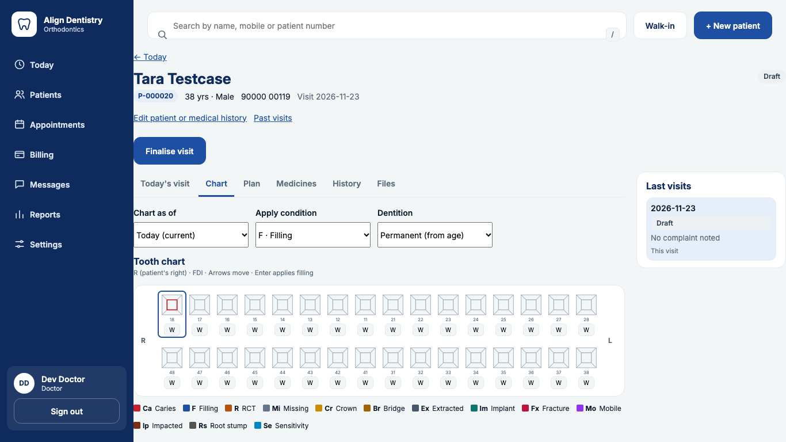

**4.** Click tooth 36 `/app/visits/01M84FVM8RX59FPGK83NY5Q9YQ`
**5.** Add procedure (Scaling ₹1,500) `/app/visits/01M84FVM8RX59FPGK83NY5Q9YQ`
**6.** Finalise visit `/app/visits/01M84FVM8RX59FPGK83NY5Q9YQ`  
   → dialog open: Finalise this visit? / After finalise, notes become read-only. Warnings: No diagnosis is recorded yet. Procedu

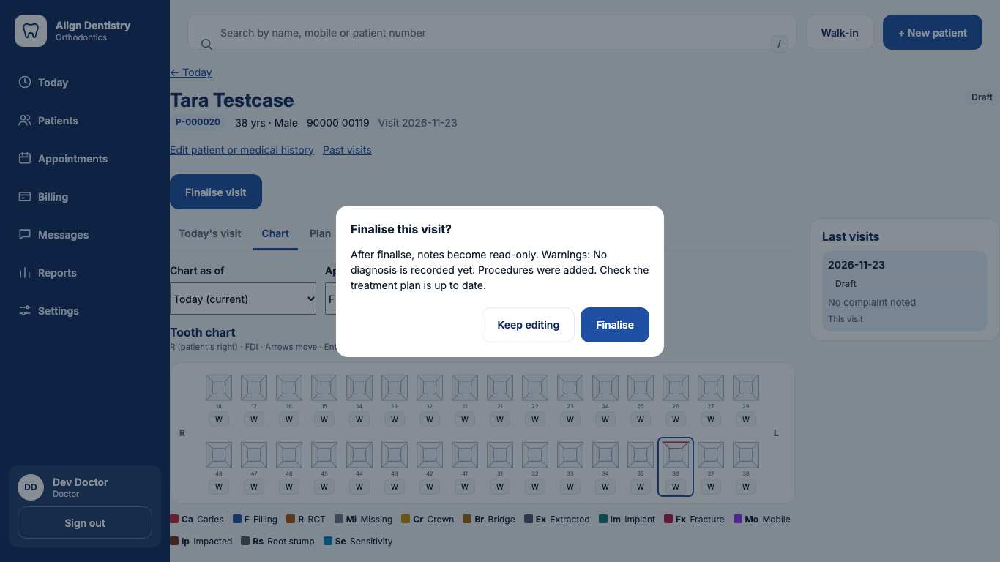

**7.** Confirm Finalise `/app/visits/01M84FVM8RX59FPGK83NY5Q9YQ`

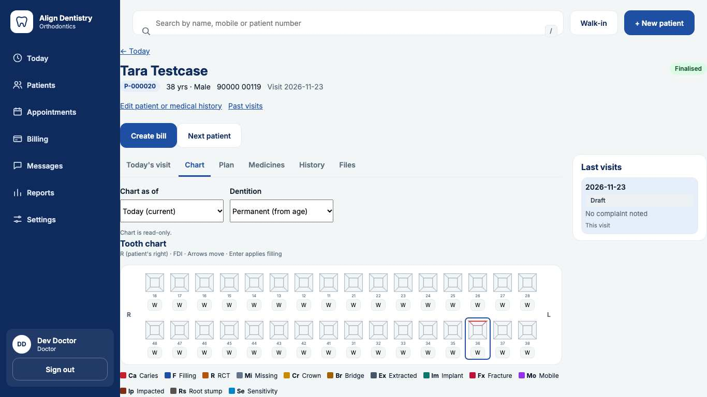

**8.** Create bill (a draft bill opens) `/app/bills/01M84KTM56AJ9ED5KNK3D4TTD7`

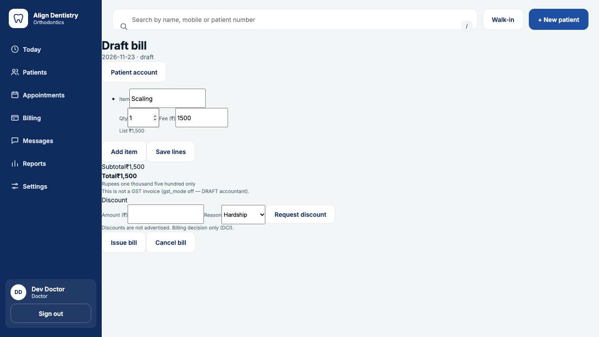

**9.** PART 1: the receptionist opens the same draft bill; the patient asks for a discount `/app`

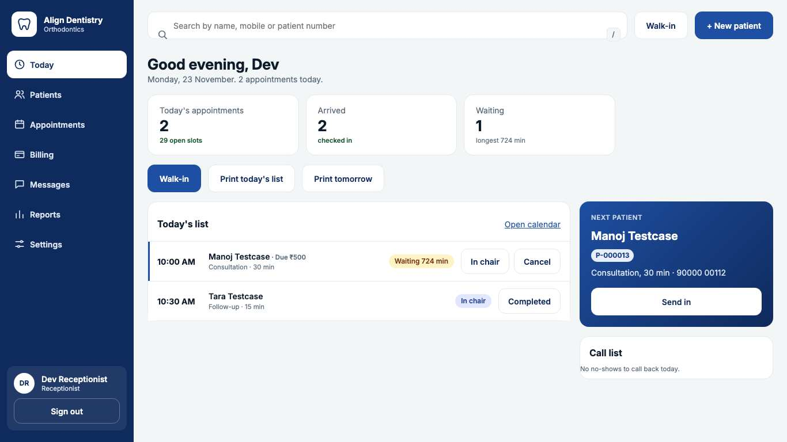

**10.** Open the draft bill as receptionist `/app/bills/01M84KTM56AJ9ED5KNK3D4TTD7`

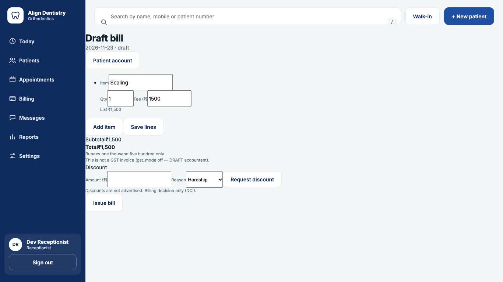

**11.** Draft bill as the receptionist sees it `/app/bills/01M84KTM56AJ9ED5KNK3D4TTD7`

Note: Receptionist's draft bill: Draft bill / 2026-11-23 · draft / Patient account / Item / QtyFee (₹) / List ₹1,500 / Add itemSave lines / Subtotal₹1,500 / Total₹1,500 / Rupees one thousand five hundred only / This is not a GST invoice (gst_mode off — DRAFT accountant). / Discount / Amount (₹)Reason / Hardship / Staff or family / Courtesy / Other / Request discount / Discounts are not advertised. Billing decision only (DCI). / Issue bill `/app/bills/01M84KTM56AJ9ED5KNK3D4TTD7`
**13.** Type discount amount 300 `/app/bills/01M84KTM56AJ9ED5KNK3D4TTD7`
**14.** Click Request discount `/app/bills/01M84KTM56AJ9ED5KNK3D4TTD7`
**15.** After the receptionist requests a discount `/app/bills/01M84KTM56AJ9ED5KNK3D4TTD7`

Note: After request: / Draft bill / 2026-11-23 · draft / Patient account / Item / QtyFee (₹) / List ₹1,500 / Add itemSave lines / Subtotal₹1,500 / Discount-₹300 / Total₹1,200 / Rupees one thousand two hundred only / This is not a GST invoice (gst_mode off — DRAFT accountant). / Discount / ₹300 · Hardship · waiting for doctor approval / Amount (₹)Reason / Hardship / Staff or family / Courtesy / Other / Request discount / `/app/bills/01M84KTM56AJ9ED5KNK3D4TTD7`
Note: EDGE: with the discount waiting, the receptionist sees an 'Issue bill' button: true (before the request she had one) `/app/bills/01M84KTM56AJ9ED5KNK3D4TTD7`
**18.** PART 2: the doctor looks for the request `/app`

**19.** Doctor Today: is there anything about a discount request? `/app`
**20.** Doctor Today `/app`

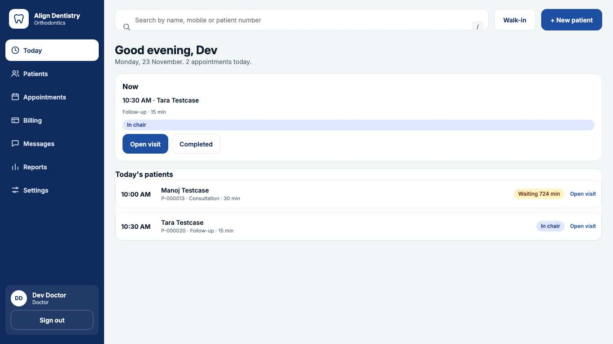

Note: Today mentions discount: false `/app`
**22.** Doctor opens the bill `/app/bills/01M84KTM56AJ9ED5KNK3D4TTD7`

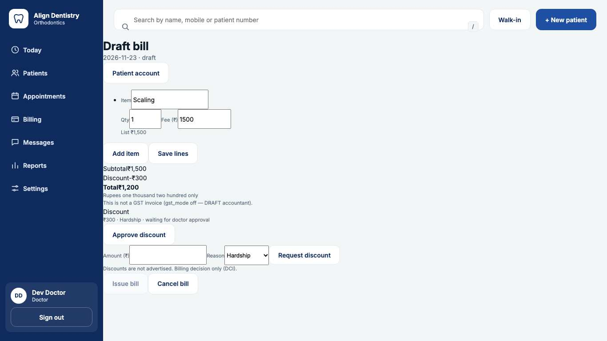

**23.** Doctor's view of the bill with a pending discount `/app/bills/01M84KTM56AJ9ED5KNK3D4TTD7`

Note: Doctor's bill: Draft bill / 2026-11-23 · draft / Patient account / Item / QtyFee (₹) / List ₹1,500 / Add itemSave lines / Subtotal₹1,500 / Discount-₹300 / Total₹1,200 / Rupees one thousand two hundred only / This is not a GST invoice (gst_mode off — DRAFT accountant). / Discount / ₹300 · Hardship · waiting for doctor approval / Approve discount / Amount (₹)Reason / Hardship / Staff or family / Courtesy / Other / Request discount / Discounts are not advertised. Billing decision only (DCI). / Issue billCancel bill `/app/bills/01M84KTM56AJ9ED5KNK3D4TTD7`
**25.** Doctor clicks Approve discount `/app/bills/01M84KTM56AJ9ED5KNK3D4TTD7`
**26.** After approval `/app/bills/01M84KTM56AJ9ED5KNK3D4TTD7`

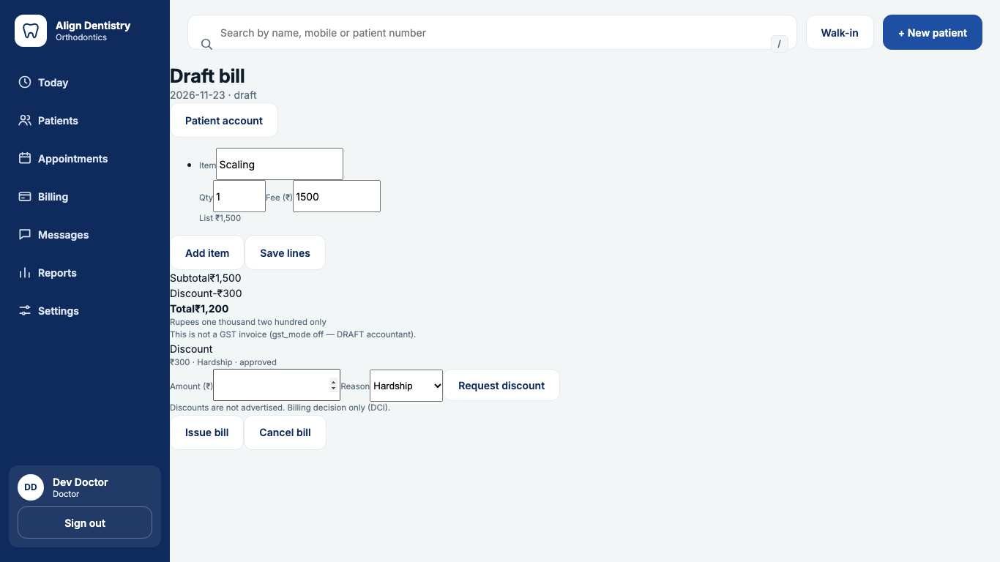

Note: After approve: / Draft bill / 2026-11-23 · draft / Patient account / Item / QtyFee (₹) / List ₹1,500 / Add itemSave lines / Subtotal₹1,500 / Discount-₹300 / Total₹1,200 / Rupees one thousand two hundred only / This is not a GST invoice (gst_mode off — DRAFT accountant). / Discount / ₹300 · Hardship · approved / Amount (₹)Reason / Hardship / Staff or family / Courtesy / Other `/app/bills/01M84KTM56AJ9ED5KNK3D4TTD7`
**28.** Doctor clicks Issue bill `/app/bills/01M84KTM56AJ9ED5KNK3D4TTD7`

**29.** Issued bill with discount `/app/bills/01M84KTM56AJ9ED5KNK3D4TTD7`

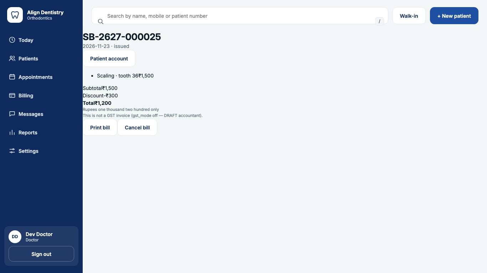

Note: Issued: SB-2627-000025 / 2026-11-23 · issued / Patient account / Scaling · tooth 36₹1,500 / Subtotal₹1,500 / Discount-₹300 / Total₹1,200 / Rupees one thousand two hundred only / This is not a GST invoice (gst_mode off — DRAFT accountant). / Print billCancel bill `/app/bills/01M84KTM56AJ9ED5KNK3D4TTD7`

## Gate A re-run (2026-11-24)
Re-run without harness repair after Part 2 and Part 3: passed. Evidence: `GATE-A-d06/`. Summary and what changed: [GATE-A.md](GATE-A.md). The findings above describe the app before Phase Q.
