# E01-settings-timings-visit-type-medicine: The doctor changes settings: opening hours, a new visit type, a new medicine, and whether the rest of the app notices

**Aim:** Settings are the doctor's own controls (nothing is hard-coded). Test the three changes a clinic makes most: opening hours, a new visit type and a new medicine. For each, save the change and then go to the screen that uses it (booking dialog for hours and visit type, the visit's Medicines tab for the medicine). Also try a wrong value (closing before opening) to see how the form protects the clinic.

**Who / device:** Doctor (changes), then Receptionist (booking dialog) and Doctor again (visit). Browser: Chromium 1366 px. Fake data only.

**Starting state:** Fresh local database. Monday opening hours 10:00 AM to 7:00 PM, lunch 1:30 to 2:30. Clock about 10 PM Monday, so with normal hours no time is free today.

**Result: WORKS (the best part of the app), one silent failure.** Settings changes save, show a clear toast, and reach the screens that use them straight away: with Monday closing at 11:30 PM the booking dialog offers times from 10:00 PM; the new visit type 'Retainer check' (20 minutes) shows in the booking dialog; the new medicine 'Ibuprofen' is found in a visit's medicine search. The Timings screen is the best-laid-out screen in the app. The one problem: a closing time before the opening time is not saved and nothing says so.

| Measure | Value |
|---|---|
| Steps recorded | 51 |
| Clicks / key presses to finish | 10 |
| Fields typed or chosen | 9 |
| Distinct pages used | 6 (/app/settings/timings, /app, /app/appointments, /app/settings/visit_types, /app/settings/medicines, /app/visits/:id) |
| Calls that would fail for a real user because of bug C1 | 1 (the test harness repaired them so the flow could continue) |
| Failed server calls | none |

## Problems found in this flow

| # | Priority | Step | Problem | Why it matters | Suggested fix |
|---|---|---|---|---|---|
| E1-1 | High | 8-11 | Closing time set before opening time (07:00 against 10:00 AM): pressing Save does nothing. No request is sent, no message appears (checked for 6 seconds), and after reloading the old value is back. The Save button stays enabled the whole time. | The doctor believes the hours are saved and the receptionist later finds no slots or the old hours. A form that fails silently is the worst kind. | Show a sentence next to the row: 'Closing time must be after opening time.' and scroll to it. |
| E1-2 | Medium | 30 | The Medicines add form has 11 fields (name, brand, form, strength, default dose, frequency, days, timing, instruction, tags, category) all at the same weight and with only the name needed. | Adding a medicine for the first time feels heavy; the doctor will type the name and leave the rest empty (as done here) or be put off. | Name and strength first; 'More details' for the rest. |
| E1-3 | Medium | 22-26 | Settings lists (visit types, medicines) show every row with four buttons: Edit, an up arrow, a down arrow and Hide. The same row pattern for 8 to 30 items. A new item is added at the bottom of a long list; the add form sits below the list. | The Add form is far down on long lists (medicines has dozens of rows). Up/down arrows are slow for long lists. | Put Add at the top; keep reorder to drag or a separate 'Reorder' mode. |
| E1-4 | Low | 25 | A visit type of 20 minutes was accepted on a booking grid that moves every 15 minutes. The booking dialog offered starts every 15 minutes for it. | Works, but overlapping 20-minute visits on a 15-minute grid may leave odd gaps. Not checked on the calendar. | Warn when the duration is not a multiple of the slot length. |
| E1-5 | Low | 3 | Save is disabled until something changes (good) but gives no hint; after a change the button does not say what will be saved. | Minor. | Show 'Unsaved changes' near Save. |

## Worked well

- Timings screen: one card per weekday with Opens, Closes, Lunch from and Lunch to, clear labels, time pickers; the layout is the best in the app.
- A saved change gives a toast: 'Opening hours saved.' and '"Retainer check" added.'
- Changes take effect at once on the booking dialog and the visit's medicine search, with no reload.
- Everything the doctor edits is versioned (history panel exists on Settings screens; not opened in this run).

## Not covered by this run

- Holidays (add a holiday and try to book on it), the number-series and billing settings, Preferences, Consent templates, Privacy notice.
- Editing or hiding an existing visit type or medicine that old records use.
- The Setting history panel and rollback.
- Closing the clinic on a day that already has appointments.

## Step by step (what the user does, and what the screen did)

Evidence labels: every line is [seen] in the browser unless marked otherwise. Screenshots exist only where the screen changed.

**1.** PART 1: the doctor wants the clinic open late today (Monday) to see how timings change booking `/app/settings/timings`

**2.** Timings screen `/app/settings/timings`

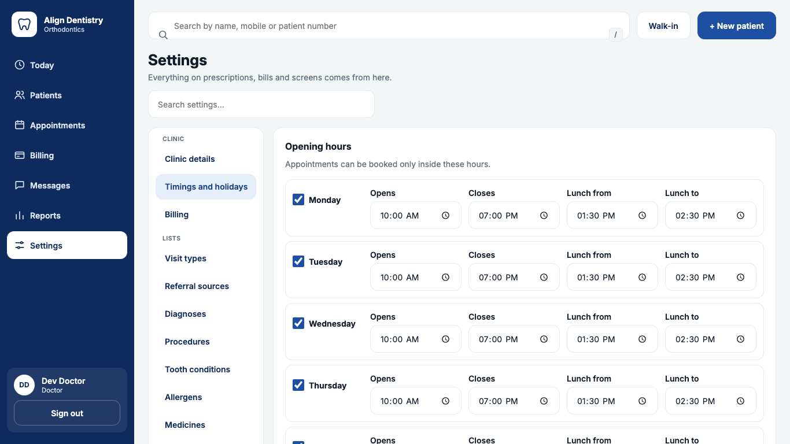

Note: Save button state before any change: disabled `/app/settings/timings`
**4.** Monday closing time changed to 23:30 `/app/settings/timings`

**5.** Click Save `/app/settings/timings`  
   → toast: Opening hours saved.

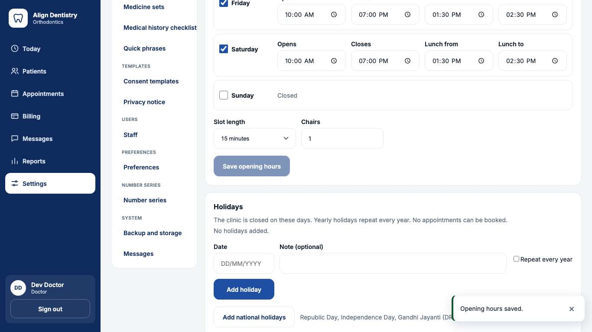

Note: After save: Opening hours saved. / Notifications Opening hours saved. `/app/settings/timings`
**7.** After saving timings `/app/settings/timings`  
   → toast: Opening hours saved.

**8.** EDGE: set Monday closing 07:00 (before opening 10:00) and Save `/app/settings/timings`  
   → toast: Opening hours saved.; error shown: Closing time must be after opening time.

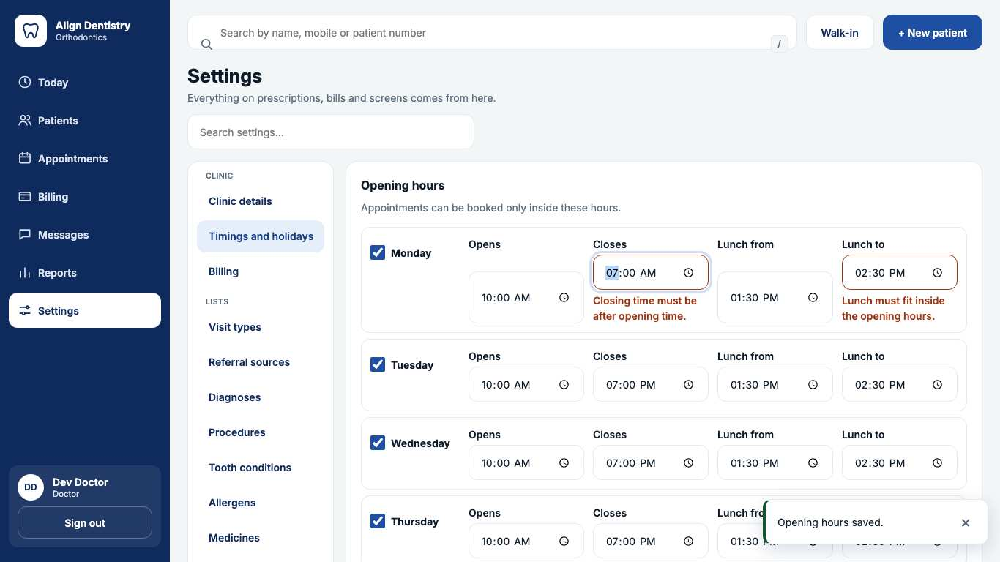

Note: 6 seconds after pressing Save with closing before opening: messages on screen = [] `/app/settings/timings`
**10.** Still no message `/app/settings/timings`  
   → error shown: Closing time must be after opening time.

Note: After reloading the page the Monday closing time is 23:30 (the 07:00 was not saved) `/app/settings/timings`
**12.** Switch to the receptionist `/app`

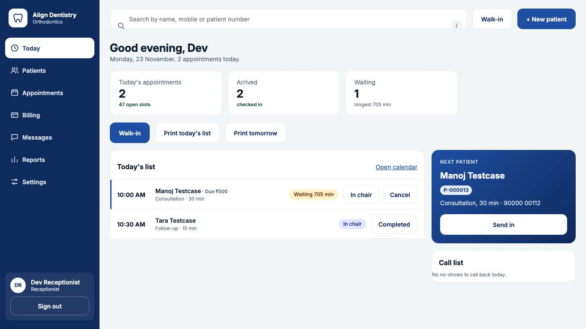

**13.** Appointments `/app/appointments`

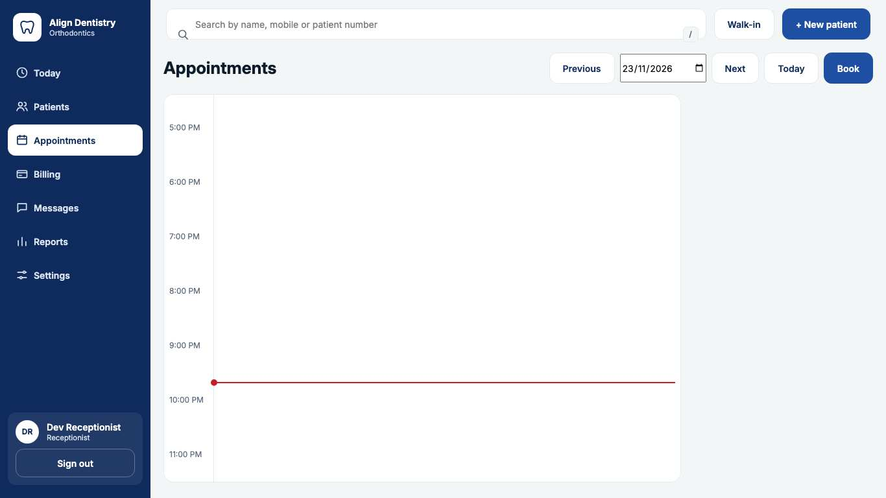

**14.** Open Book dialog (today) `/app/appointments?book=1`  
   → dialog open: Book appointment / Patient / Visit type / Choose… / Consultation / Follow-up / Cleaning / RCT sitting / Extrac

**15.** Type a patient name `/app/appointments?book=1`  
   → dialog open: Book appointment / Patient / Neha Testcase / P-000014 / Visit type / Choose… / Consultation / Follow-up / Clea
**16.** Pick the patient `/app/appointments?book=1`  
   → dialog open: Book appointment / Neha Testcase · P-000014 / Change / Visit type / Choose… / Consultation / Follow-up / Clean

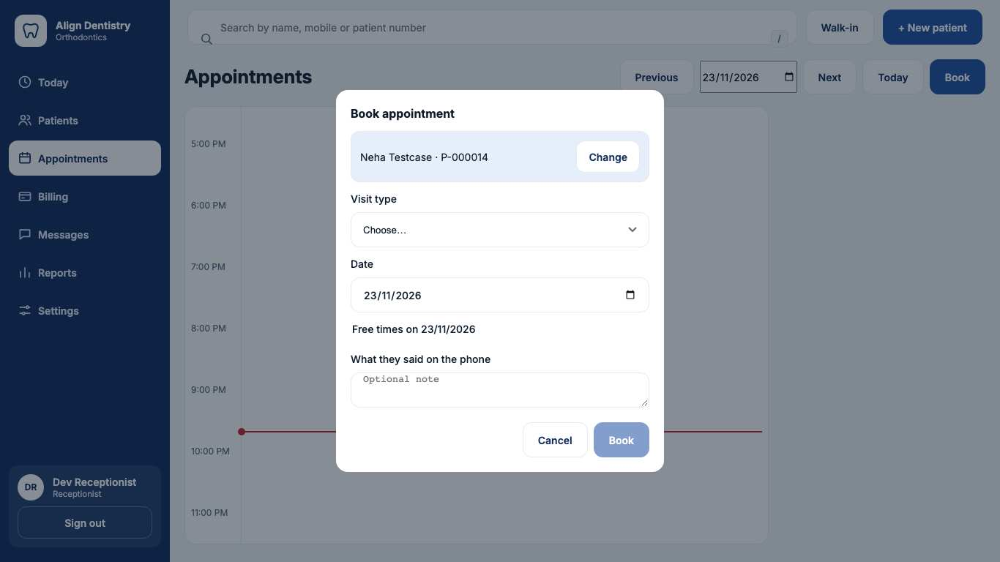

**17.** Choose Consultation `/app/appointments?book=1`  
   → dialog open: Book appointment / Neha Testcase · P-000014 / Change / Visit type / Choose… / Consultation / Follow-up / Clean
**18.** Free times today now that the clinic is open until 23:30 `/app/appointments?book=1`  
   → dialog open: Book appointment / Neha Testcase · P-000014 / Change / Visit type / Choose… / Consultation / Follow-up / Clean

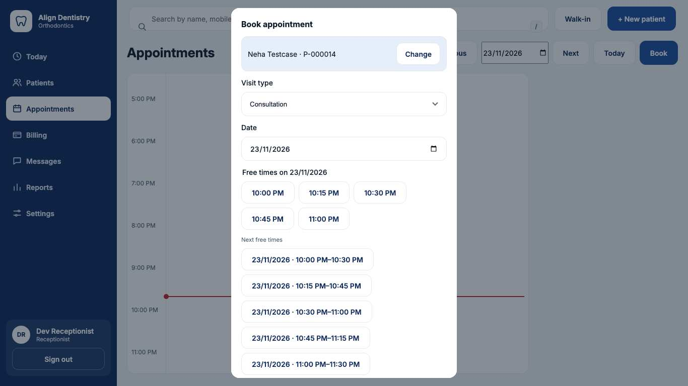

Note: Times offered today: 10:00 PM, 10:15 PM, 10:30 PM, 10:45 PM, 11:00 PM, 10:00 PM, 10:30 PM, 10:15 PM ... `/app/appointments`
**20.** Back to the doctor `/app`

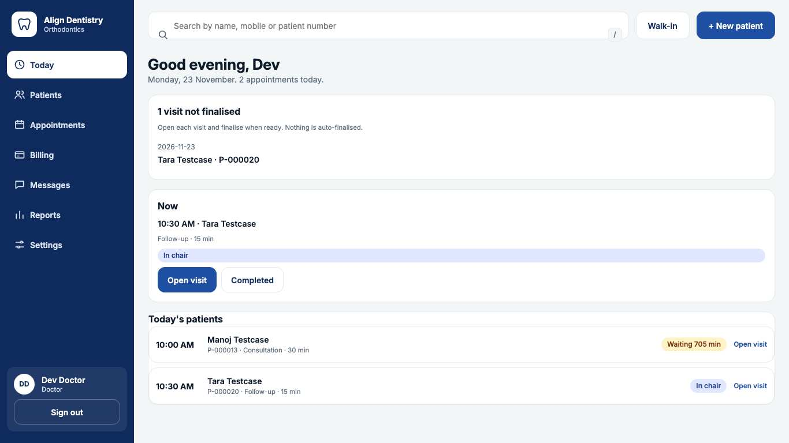

**21.** PART 2: add a new visit type `/app/settings/visit_types`

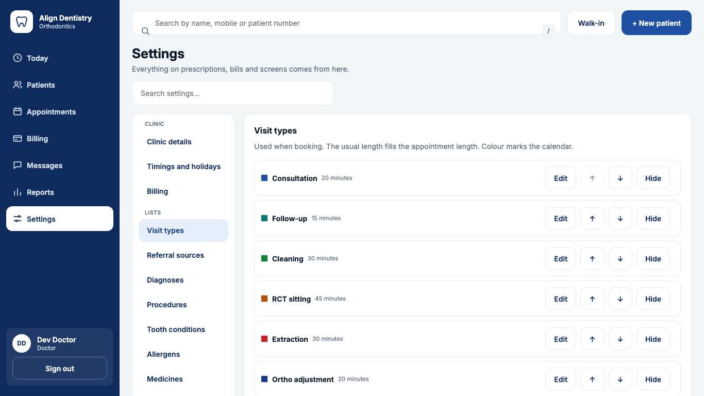

**22.** Visit types list and add form `/app/settings/visit_types`

**23.** Type the name 'Retainer check' `/app/settings/visit_types`
**24.** Duration 20 minutes (slot grid is every 15 minutes) `/app/settings/visit_types`
**25.** Click Add `/app/settings/visit_types`  
   → toast: "Retainer check" added.

Note: After add: "Retainer check" added. / Notifications "Retainer check" added. `/app/settings/visit_types`
**27.** After adding the visit type `/app/settings/visit_types`  
   → toast: "Retainer check" added.

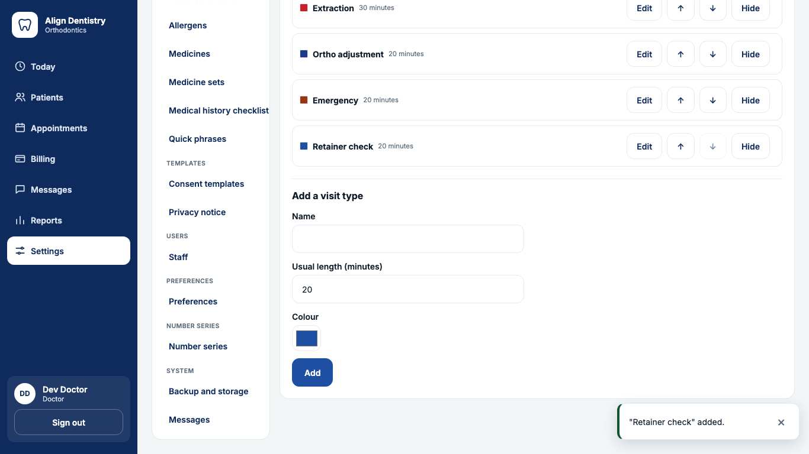

**28.** PART 3: add a medicine to the doctor's own list `/app/settings/medicines`

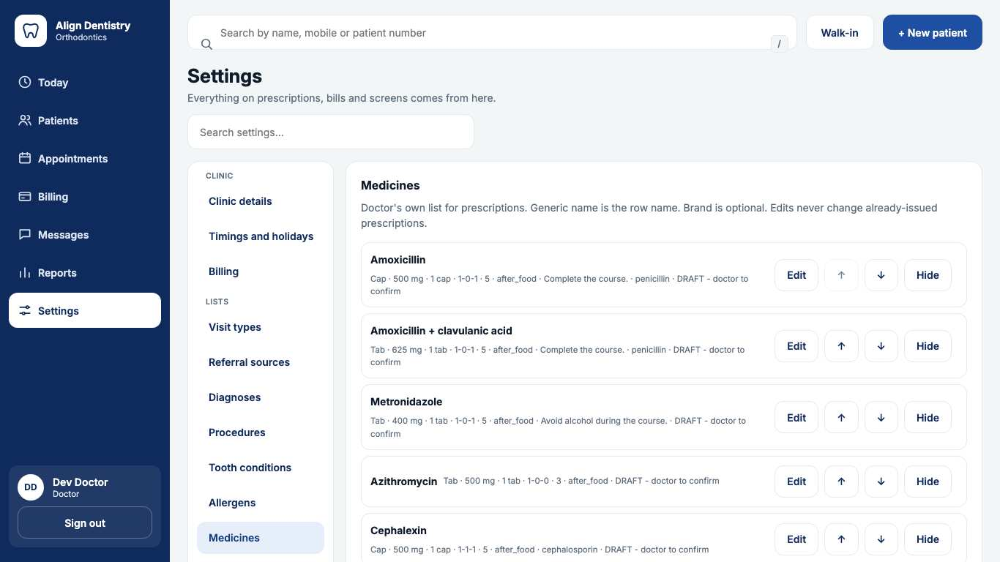

**29.** Medicines list `/app/settings/medicines`

Note: Add form fields: label, data.brand, data.form, data.strength, data.default_dose, data.default_frequency, data.default_days, data.timing, data.instruction, data.tags, data.category `/app/settings/medicines`
**31.** Type the medicine name 'Ibuprofen' `/app/settings/medicines`
**32.** Type strength 400 mg `/app/settings/medicines`
**33.** Click Add `/app/settings/medicines`  
   → error shown: Enter the form.

Note: After add medicine: `/app/settings/medicines`
**35.** After adding the medicine `/app/settings/medicines`  
   → error shown: Enter the form.

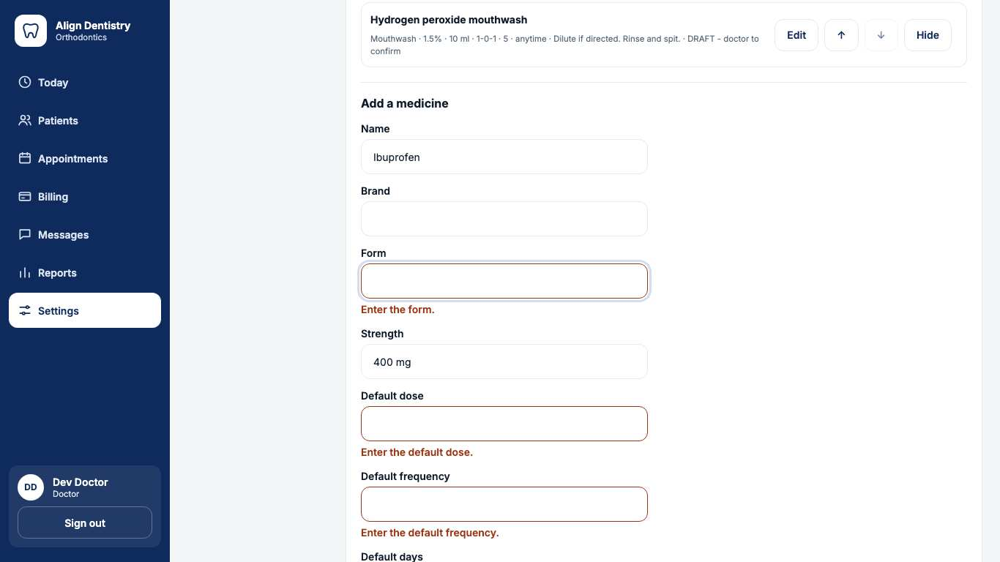

**36.** PART 4: do the new settings appear where they are used? Receptionist opens Book `/app`

**37.** Appointments `/app/appointments`

**38.** Open Book `/app/appointments?book=1`  
   → dialog open: Book appointment / Patient / Visit type / Choose… / Consultation / Follow-up / Cleaning / RCT sitting / Extrac

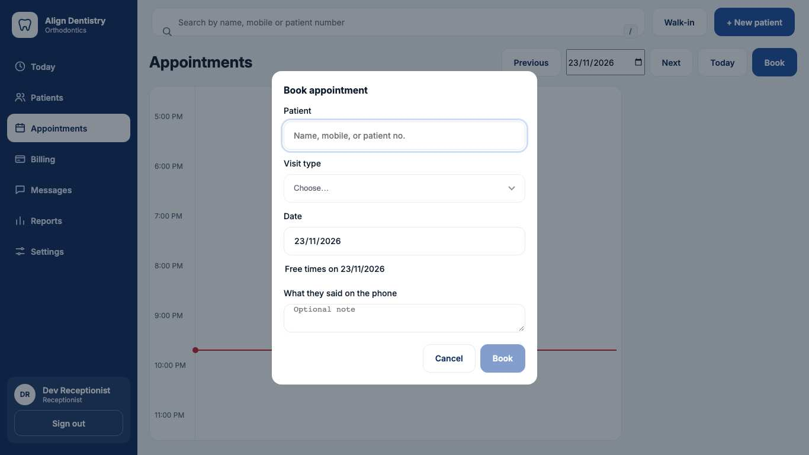

**39.** Patient `/app/appointments?book=1`  
   → dialog open: Book appointment / Patient / Neha Testcase / P-000014 / Visit type / Choose… / Consultation / Follow-up / Clea
**40.** Pick the patient `/app/appointments?book=1`  
   → dialog open: Book appointment / Neha Testcase · P-000014 / Change / Visit type / Choose… / Consultation / Follow-up / Clean

Note: Visit types offered: Choose…, Consultation, Follow-up, Cleaning, RCT sitting, Extraction, Ortho adjustment, Emergency, Retainer check `/app/appointments`
**42.** Choose the new visit type 'Retainer check' (20 minutes) `/app/appointments?book=1`  
   → dialog open: Book appointment / Neha Testcase · P-000014 / Change / Visit type / Choose… / Consultation / Follow-up / Clean
**43.** Free times for a 20-minute visit type `/app/appointments?book=1`  
   → dialog open: Book appointment / Neha Testcase · P-000014 / Change / Visit type / Choose… / Consultation / Follow-up / Clean

Note: Times offered for the 20-minute type: 10:00 PM, 10:15 PM, 10:30 PM, 10:45 PM, 11:00 PM, 10:00 PM, 10:30 PM, 10:15 PM `/app/appointments`
**45.** Doctor: does the new medicine appear in a visit? `/app`

**46.** Doctor Today `/app`
**47.** Open a visit `/app/visits/01M84FVM8RX59FPGK83NY5Q9YQ`  
   → toast: Saved

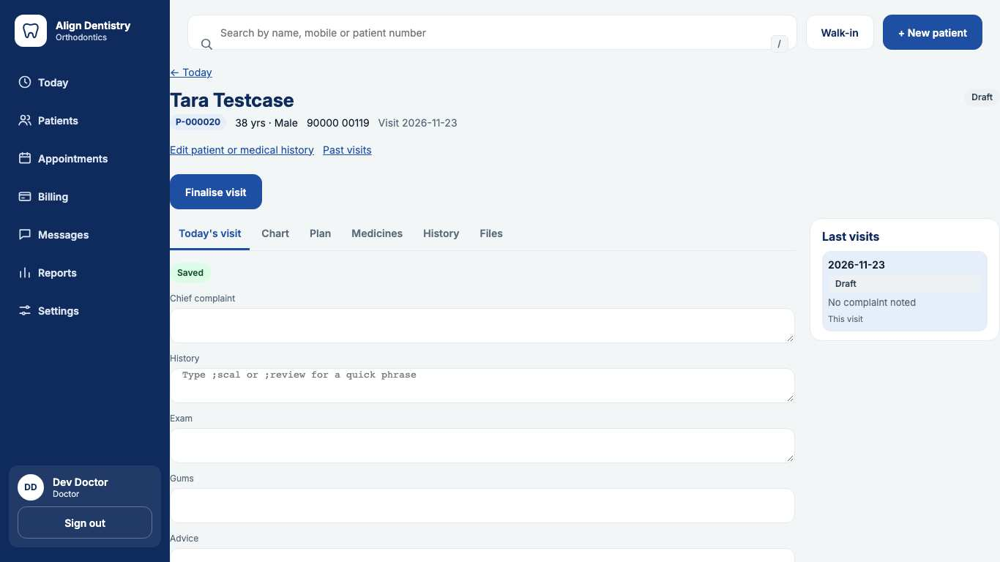

**48.** Medicines tab `/app/visits/01M84FVM8RX59FPGK83NY5Q9YQ`

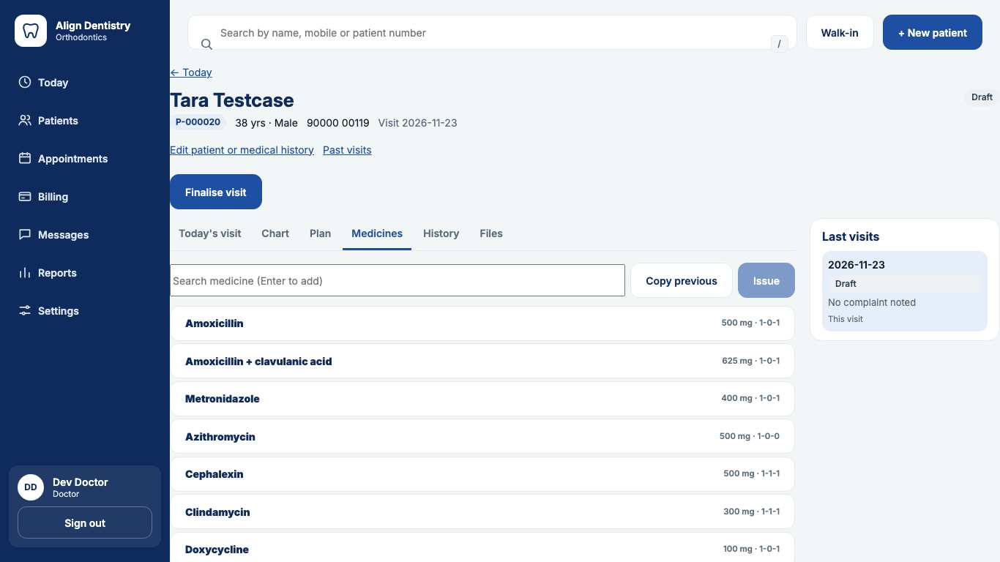

**49.** Search 'Ibu' `/app/visits/01M84FVM8RX59FPGK83NY5Q9YQ`
**50.** Is Ibuprofen found? `/app/visits/01M84FVM8RX59FPGK83NY5Q9YQ`

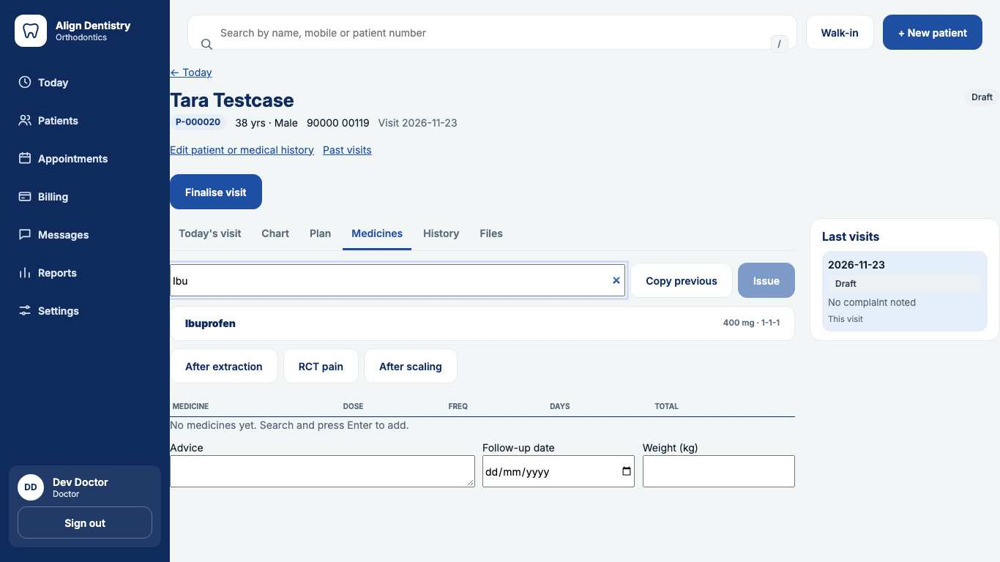

Note: Ibuprofen found in the visit's search: true `/app/visits/01M84FVM8RX59FPGK83NY5Q9YQ`
