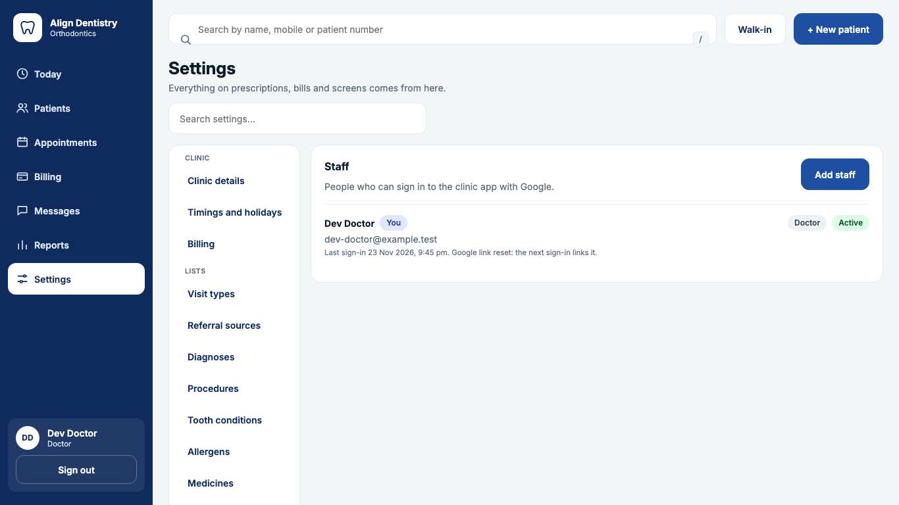
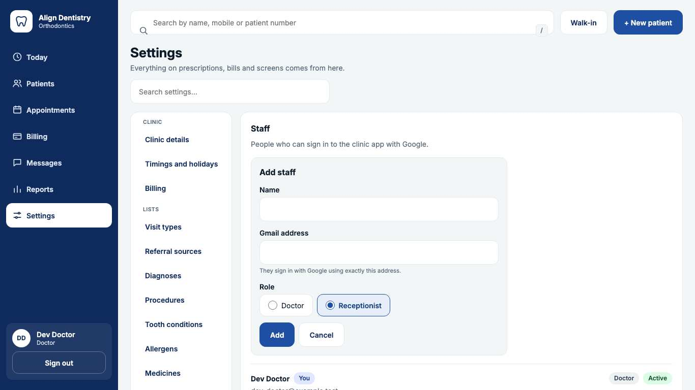
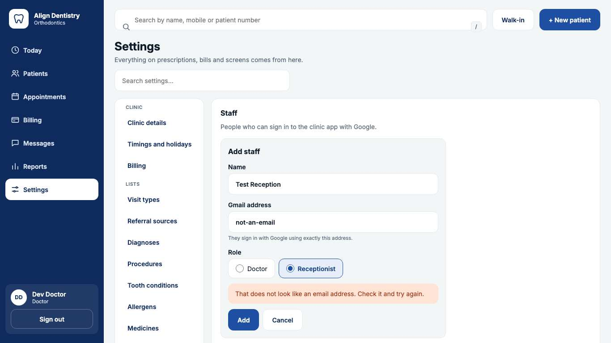
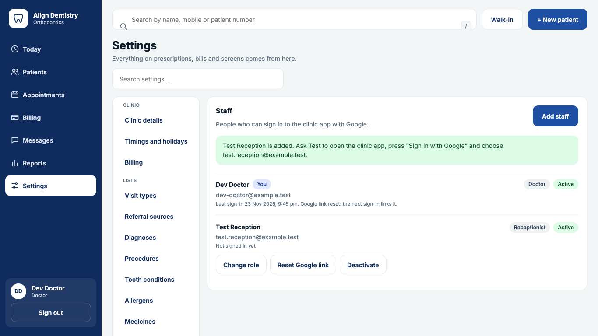
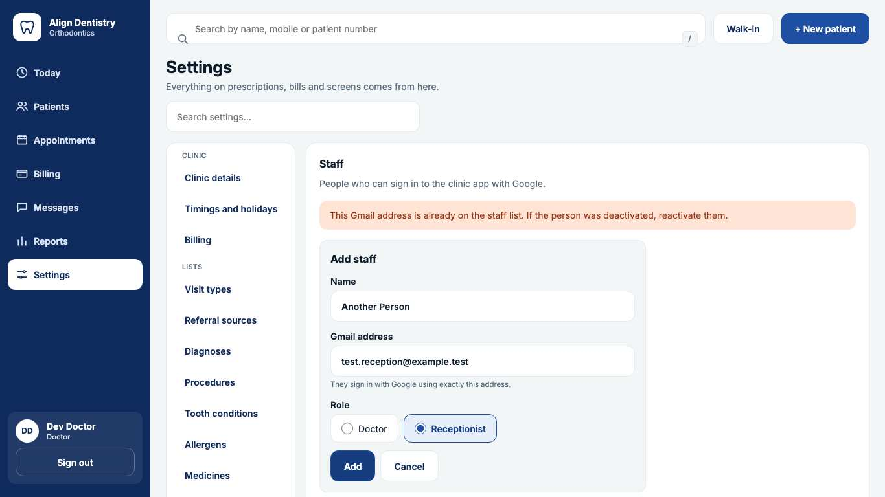
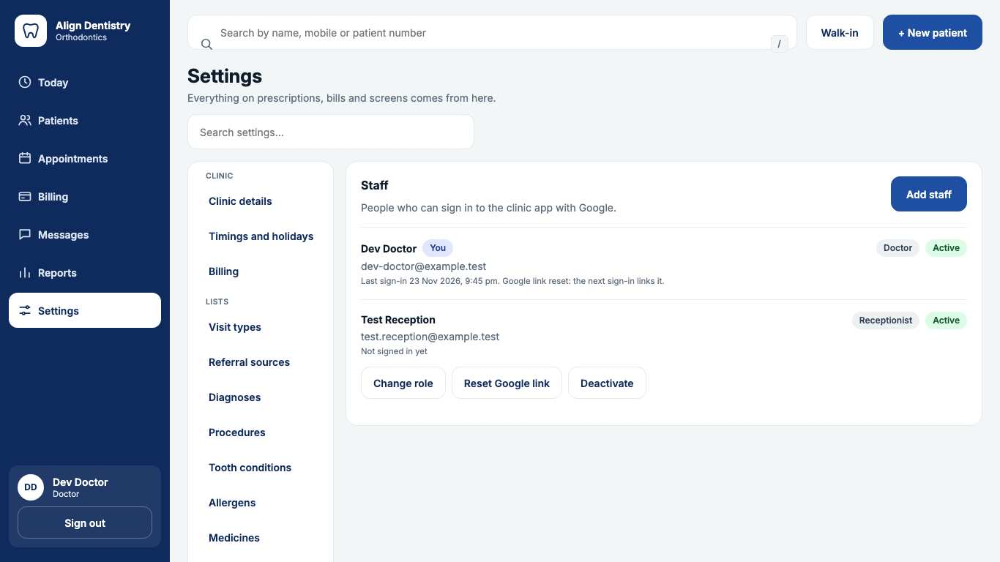
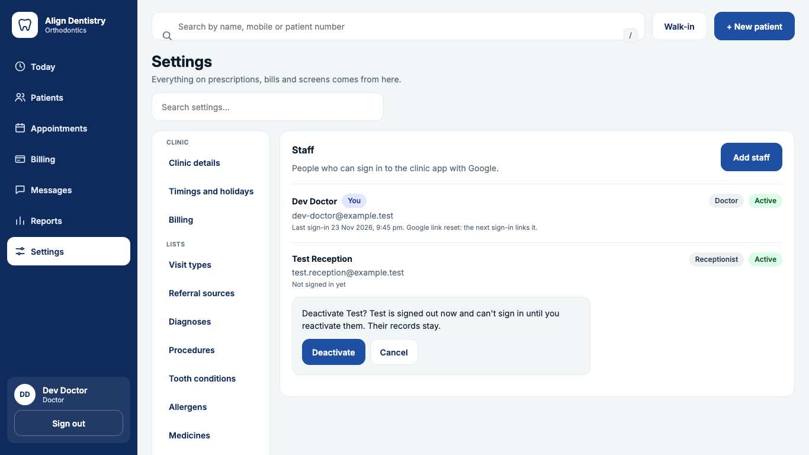
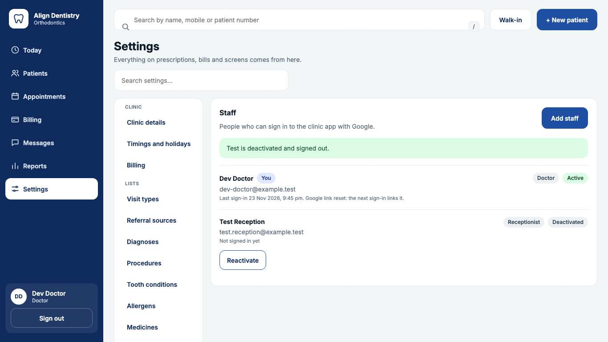
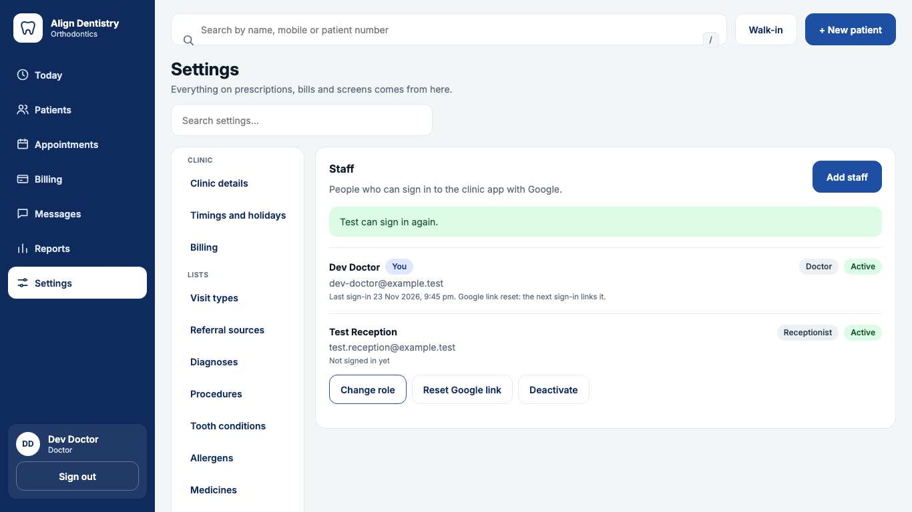
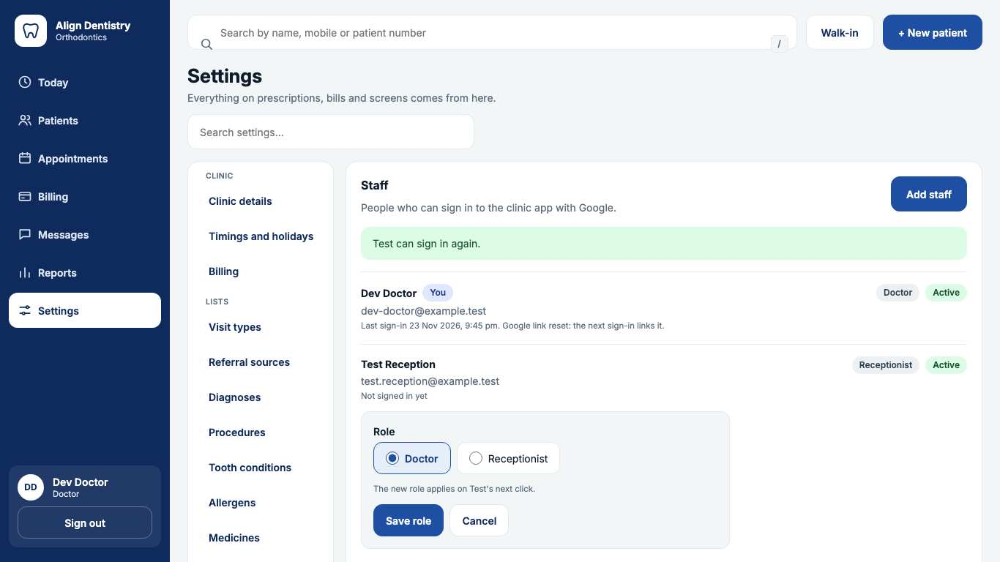

# E02-staff-add-change-role-deactivate: The doctor adds a receptionist, tries bad input, deactivates and reactivates her

**Aim:** Check the one screen that controls who can enter the clinic app: add a staff member with a wrong email, a right email and a repeated email; deactivate and reactivate; look at the role change. Check that the doctor cannot lock themself out and that every sentence tells the doctor what happens next.

**Who / device:** Doctor, laptop (Settings > Staff). Receptionist cannot open this screen (seen in the first audit: Page not found).. Browser: Chromium 1366 px. Fake data only.

**Starting state:** Fresh local database. Only the doctor 'Dev Doctor' is on the list.

**Result: WORKS very well (this is the model screen for the rest of the app).** Every step gave a plain, correct sentence: invalid email, success with what to tell the new person, duplicate email with what to do, deactivate confirmation that says what happens to the person and the records, reactivate confirmation. The doctor's own row has no Deactivate button, so the doctor cannot remove themself. Only small things to improve.

| Measure | Value |
|---|---|
| Steps recorded | 32 |
| Clicks / key presses to finish | 11 |
| Fields typed or chosen | 3 |
| Distinct pages used | 1 (/app/settings/staff) |
| Calls that would fail for a real user because of bug C1 | 0 (the test harness repaired them so the flow could continue) |
| Failed server calls | 422 /api/staff/users |

## Problems found in this flow

| # | Priority | Step | Problem | Why it matters | Suggested fix |
|---|---|---|---|---|---|
| E2-1 | Low | 11 | The success sentence says 'Ask Test to open the clinic app...' using the first word of the typed name. For 'Test Reception' that reads like a person called Test. | Slightly odd with two-word job titles; fine for real names. | Use the full name. |
| E2-2 | Low | 13, 26 | Row actions 'Reset Google link' and the status line 'Google link reset: the next sign-in links it' use internal wording. | A non-technical doctor will not know when to press it. | 'Fix sign-in problem' with one sentence of help. |
| E2-3 | Low | 30-32 | The Change role panel text was not captured by this run (the click opened something but no text was read). Not judged. | - | Re-run with a screenshot of the panel. |
| E2-4 | Low | 8 | The field is named 'Gmail address'. A Google Workspace address that is not Gmail may be refused or confusing. Not tested. | Possible dead end for a staff member with a work Google account. | Label 'Google account email' and test a non-Gmail address. |

## Worked well

- Invalid email: 'That does not look like an email address. Check it and try again.'
- Added: 'Test Reception is added. Ask Test to open the clinic app, press "Sign in with Google" and choose test.reception@example.test.' tells the doctor exactly what to say.
- Duplicate: 'This Gmail address is already on the staff list. If the person was deactivated, reactivate them.'
- Deactivate: 'Deactivate Test? Test is signed out now and can't sign in until you reactivate them. Their records stay.' with Deactivate and Cancel.
- Reactivate: 'Test can sign in again.' Status badges (Doctor/Receptionist, Active/Deactivated) and 'You' chip are clear and styled.
- The doctor's own account has no Deactivate button.

## Not covered by this run

- Whether a deactivated person is signed out at once (needs two sessions and real Google sign-in).
- Role change of the only doctor, and a second doctor.
- The Settings history of staff changes (audit log screen).

## Step by step (what the user does, and what the screen did)

Evidence labels: every line is [seen] in the browser unless marked otherwise. Screenshots exist only where the screen changed.

**1.** The doctor opens Settings > Staff to give a new receptionist access `/app/settings/staff`

**2.** Click Add staff `/app/settings/staff`
**3.** Add staff form `/app/settings/staff`

**4.** Type the name `/app/settings/staff`
**5.** EDGE: type an invalid email `/app/settings/staff`
**6.** Choose the role Receptionist `/app/settings/staff`
**7.** Submit with an invalid email `/app/settings/staff`  
   → error shown: That does not look like an email address. Check it and try again.

Note: Invalid email result: That does not look like an email address. Check it and try again. `/app/settings/staff`
**9.** After submitting an invalid email `/app/settings/staff`  
   → error shown: That does not look like an email address. Check it and try again.

**10.** Fix the email and submit `/app/settings/staff`  
   → toast: Test Reception is added. Ask Test to open the clinic app, press "Sign in with Google" and choose test.reception@example.test.

Note: Valid add result: Test Reception is added. Ask Test to open the clinic app, press "Sign in with Google" and choose test.reception@example.test. `/app/settings/staff`
**12.** After adding the staff member `/app/settings/staff`  
   → toast: Test Reception is added. Ask Test to open the clinic app, press "Sign in with Google" and choose test.reception@example.test.

Note: Rows: People who can sign in to the clinic app with Google. / Add staff / Test Reception is added. Ask Test to open the clinic app, press "Sign in with Google" and choose test.reception@example.test. / Dev Doctor / You / dev-doctor@example.test / Last sign-in 23 Nov 2026, 9:45 pm. Google link reset: the next sign-in links it. / Doctor / Active / Test Reception / test.reception@example.test / Not signed in yet / Receptionist / Active / Change role / Reset Google link / Deactivate `/app/settings/staff`
**14.** Add staff again with the same email `/app/settings/staff`  
   → toast: Test Reception is added. Ask Test to open the clinic app, press "Sign in with Google" and choose test.reception@example.test.
**15.** Name `/app/settings/staff`  
   → toast: Test Reception is added. Ask Test to open the clinic app, press "Sign in with Google" and choose test.reception@example.test.
**16.** Role `/app/settings/staff`  
   → toast: Test Reception is added. Ask Test to open the clinic app, press "Sign in with Google" and choose test.reception@example.test.
**17.** Submit duplicate email `/app/settings/staff`  
   → error shown: This Gmail address is already on the staff list. If the person was deactivated, reactivate them.; server replied: 422 /api/staff/users

Note: Duplicate email result: This Gmail address is already on the staff list. If the person was deactivated, reactivate them. `/app/settings/staff`
**19.** After duplicate email `/app/settings/staff`  
   → error shown: This Gmail address is already on the staff list. If the person was deactivated, reactivate them.

**20.** Now deactivate the new receptionist (she left the job) `/app/settings/staff`

Note: Deactivate buttons on screen: 1 (the doctor's own row 'You' has none, so the doctor cannot lock themself out) `/app/settings/staff`
**22.** Click Deactivate on Test Reception `/app/settings/staff`
**23.** Confirmation panel `/app/settings/staff`

**24.** Confirm Deactivate `/app/settings/staff`  
   → toast: Test is deactivated and signed out.

**25.** After deactivating `/app/settings/staff`  
   → toast: Test is deactivated and signed out.

Note: Row now: Test Reception / test.reception@example.test / Not signed in yet / Receptionist / Deactivated / Reactivate `/app/settings/staff`
**27.** Click Reactivate `/app/settings/staff`  
   → toast: Test can sign in again.

**28.** After reactivating `/app/settings/staff`  
   → toast: Test can sign in again.

Note: Reactivate result: Test can sign in again. `/app/settings/staff`
**30.** Click Change role `/app/settings/staff`  
   → toast: Test can sign in again.
**31.** Change role panel `/app/settings/staff`  
   → toast: Test can sign in again.

Note: Change role panel: `/app/settings/staff`
