# F01-receptionist-opens-doctor-only-pages: The receptionist types the doctor's page addresses and API addresses by hand

**Aim:** The project rule is that the receptionist never sees clinical data, and that this is enforced in the server, not only by hiding menu items. Prove it: sign in as the receptionist, open 13 pages that belong to the doctor straight by their address, and call 7 server addresses directly. Record what is shown or refused and whether the refusal sentence helps.

**Who / device:** Doctor (to read real record ids), then Receptionist, laptop. Browser: Chromium 1366 px. Fake data only.

**Starting state:** Fresh local database. Neha Testcase has a finalised visit (no prescription in the seed, so the prescription print could only be tested with an id that does not exist).

**Result: WORKS (privacy rule holds), with a few screens that open and then cannot be used.** The server refuses every clinical read from the receptionist with HTTP 403 (visit, prescriptions, chart events) and the patient history feed returns only appointment, bill and consent entries, no visits or prescriptions. The pages show a plain sentence: 'You do not have permission to do this. Ask the doctor if you need it.' A few pages open fully for the receptionist although they are doctor tools or not in her menu (New medical certificate form, Style guide, doctor's medicine list in Settings).

| Measure | Value |
|---|---|
| Steps recorded | 39 |
| Clicks / key presses to finish | 3 |
| Fields typed or chosen | 0 |
| Distinct pages used | 16 (/app/patients, /app/patients/:id, /app/visits/:id, /app, /app/print/prescription/none, /app/print/history-summary/:id, /app/patients/:id/certificates/new, /app/certificates, /app/errors, /app/requests, /app/settings/staff, /app/settings/medicines, /app/settings/billing, /app/reports, /app/style-guide, /app/print/consent/:id) |
| Calls that would fail for a real user because of bug C1 | 0 (the test harness repaired them so the flow could continue) |
| Failed server calls | 403 /api/staff/visits/01M84FVH76ZP3Z63VCA5M7X4HZ; 404 /api/staff/prescriptions/none; 403 /api/staff/patients/01M84FVD7HF5AE7M79J4VTRK5M/history/print-summary; 403 /api/staff/errors |

## Problems found in this flow

| # | Priority | Step | Problem | Why it matters | Suggested fix |
|---|---|---|---|---|---|
| F1-1 | Medium | 13-14 | The receptionist can open the 'New medical certificate' form by address (/app/patients/:id/certificates/new). It shows an empty form (patient name, age, address, identification mark, reason, dates) that is not even filled with that patient. The patient overview tells her 'Doctor creates and finalises'. | A form she cannot finish. If she types and saves, the server probably refuses (not tested), after she has typed medical reasons. | Show the same 'You do not have permission' page as for the visit. |
| F1-2 | Low | 23-25 | The receptionist can read the doctor's Medicines list and Billing settings (Settings > Medicines, Settings > Billing). Edit controls were not seen on the medicine rows in the screenshot; billing settings not checked. | The medicine list is clinic configuration, not patient data, so this is probably intended. It is not listed in the permission notes, so confirm with the doctor. | Decide and write it in AUTH_PLAN section 4f; hide the sections from the receptionist menu if not intended. |
| F1-3 | Low | 29 | The developer 'Style guide' page opens for staff (and overflows at 360 px). | Not harmful; it is a developer page in the staff app. | Show it only in local development. |
| F1-4 | Low | 19 | Patient requests list (/app/requests) opens for the receptionist and shows each request. HANDOFF says view is allowed for both roles. Not checked whether the text of a request can contain health information. | Needs a policy check, not a bug. | Doctor confirms the roles (already listed as waiting in STATE.md). |
| F1-5 | Low | 36-37 | Two server addresses (/api/staff/requests, /api/staff/staff) return 404 'This address does not exist' instead of 403 because the real addresses differ. They were guesses. | Not a finding about the app; recorded so nobody reads the 404 as protection. | None. |
| F1-6 | Low | 27 | Reports for the receptionist shows 'Collected -₹50' (a negative collected amount for today, from a seeded refund). | A negative 'Collected' looks like an error to a receptionist; it comes from refunds being larger than payments today. | Show Payments and Refunds on two lines. |

## Worked well

- Server side enforcement is real: /api/staff/visits/:id, /visits/:id/prescriptions, /patients/:id/chart and /errors return HTTP 403 for the receptionist.
- Patient history feed for the receptionist has only appointment, bill and consent entries.
- Refusal wording is plain and consistent on pages and API: 'You do not have permission to do this. Ask the doctor if you need it.'
- Reports for the receptionist is a small safe summary with 'The full dashboard is for the doctor.'
- Consent print (allowed for the receptionist) works and prints.

## Not covered by this run

- Submitting the certificate form as the receptionist.
- Prescription print with a real prescription id (none in the seed).
- The patient-facing portal (not built).
- A deactivated or logged-out user opening a page (session expiry).

## Step by step (what the user does, and what the screen did)

Evidence labels: every line is [seen] in the browser unless marked otherwise. Screenshots exist only where the screen changed.

**1.** The doctor looks up real record ids first (a finalised visit, its prescription, the patient) `/app/patients`

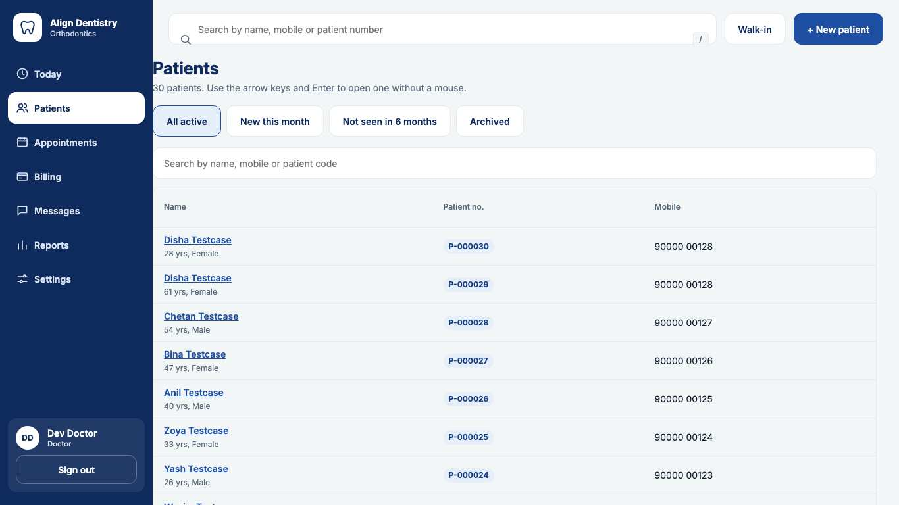

**2.** Open Neha Testcase `/app/patients/01M84FVD7HF5AE7M79J4VTRK5M`

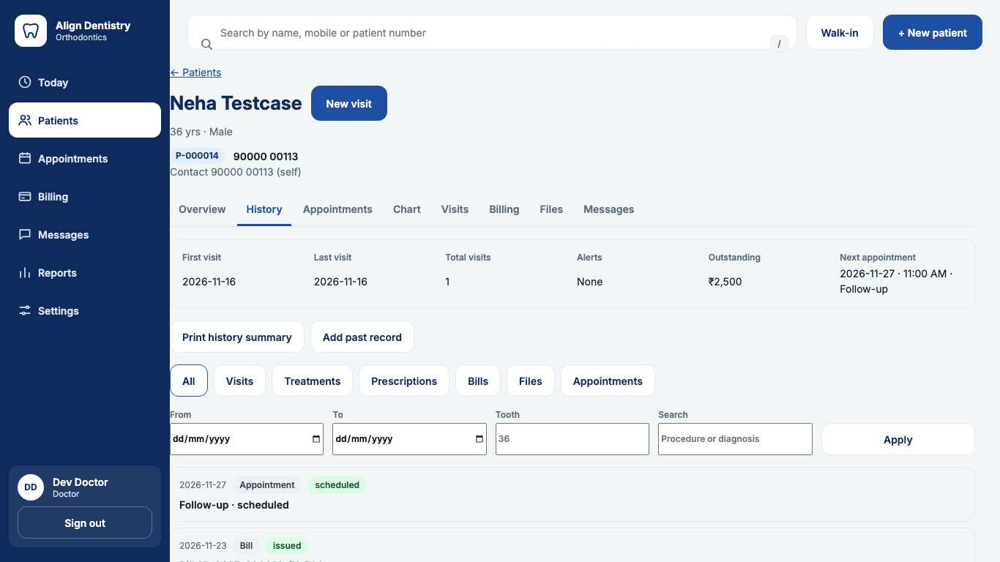

**3.** Open the Visits tab `/app/patients/01M84FVD7HF5AE7M79J4VTRK5M`
**4.** Open the finalised visit `/app/visits/01M84FVH76ZP3Z63VCA5M7X4HZ`

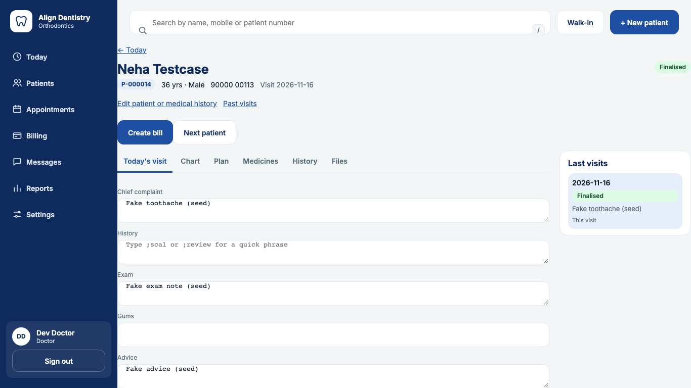

Note: Doctor's ids: patient 01M84FVD7HF5AE7M79J4VTRK5M, visit 01M84FVH76ZP3Z63VCA5M7X4HZ, prescription none. Doctor API reads: visit prescriptions HTTP 200 `/app/visits/01M84FVH76ZP3Z63VCA5M7X4HZ`
**6.** NOW the receptionist (who must never see clinical data) types the doctor's URLs `/app`

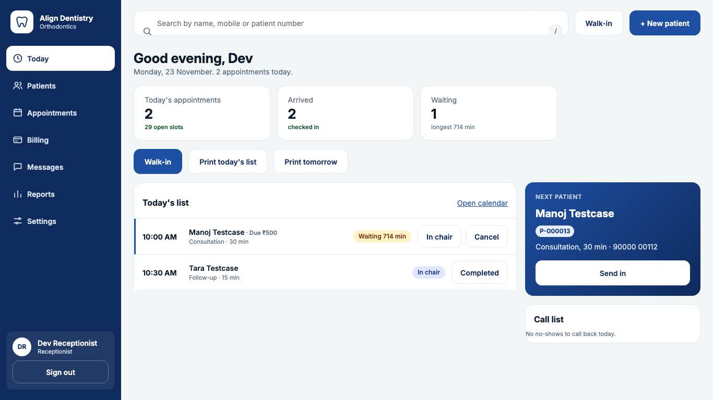

Note: PAGE Finalised visit /app/visits/:id => You do not have permission to do this. Ask the doctor if you need it. `/app/visits/01M84FVH76ZP3Z63VCA5M7X4HZ`
**8.** Receptionist opens: Finalised visit `/app/visits/01M84FVH76ZP3Z63VCA5M7X4HZ`  
   → error shown: You do not have permission to do this. Ask the doctor if you need it.; server replied: 403 /api/staff/visits/01M84FVH76ZP3Z63VCA5M7X4HZ

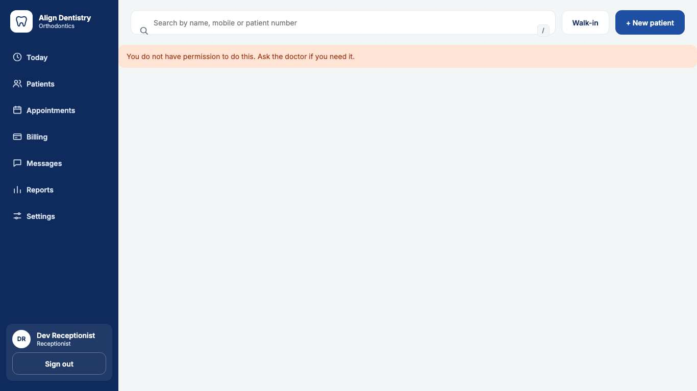

Note: PAGE Prescription print /app/print/prescription/none => That prescription was not found. It may have been removed. / Back `/app/print/prescription/none`
**10.** Receptionist opens: Prescription print `/app/print/prescription/none`  
   → error shown: That prescription was not found. It may have been removed.; server replied: 404 /api/staff/prescriptions/none

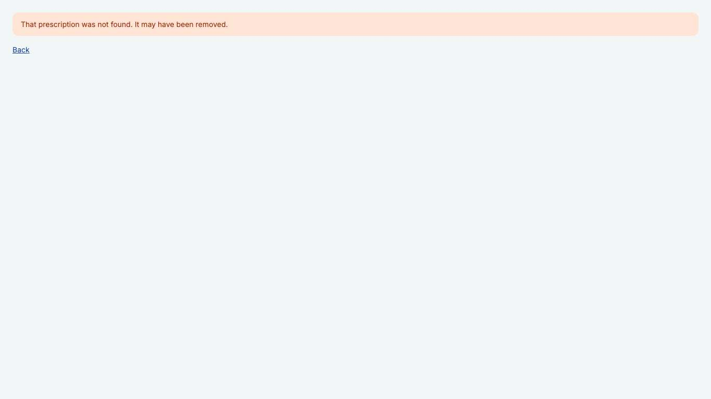

Note: PAGE History summary print /app/print/history-summary/:id => You do not have permission to do this. Ask the doctor if you need it. Back `/app/print/history-summary/01M84FVD7HF5AE7M79J4VTRK5M`
**12.** Receptionist opens: History summary print `/app/print/history-summary/01M84FVD7HF5AE7M79J4VTRK5M`  
   → server replied: 403 /api/staff/patients/01M84FVD7HF5AE7M79J4VTRK5M/history/print-summary

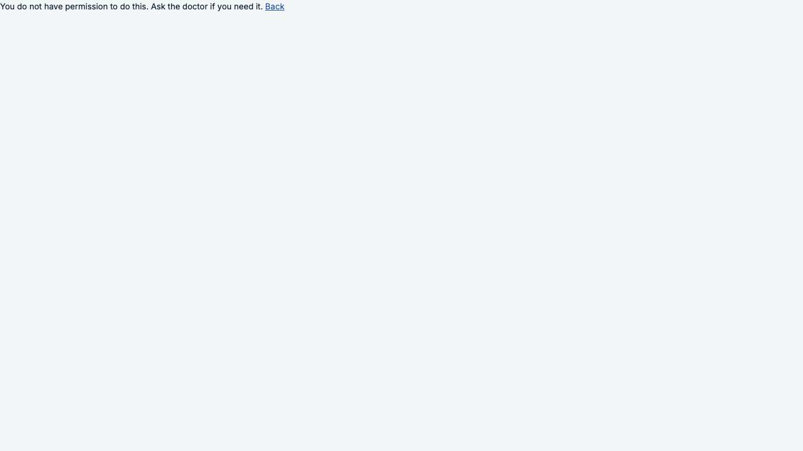

Note: PAGE New certificate /app/patients/:id/certificates/new => Align Dentistry / Orthodontics / Today / Patients / Appointments / Billing / Messages / Reports / Settings / DR / Dev Receptionist / Receptionist / Sign out / Search patients (shortcut: /) / / / Walk- `/app/patients/01M84FVD7HF5AE7M79J4VTRK5M/certificates/new`
**14.** Receptionist opens: New certificate `/app/patients/01M84FVD7HF5AE7M79J4VTRK5M/certificates/new`

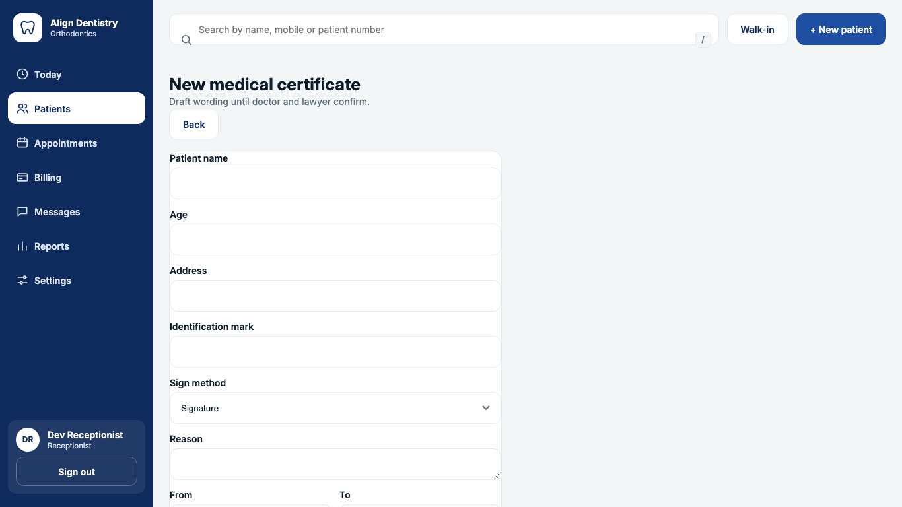

Note: PAGE Certificate register /app/certificates => Align Dentistry / Orthodontics / Today / Patients / Appointments / Billing / Messages / Reports / Settings / DR / Dev Receptionist / Receptionist / Sign out / Search patients (shortcut: /) / / / Walk- `/app/certificates`
**16.** Receptionist opens: Certificate register `/app/certificates`

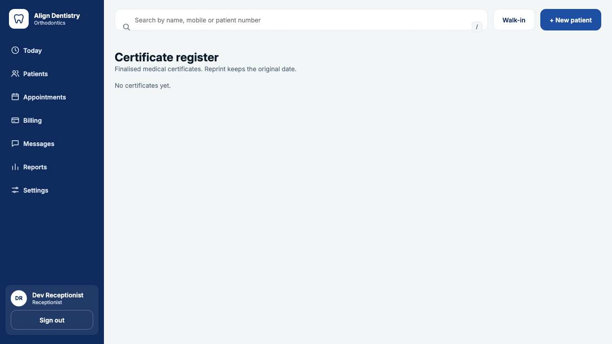

Note: PAGE Error log /app/errors => Error log / You do not have permission to do this. Ask the doctor if you need it. `/app/errors`
**18.** Receptionist opens: Error log `/app/errors`  
   → server replied: 403 /api/staff/errors

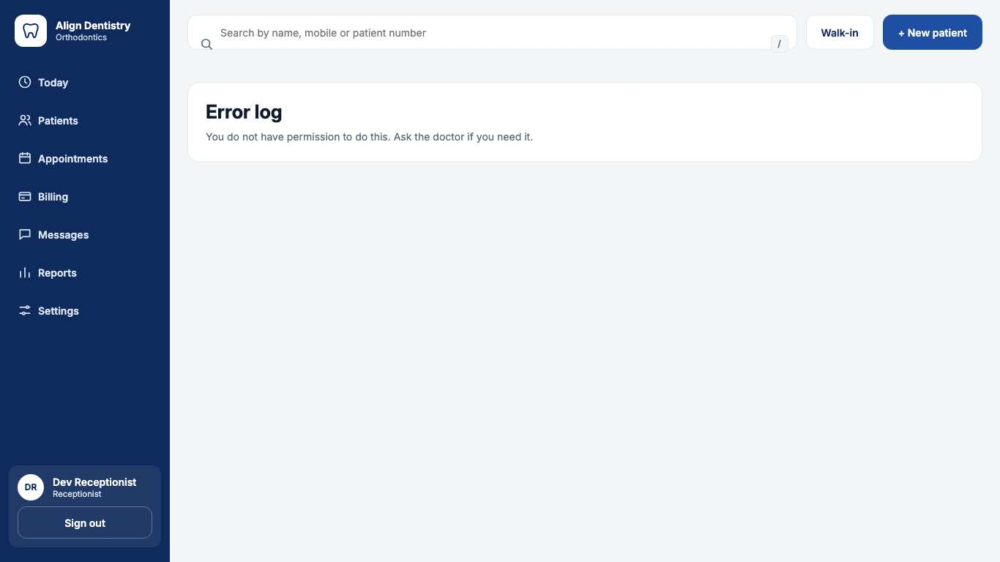

Note: PAGE Patient requests /app/requests => Patient requests / DRAFT: due date is 30 days from the request. The doctor confirms the final rule. / Open / Done / Rejected / All / Kiran Testcase P-000011 / open / Copy of my information · due 23/12 `/app/requests`
**20.** Receptionist opens: Patient requests `/app/requests`

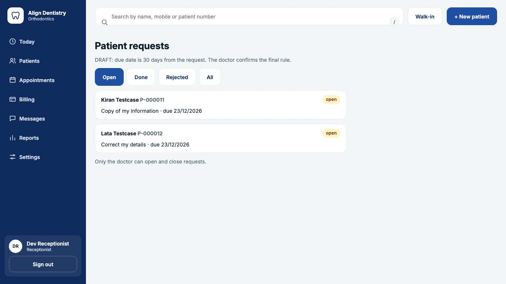

Note: PAGE Settings > Staff /app/settings/staff => Settings / Everything on prescriptions, bills and screens comes from here. / Search settings / CLINIC / Clinic details / Timings and holidays / Billing / LISTS / Visit types / Referral sources / Diagn `/app/settings/staff`
**22.** Receptionist opens: Settings > Staff `/app/settings/staff`

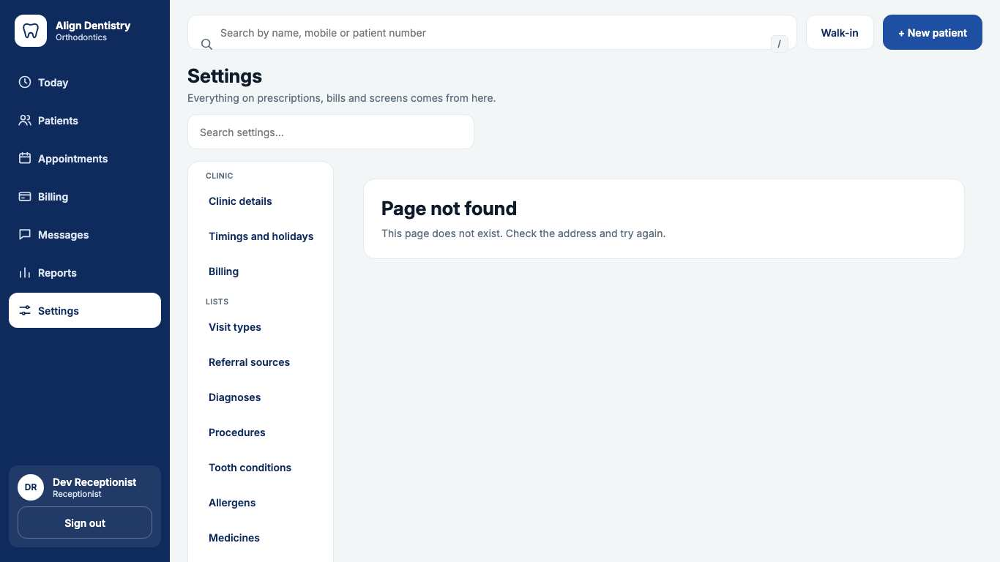

Note: PAGE Settings > Medicines /app/settings/medicines => Settings / Everything on prescriptions, bills and screens comes from here. / Search settings / CLINIC / Clinic details / Timings and holidays / Billing / LISTS / Visit types / Referral sources / Diagn `/app/settings/medicines`
**24.** Receptionist opens: Settings > Medicines `/app/settings/medicines`

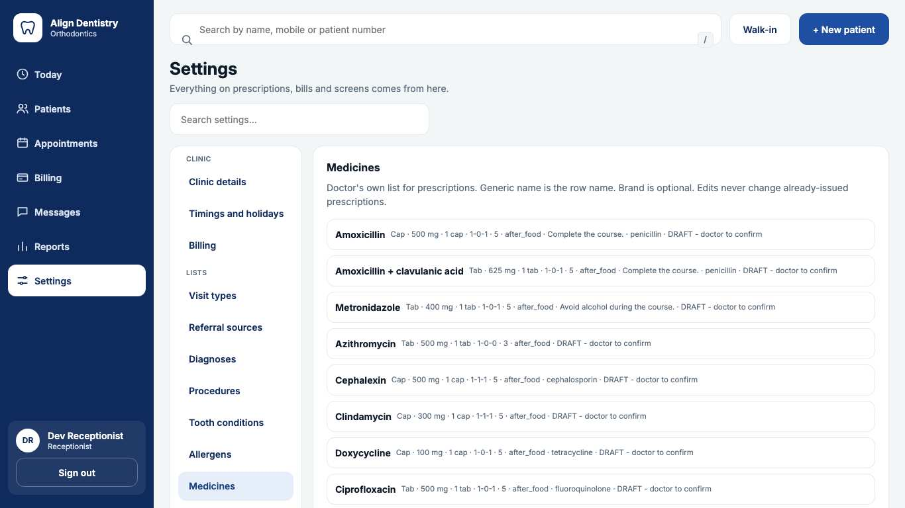

Note: PAGE Settings > Billing /app/settings/billing => Settings / Everything on prescriptions, bills and screens comes from here. / Search settings / CLINIC / Clinic details / Timings and holidays / Billing / LISTS / Visit types / Referral sources / Diagn `/app/settings/billing`
**26.** Receptionist opens: Settings > Billing `/app/settings/billing`

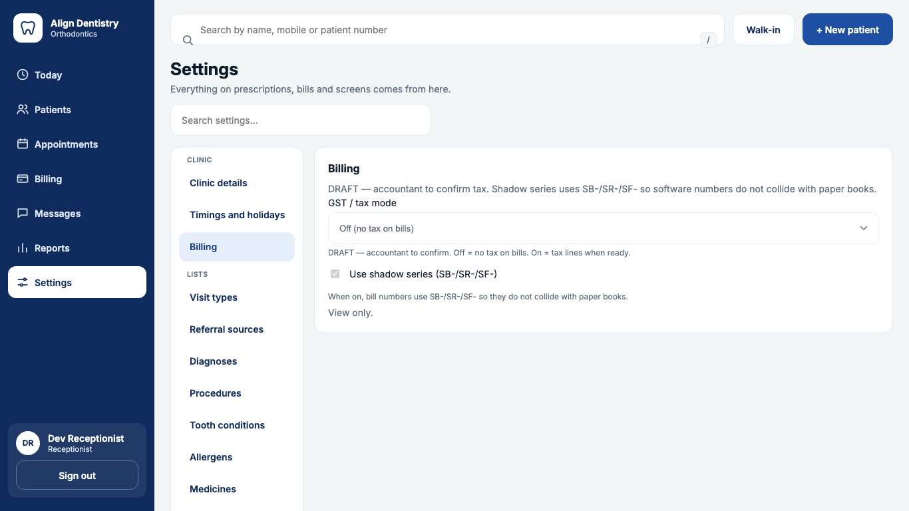

Note: PAGE Reports /app/reports => Reports / Today's summary / 2026-11-23 / Arrived / 2 / Still on list / 2 / Collected / -₹50 / The full dashboard is for the doctor. You can use Today for the live queue. `/app/reports`
**28.** Receptionist opens: Reports `/app/reports`

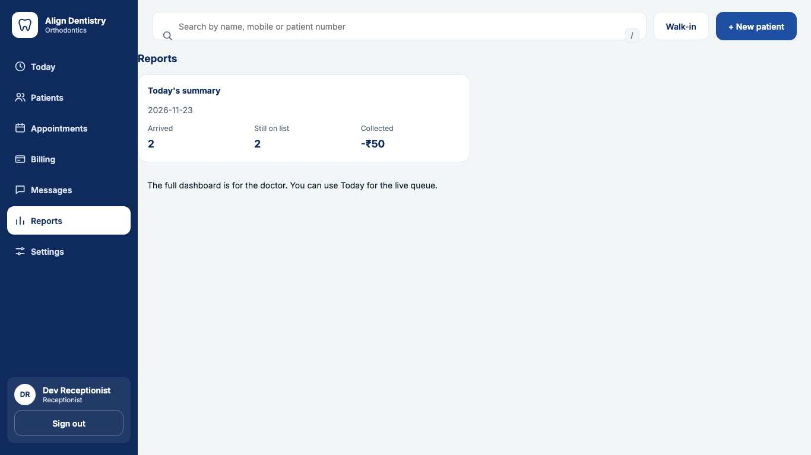

Note: PAGE Style guide (developer page) /app/style-guide => Style guide / Colours, type and building blocks from DESIGN.md. Open the printer check · Blank forms (20 copies) / Colours / --blue / #1e4fa3 · Buttons, links, active / --navy / #0f2a5c · Sidebar, hea `/app/style-guide`
**30.** Receptionist opens: Style guide (developer page) `/app/style-guide`

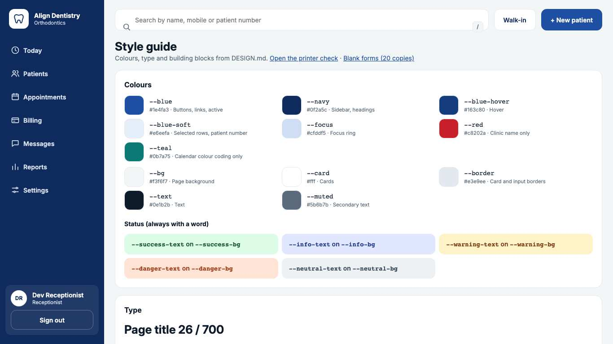

Note: PAGE Consent print (allowed) /app/print/consent/:id => Consent form / Tooth extraction, version 1. Text is the doctor's own; lawyer still to confirm. / Template / Tooth extraction / Dental filling / Root canal treatment / Scaling and polishing / Crown and `/app/print/consent/01M84FVD7HF5AE7M79J4VTRK5M`
**32.** Receptionist opens: Consent print (allowed) `/app/print/consent/01M84FVD7HF5AE7M79J4VTRK5M`

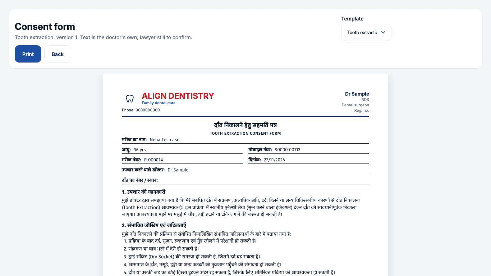

Note: API visit /api/staff/visits/:id => HTTP 403 {"ok":false,"error":{"code":"forbidden","message":"You do not have permission to do this. Ask the doctor if yo `/app/print/consent/01M84FVD7HF5AE7M79J4VTRK5M`
Note: API visit prescriptions /api/staff/visits/:id/prescriptions => HTTP 403 {"ok":false,"error":{"code":"forbidden","message":"You do not have permission to do this. Ask the doctor if yo `/app/print/consent/01M84FVD7HF5AE7M79J4VTRK5M`
Note: API error log /api/staff/errors => HTTP 403 {"ok":false,"error":{"code":"forbidden","message":"You do not have permission to do this. Ask the doctor if yo `/app/print/consent/01M84FVD7HF5AE7M79J4VTRK5M`
Note: API requests /api/staff/requests => HTTP 404 {"ok":false,"error":{"code":"not_found","message":"This address does not exist."}} `/app/print/consent/01M84FVD7HF5AE7M79J4VTRK5M`
Note: API staff list /api/staff/staff => HTTP 404 {"ok":false,"error":{"code":"not_found","message":"This address does not exist."}} `/app/print/consent/01M84FVD7HF5AE7M79J4VTRK5M`
Note: API chart events /api/staff/patients/:id/chart => HTTP 403 {"ok":false,"error":{"code":"forbidden","message":"You do not have permission to do this. Ask the doctor if yo `/app/print/consent/01M84FVD7HF5AE7M79J4VTRK5M`
Note: API history feed /api/staff/patients/:id/history => HTTP 200 {"ok":true,"data":{"entries":[{"id":"01M84FVMKRWEVAS5SME8X8VB2E","type":"appointment","at":"2026-11-27T05:30:0 entry types: appointment,bill,consent `/app/print/consent/01M84FVD7HF5AE7M79J4VTRK5M`
