# F02-phone-full-day: A full working day on a phone (360 px): receptionist, then doctor

**Aim:** The rules say every screen must work at 360 px with no sideways scrolling and 44 px tap targets, and the owner may use the app from a phone. Do the day's real tasks on a 360 px phone: Today, new patient, booking, calendar, patient list and search, payment, dues, messages, then the doctor's visit, chart, medicines, reports, settings. On every screen measure sideways scroll and tap targets under 44 px.

**Who / device:** Receptionist then Doctor, Chromium at 360 x 780 with touch. Browser: Chromium 360 px. Fake data only.

**Starting state:** Fresh local database. Clock about 10 PM Monday.

**Result: BROKEN on two screens, usable but cramped elsewhere.** Most screens fit. Two do not: the receptionist's Today page is wider than the phone (441 px on a 360 px screen) so the stat cards, the Next patient card and the row buttons 'In chair' and 'Cancel' are cut off or hidden behind the round '+' button; and the doctor's Chart tab is 774 px wide, so most of the tooth chart is off-screen and its 193 tap targets are about 32 by 8 px. Small tap targets are common on lists (patient names 21 px high, calendar times 21 px, dues links 17 px, checkboxes 13 px).

| Measure | Value |
|---|---|
| Steps recorded | 50 |
| Clicks / key presses to finish | 10 |
| Fields typed or chosen | 9 |
| Distinct pages used | 11 (/app, /app/patients/new, /app/appointments, /app/patients, /app/patients/:id, /app/billing, /app/messages, /app/more, /app/visits/:id, /app/reports, /app/settings/clinic) |
| Calls that would fail for a real user because of bug C1 | 1 (the test harness repaired them so the flow could continue) |
| Failed server calls | none |

## Problems found in this flow

| # | Priority | Step | Problem | Why it matters | Suggested fix |
|---|---|---|---|---|---|
| F2-1 | Critical | 2 | Receptionist Today at 360 px has sideways scroll (page 441 px wide). The 'Waiting' stat card and the 'Next patient' card run off the right edge, and in 'Today's list' the buttons ('In chair', 'Cancel') are cut off or sit under the round '+' button. | On a phone the receptionist cannot mark a patient In chair or cancel. Today is the main screen. This breaks the project rule 'no horizontal scroll'. | Stack the stat cards in one column, make the Next patient card full width, move row actions under the name, and keep 80 px of bottom space for the '+' button. |
| F2-2 | High | 44 | Doctor's Chart tab at 360 px: the page is 774 px wide, only teeth 18 to 12 are visible, and the third drop-down 'Dentition' is cut off. 193 tap targets are smaller than 44 px; each tooth is about 32 by 8 px with a tiny 'W' button. | A dentist on a phone or small tablet cannot reach the left side of the mouth or tap the right tooth. | Make the chart scroll inside its own box with a zoom, or show it as two rows of larger teeth; make the controls 44 px. |
| F2-3 | High | MEASURE notes for Book dialog and Calendar | Calendar and Book dialog on the phone: 25 to 29 tap targets 21 px high ('Book at 10:45 AM' rows), and the Book dialog is taller than the phone screen with the time chips, 'Next free times' list and note. (Patient names in the calendar were already seen cut to 'M.' in the first audit.) | Hard to pick the right time with a finger. | Larger rows, 8 time chips with 'More', Book button fixed at the bottom of the dialog. |
| F2-4 | Medium | MEASURE note for Patients list | Patients list: names are 21 px high links; every card repeats the labels 'Patient no.' and 'Mobile'. | Small target for the busiest list. | Whole card is the link, 56 px high. |
| F2-5 | Medium | MEASURE notes for Dues, New patient, Profile | Dues list links 17 px high; consent checkboxes in New patient 13 px; 'Back to patients' link 17 px; '← Patients' / '← Today' links 17 px. | All under the 44 px rule. | One 44 px minimum for links and checkboxes (padding around them). |
| F2-6 | Low | screenshots of Today and Visit | The round '+' button covers content on Today, Patients, Billing and the visit (first audit H7). | Overlap hides row buttons. | Only on Today and Patients, with bottom padding. |

## Worked well

- Doctor's Today, Visit (first tab), Medicines, Settings, Messages and More fit at 360 px with no sideways scroll.
- The new-patient form is one column with big inputs and fits.
- Bottom tab bar (Today, Patients, Calendar, Billing, More) is clear and reachable.
- Booking, patient search and payment work with touch (the flow completed with 10 taps and 9 fields).

## Not covered by this run

- Real touch gestures (swipe, long press) and the on-screen keyboard covering the field being typed.
- Landscape orientation, phone zoom 125%.
- Portal on a phone (not built).

## Step by step (what the user does, and what the screen did)

Evidence labels: every line is [seen] in the browser unless marked otherwise. Screenshots exist only where the screen changed.

**1.** Receptionist on a phone: Today `/app`

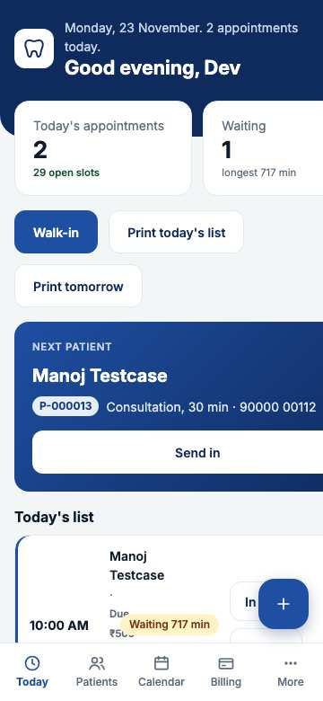

Note: MEASURE Today (receptionist): horizontal scroll=YES (441 > 360); tap targets under 44px=0 `/app`
**3.** New patient form `/app/patients/new`

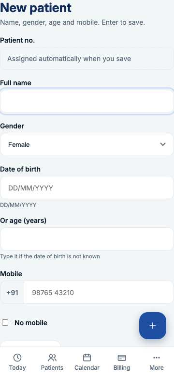

Note: MEASURE New patient (empty): horizontal scroll=no; tap targets under 44px=4 e.g. noMobile 13x13, noticeShown 13x13, smsReminders 13x13 `/app/patients/new`
**5.** Name `/app/patients/new`
**6.** Gender `/app/patients/new`
**7.** Age `/app/patients/new`
**8.** Mobile `/app/patients/new`
**9.** Save patient `/app/patients/new`

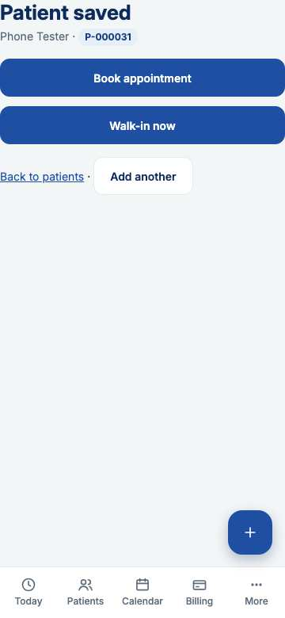

Note: MEASURE Patient saved screen: horizontal scroll=no; tap targets under 44px=1 e.g. Back to patients 106x17 `/app/patients/new`
**11.** Book appointment `/app/appointments?patient=01M84KEH15KNN0BM1M45G18XS4`  
   → dialog open: Book appointment / Phone Tester · P-000031 / Change / Visit type / Choose… / Consultation / Follow-up / Cleani

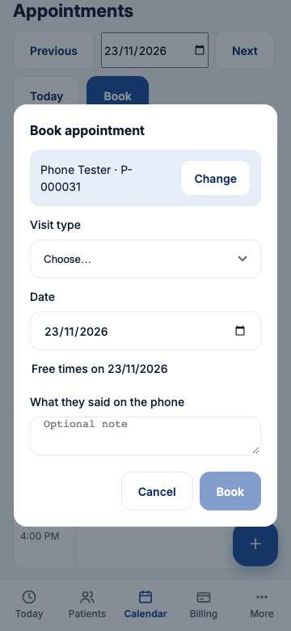

**12.** Consultation `/app/appointments?patient=01M84KEH15KNN0BM1M45G18XS4`  
   → dialog open: Book appointment / Phone Tester · P-000031 / Change / Visit type / Choose… / Consultation / Follow-up / Cleani
**13.** Book dialog with times (phone) `/app/appointments?patient=01M84KEH15KNN0BM1M45G18XS4`  
   → dialog open: Book appointment / Phone Tester · P-000031 / Change / Visit type / Choose… / Consultation / Follow-up / Cleani

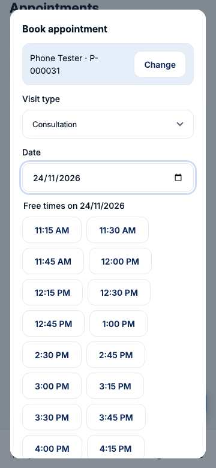

Note: MEASURE Book dialog: horizontal scroll=no; tap targets under 44px=29 e.g. Book at 10:45 AM 241x21, Book at 11:00 AM 241x21, Book at 11:15 AM 241x21 `/app/appointments`
**15.** Pick 11:15 AM `/app/appointments?patient=01M84KEH15KNN0BM1M45G18XS4`  
   → dialog open: Book appointment / Phone Tester · P-000031 / Change / Visit type / Choose… / Consultation / Follow-up / Cleani
**16.** Note `/app/appointments?patient=01M84KEH15KNN0BM1M45G18XS4`  
   → dialog open: Book appointment / Phone Tester · P-000031 / Change / Visit type / Choose… / Consultation / Follow-up / Cleani
**17.** Book `/app/appointments`  
   → toast: Booked for 24/11/2026, 11:15 AM

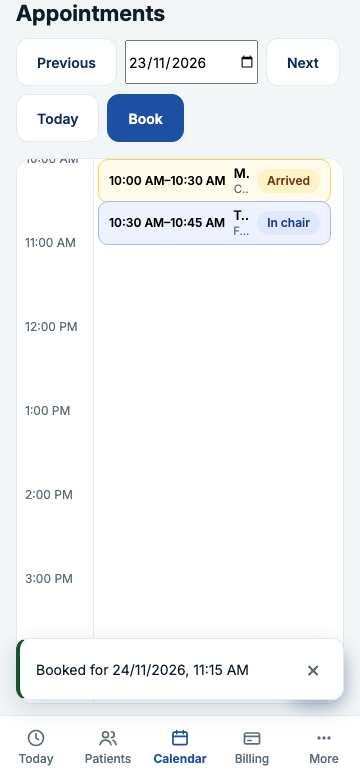

Note: MEASURE Appointments after booking: horizontal scroll=no; tap targets under 44px=29 e.g. Book at 10:45 AM 241x21, Book at 11:00 AM 241x21, Book at 11:15 AM 241x21 `/app/appointments`
**19.** Calendar tomorrow on the phone `/app/appointments?date=2026-11-24`

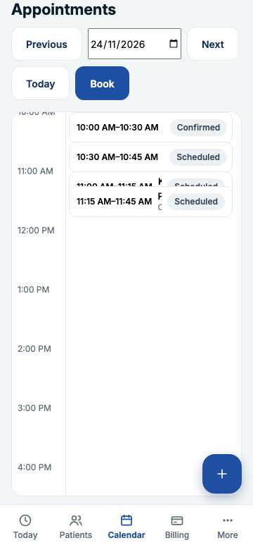

Note: MEASURE Calendar: horizontal scroll=no; tap targets under 44px=26 e.g. Book at 10:45 AM 241x21, Book at 11:45 AM 241x21, Book at 12:00 PM 241x21 `/app/appointments`
**21.** Patients list `/app/patients`

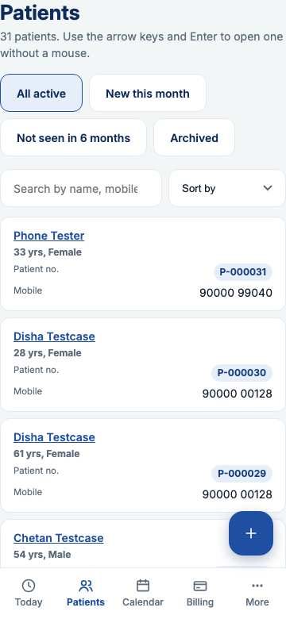

Note: MEASURE Patients list: horizontal scroll=no; tap targets under 44px=25 e.g. Phone Tester 326x21, Disha Testcase 326x21, Disha Testcase 326x21 `/app/patients`
**23.** Search Neha `/app/patients`
**24.** Search result on the phone `/app/patients`

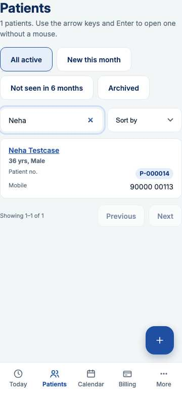

**25.** Open Neha `/app/patients/01M84FVD7HF5AE7M79J4VTRK5M`

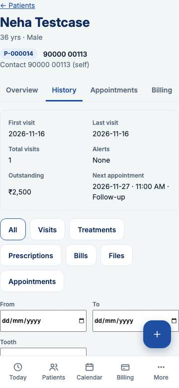

Note: MEASURE Profile (receptionist): horizontal scroll=no; tap targets under 44px=1 e.g. ← Patients 70x17 `/app/patients/01M84FVD7HF5AE7M79J4VTRK5M`
**27.** Billing tab `/app/patients/01M84FVD7HF5AE7M79J4VTRK5M`
Note: MEASURE Billing tab: horizontal scroll=no; tap targets under 44px=3 e.g. ← Patients 70x17, INPUT 13x13, SB-2627-000014 114x17 `/app/patients/01M84FVD7HF5AE7M79J4VTRK5M`
**29.** Amount 500 `/app/patients/01M84FVD7HF5AE7M79J4VTRK5M`
**30.** Record payment `/app/patients/01M84FVD7HF5AE7M79J4VTRK5M`
**31.** After payment on phone `/app/patients/01M84FVD7HF5AE7M79J4VTRK5M`

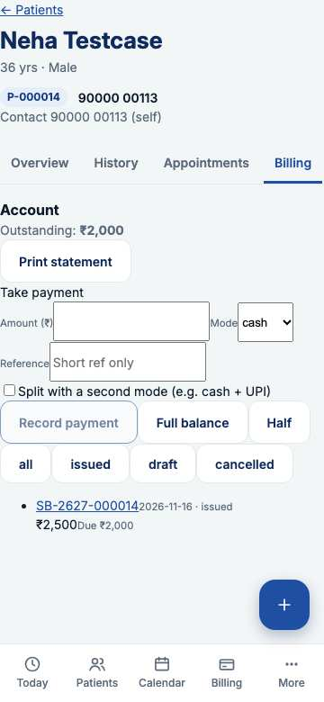

**32.** Billing (dues) `/app/billing`

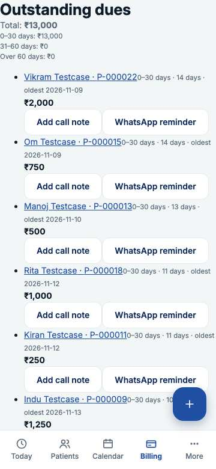

Note: MEASURE Dues list: horizontal scroll=no; tap targets under 44px=12 e.g. Vikram Testcase · P-0000 189x17, Om Testcase · P-000015 162x17, Manoj Testcase · P-00001 180x17 `/app/billing`
**34.** Messages `/app/messages`  
   → toast: Test mode is ON. Nothing is sent by SMS. Use Open WhatsApp to send by hand.

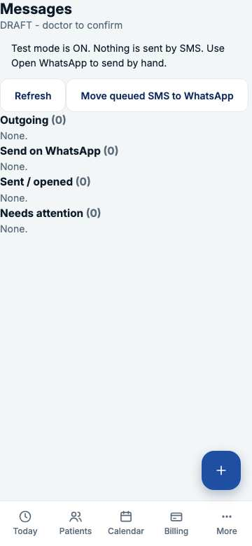

Note: MEASURE Messages: horizontal scroll=no; tap targets under 44px=0 `/app/messages`
**36.** More tab `/app/more`

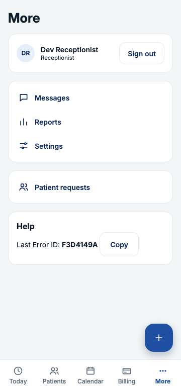

Note: MEASURE More: horizontal scroll=no; tap targets under 44px=0 `/app/more`
**38.** Switch to the doctor (same phone) `/app`

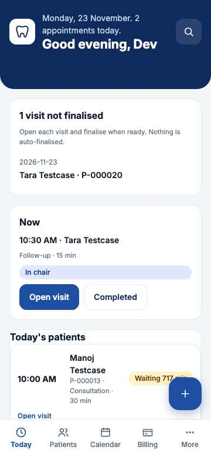

Note: MEASURE Today (doctor): horizontal scroll=no; tap targets under 44px=0 `/app`
**40.** Open visit `/app/visits/01M84FVM8RX59FPGK83NY5Q9YQ`  
   → toast: Saved

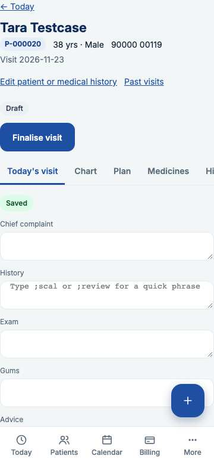

Note: MEASURE Visit: horizontal scroll=no; tap targets under 44px=1 e.g. ← Today 58x17 `/app/visits/01M84FVM8RX59FPGK83NY5Q9YQ`
**42.** Complaint `/app/visits/01M84FVM8RX59FPGK83NY5Q9YQ`  
   → toast: Not saved
**43.** Chart tab `/app/visits/01M84FVM8RX59FPGK83NY5Q9YQ`

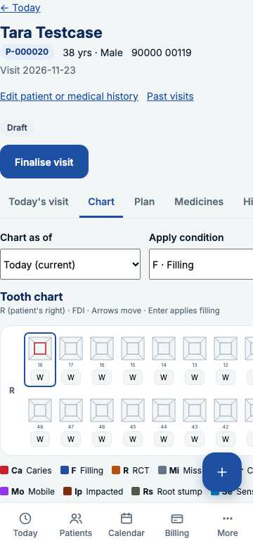

Note: MEASURE Chart tab: horizontal scroll=YES (774 > 360); tap targets under 44px=193 e.g. ← Today 58x17, Tooth 18, permanent, buc 32x8, Tooth 18, permanent, lin 32x8 `/app/visits/01M84FVM8RX59FPGK83NY5Q9YQ`
**45.** Medicines tab `/app/visits/01M84FVM8RX59FPGK83NY5Q9YQ`
Note: MEASURE Medicines tab: horizontal scroll=no; tap targets under 44px=1 e.g. ← Today 58x17 `/app/visits/01M84FVM8RX59FPGK83NY5Q9YQ`
**47.** Reports (doctor) `/app/reports`

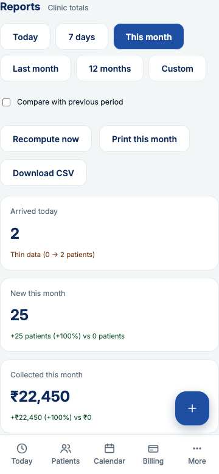

Note: MEASURE Reports: horizontal scroll=no; tap targets under 44px=4 e.g. INPUT 13x13, Outstanding dues over 60 207x17, Incomplete visits 111x17 `/app/reports`
**49.** Settings (doctor) `/app/settings/clinic`

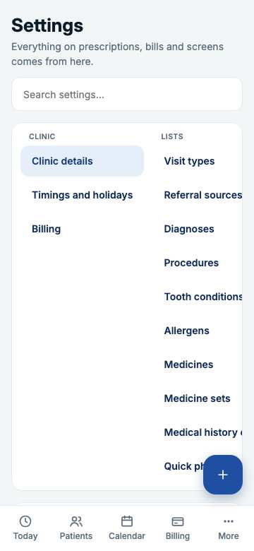

Note: MEASURE Settings: horizontal scroll=no; tap targets under 44px=0 `/app/settings/clinic`

## Gate A re-run (2026-11-24)
Re-run without harness repair after Part 2 and Part 3: passed. Evidence: `GATE-A-f02/`. Summary and what changed: [GATE-A.md](GATE-A.md). The findings above describe the app before Phase Q.
