# F03-tablet-full-day: The same working day on a tablet (768 px)

**Aim:** Repeat the phone day (flow F02) at 768 px, the width of a small tablet or a narrow laptop window, and measure sideways scroll and tap targets on every screen. The project rule requires 768 px to work.

**Who / device:** Receptionist then Doctor, Chromium at 768 x 1024 with touch. Browser: Chromium 768 px. Fake data only.

**Starting state:** Fresh local database. Same steps as F02.

**Result: WORKS except the tooth chart.** At 768 px every screen fits without sideways scroll except the doctor's Chart tab, which is 838 px wide (70 px too wide) and has 193 tap targets of about 35 by 9 px. The receptionist's Today page, which broke on the phone, is fine here. Tap targets on lists are small, as on the phone. The top tab row cut-off seen in the first audit (Reports and Settings off-screen) still applies; this run did not measure it as page overflow because it scrolls inside its own bar.

| Measure | Value |
|---|---|
| Steps recorded | 50 |
| Clicks / key presses to finish | 10 |
| Fields typed or chosen | 9 |
| Distinct pages used | 11 (/app, /app/patients/new, /app/appointments, /app/patients, /app/patients/:id, /app/billing, /app/messages, /app/more, /app/visits/:id, /app/reports, /app/settings/clinic) |
| Calls that would fail for a real user because of bug C1 | 1 (the test harness repaired them so the flow could continue) |
| Failed server calls | none |

## Problems found in this flow

| # | Priority | Step | Problem | Why it matters | Suggested fix |
|---|---|---|---|---|---|
| F3-1 | High | MEASURE note for Chart tab | The Chart tab is 838 px wide at 768 px, so the page scrolls sideways; teeth and the 'W' buttons are about 35 by 9 px. | A dentist using a tablet at the chair cannot tap the right tooth reliably. | Size the chart to the container width (two rows of teeth) with 44 px tap areas; see F2-2. |
| F3-2 | Medium | MEASURE notes for Book dialog, Calendar, Patients list, Dues list | Same small tap targets as on the phone: calendar times 21 px high, patient names 21 px, dues links 17 px, checkboxes 13 px. | Touch rule is 44 px. | Make rows the link; add padding. |
| F3-3 | Medium | - | The top tab row at 768 px is cut off after 'Messages' (Reports and Settings hidden; seen in the first audit, screenshot today/receptionist-tablet.png). | Reports and Settings need a swipe that nothing hints at. | Use the laptop sidebar from 768 px or a 'More' tab. |

## Worked well

- Receptionist Today fits and the buttons are reachable at 768 px.
- New patient, booking, payment, visit notes, medicines, reports, settings all fit.
- No sideways scroll anywhere except the chart.

## Not covered by this run

- Landscape tablet, split-screen windows.
- The visual check of each tablet screenshot (taken, not all reviewed); measurements are the evidence here.

## Step by step (what the user does, and what the screen did)

Evidence labels: every line is [seen] in the browser unless marked otherwise. Screenshots exist only where the screen changed.

**1.** Receptionist on a phone: Today `/app`

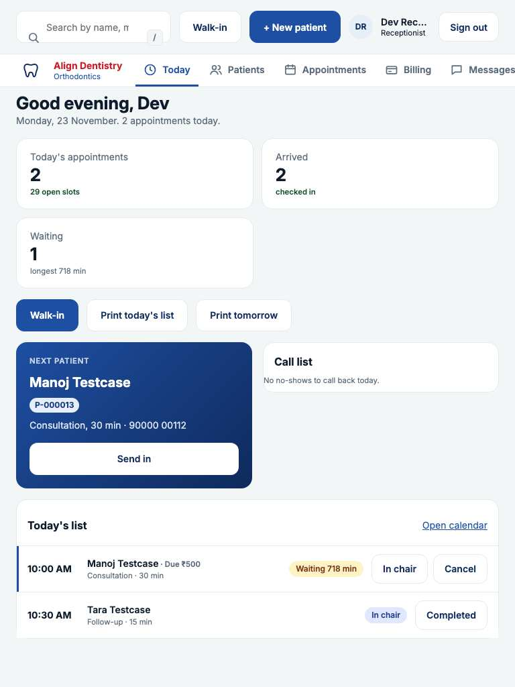

Note: MEASURE Today (receptionist): horizontal scroll=no; tap targets under 44px=0 `/app`
**3.** New patient form `/app/patients/new`

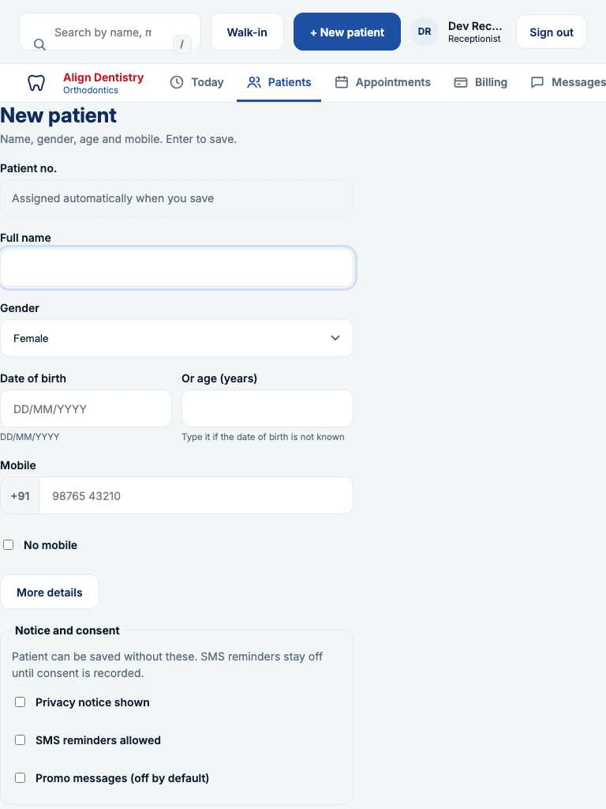

Note: MEASURE New patient (empty): horizontal scroll=no; tap targets under 44px=4 e.g. noMobile 13x13, noticeShown 13x13, smsReminders 13x13 `/app/patients/new`
**5.** Name `/app/patients/new`
**6.** Gender `/app/patients/new`
**7.** Age `/app/patients/new`
**8.** Mobile `/app/patients/new`
**9.** Save patient `/app/patients/new`

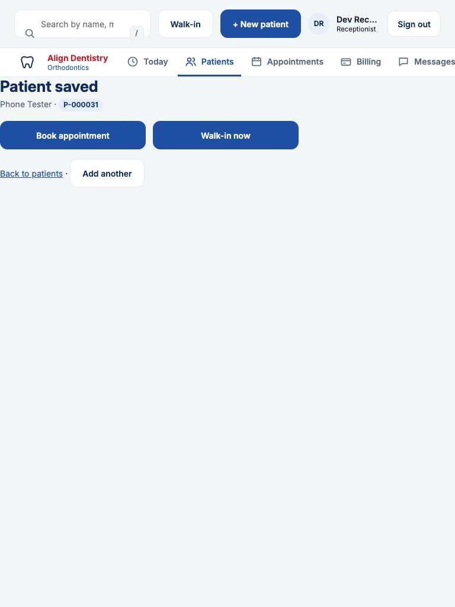

Note: MEASURE Patient saved screen: horizontal scroll=no; tap targets under 44px=1 e.g. Back to patients 106x17 `/app/patients/new`
**11.** Book appointment `/app/appointments?patient=01M84KGTA7G2Q7K593DA6FNP17`  
   → dialog open: Book appointment / Phone Tester · P-000031 / Change / Visit type / Choose… / Consultation / Follow-up / Cleani

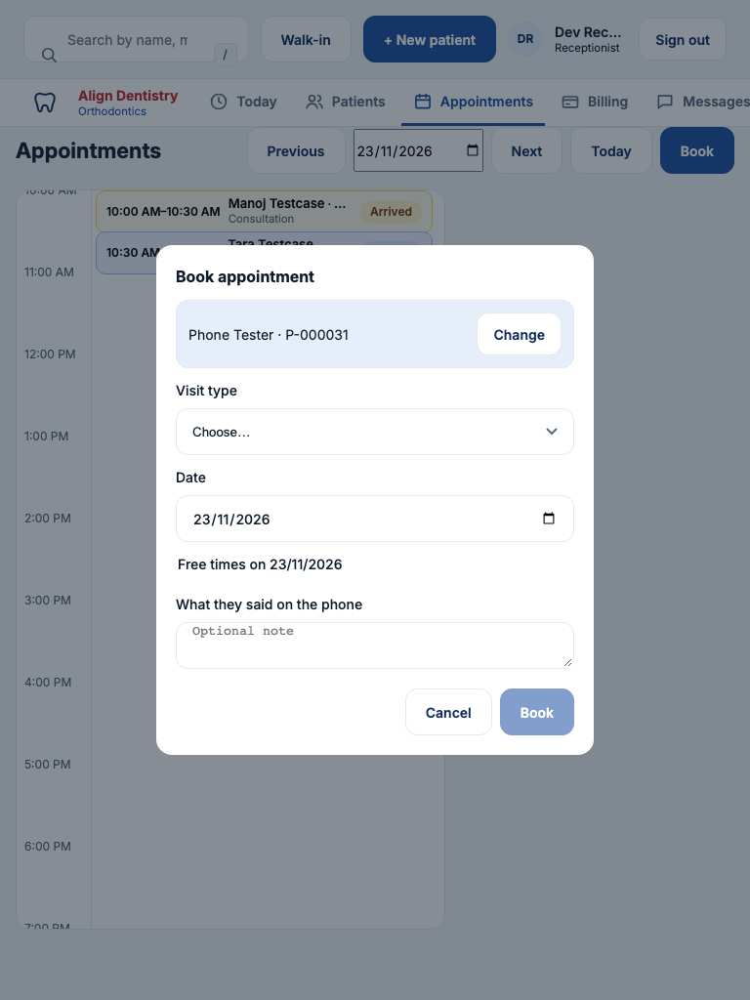

**12.** Consultation `/app/appointments?patient=01M84KGTA7G2Q7K593DA6FNP17`  
   → dialog open: Book appointment / Phone Tester · P-000031 / Change / Visit type / Choose… / Consultation / Follow-up / Cleani
**13.** Book dialog with times (phone) `/app/appointments?patient=01M84KGTA7G2Q7K593DA6FNP17`  
   → dialog open: Book appointment / Phone Tester · P-000031 / Change / Visit type / Choose… / Consultation / Follow-up / Cleani

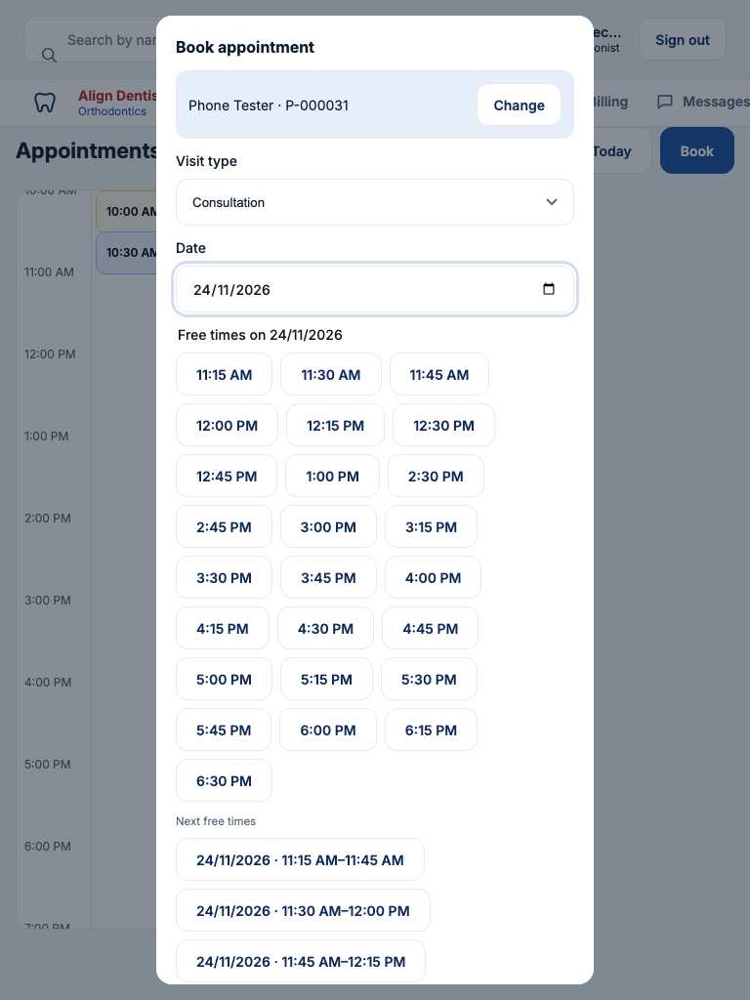

Note: MEASURE Book dialog: horizontal scroll=no; tap targets under 44px=29 e.g. Book at 10:45 AM 353x21, Book at 11:00 AM 353x21, Book at 11:15 AM 353x21 `/app/appointments`
**15.** Pick 11:15 AM `/app/appointments?patient=01M84KGTA7G2Q7K593DA6FNP17`  
   → dialog open: Book appointment / Phone Tester · P-000031 / Change / Visit type / Choose… / Consultation / Follow-up / Cleani
**16.** Note `/app/appointments?patient=01M84KGTA7G2Q7K593DA6FNP17`  
   → dialog open: Book appointment / Phone Tester · P-000031 / Change / Visit type / Choose… / Consultation / Follow-up / Cleani
**17.** Book `/app/appointments`  
   → toast: Booked for 24/11/2026, 11:15 AM

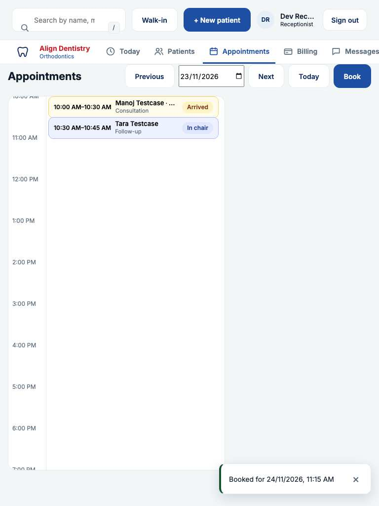

Note: MEASURE Appointments after booking: horizontal scroll=no; tap targets under 44px=29 e.g. Book at 10:45 AM 353x21, Book at 11:00 AM 353x21, Book at 11:15 AM 353x21 `/app/appointments`
**19.** Calendar tomorrow on the phone `/app/appointments?date=2026-11-24`

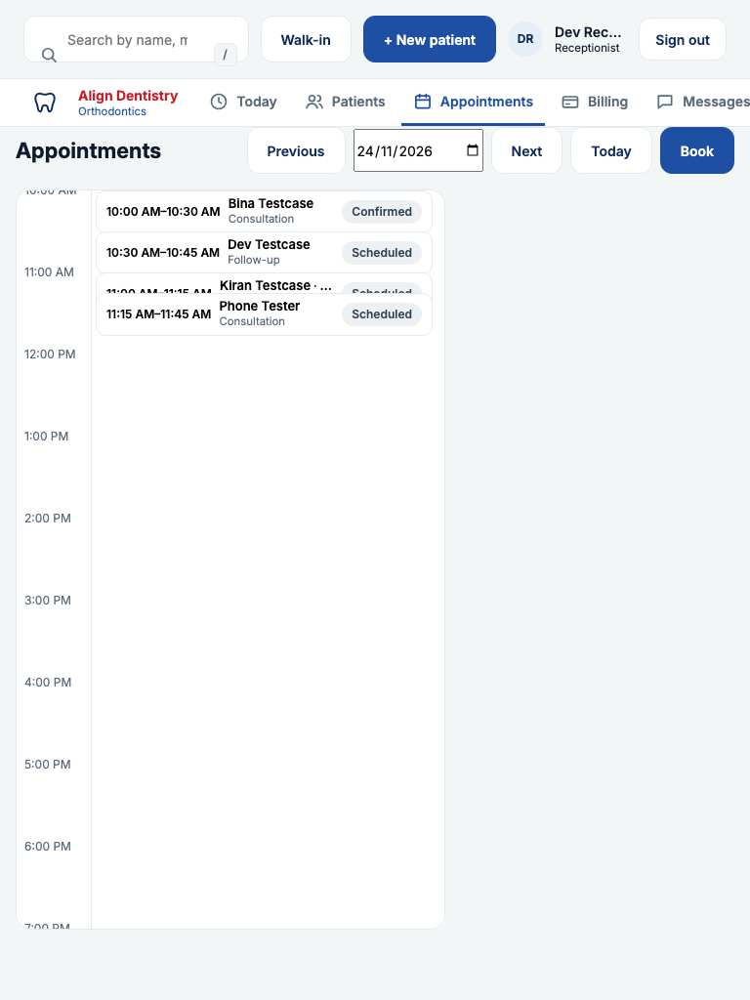

Note: MEASURE Calendar: horizontal scroll=no; tap targets under 44px=26 e.g. Book at 10:45 AM 353x21, Book at 11:45 AM 353x21, Book at 12:00 PM 353x21 `/app/appointments`
**21.** Patients list `/app/patients`

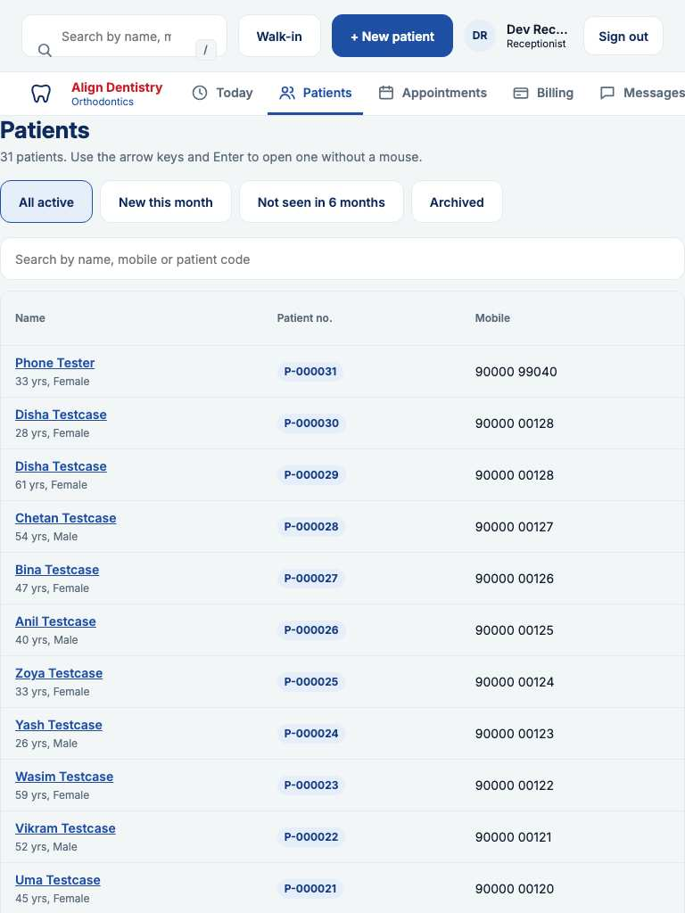

Note: MEASURE Patients list: horizontal scroll=no; tap targets under 44px=25 e.g. Phone Tester 262x21, Disha Testcase 262x21, Disha Testcase 262x21 `/app/patients`
**23.** Search Neha `/app/patients`
**24.** Search result on the phone `/app/patients`

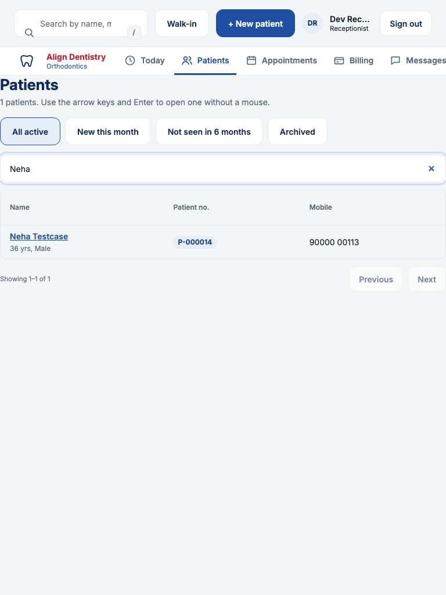

**25.** Open Neha `/app/patients/01M84FVD7HF5AE7M79J4VTRK5M`

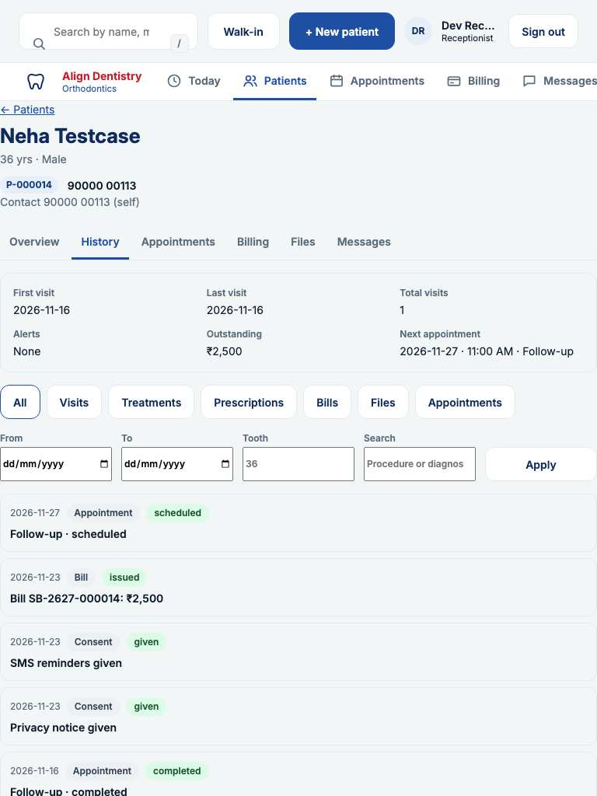

Note: MEASURE Profile (receptionist): horizontal scroll=no; tap targets under 44px=1 e.g. ← Patients 70x17 `/app/patients/01M84FVD7HF5AE7M79J4VTRK5M`
**27.** Billing tab `/app/patients/01M84FVD7HF5AE7M79J4VTRK5M`
Note: MEASURE Billing tab: horizontal scroll=no; tap targets under 44px=3 e.g. ← Patients 70x17, INPUT 13x13, SB-2627-000014 114x17 `/app/patients/01M84FVD7HF5AE7M79J4VTRK5M`
**29.** Amount 500 `/app/patients/01M84FVD7HF5AE7M79J4VTRK5M`
**30.** Record payment `/app/patients/01M84FVD7HF5AE7M79J4VTRK5M`
**31.** After payment on phone `/app/patients/01M84FVD7HF5AE7M79J4VTRK5M`

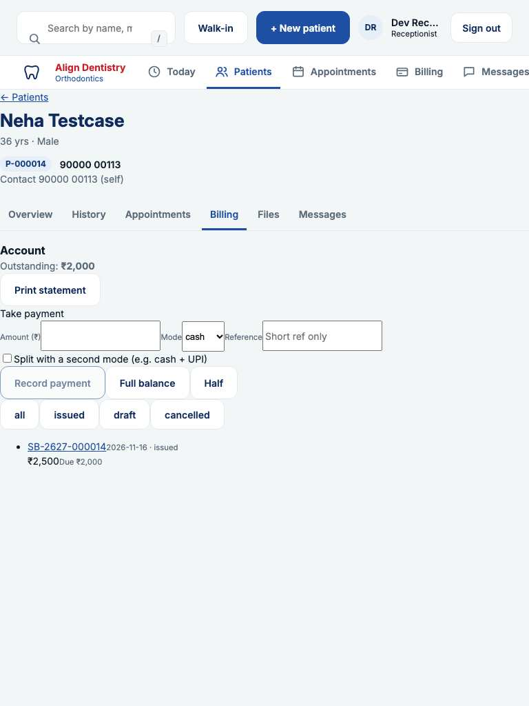

**32.** Billing (dues) `/app/billing`

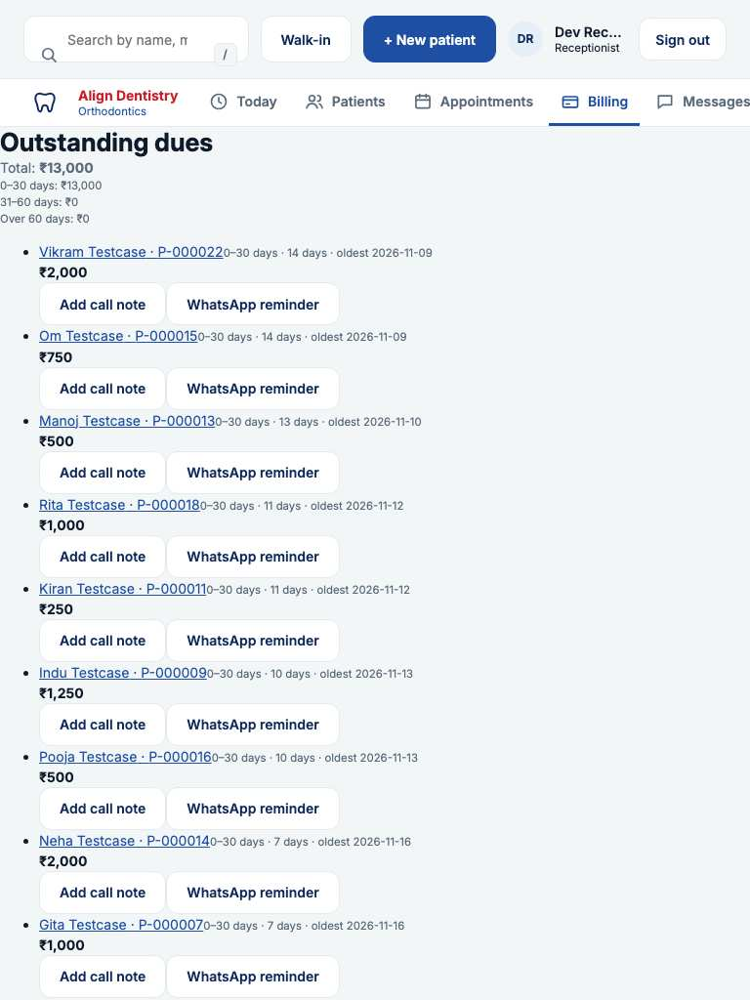

Note: MEASURE Dues list: horizontal scroll=no; tap targets under 44px=12 e.g. Vikram Testcase · P-0000 189x17, Om Testcase · P-000015 162x17, Manoj Testcase · P-00001 180x17 `/app/billing`
**34.** Messages `/app/messages`  
   → toast: Test mode is ON. Nothing is sent by SMS. Use Open WhatsApp to send by hand.

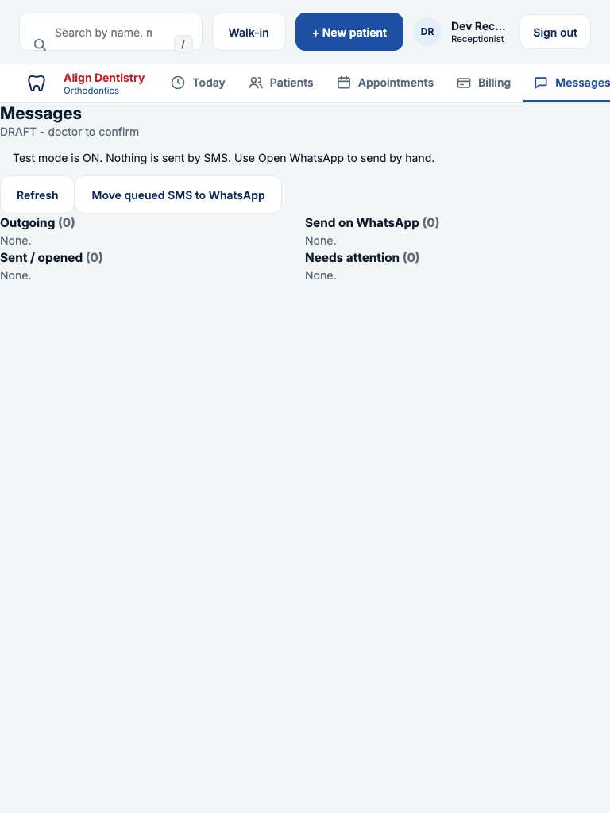

Note: MEASURE Messages: horizontal scroll=no; tap targets under 44px=0 `/app/messages`
**36.** More tab `/app/more`

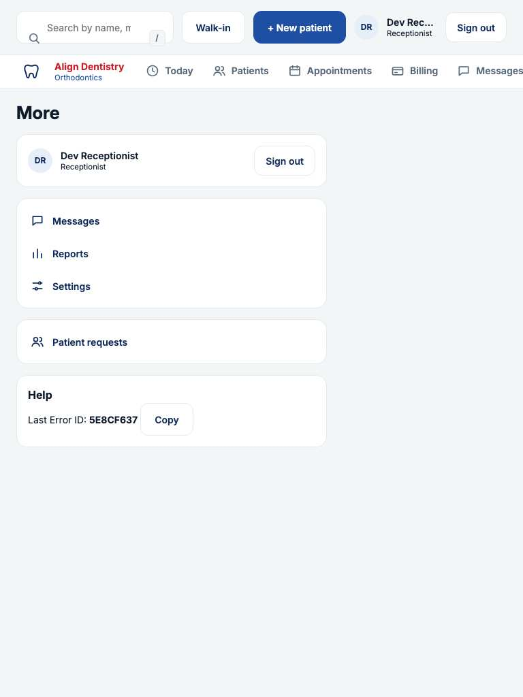

Note: MEASURE More: horizontal scroll=no; tap targets under 44px=0 `/app/more`
**38.** Switch to the doctor (same phone) `/app`

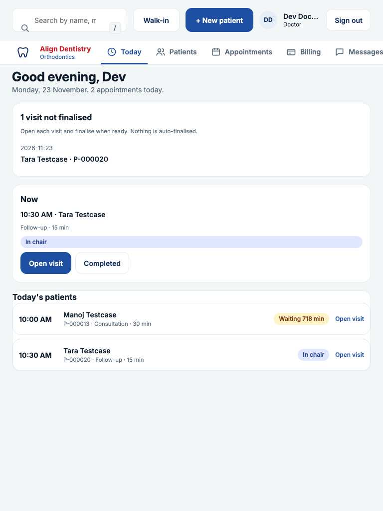

Note: MEASURE Today (doctor): horizontal scroll=no; tap targets under 44px=0 `/app`
**40.** Open visit `/app/visits/01M84FVM8RX59FPGK83NY5Q9YQ`  
   → toast: Saved

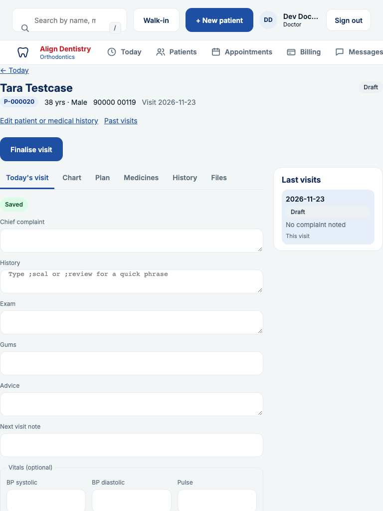

Note: MEASURE Visit: horizontal scroll=no; tap targets under 44px=1 e.g. ← Today 58x17 `/app/visits/01M84FVM8RX59FPGK83NY5Q9YQ`
**42.** Complaint `/app/visits/01M84FVM8RX59FPGK83NY5Q9YQ`  
   → toast: Not saved
**43.** Chart tab `/app/visits/01M84FVM8RX59FPGK83NY5Q9YQ`

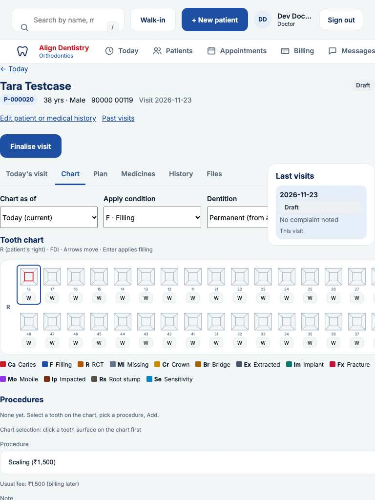

Note: MEASURE Chart tab: horizontal scroll=YES (838 > 768); tap targets under 44px=193 e.g. ← Today 58x17, Tooth 18, permanent, buc 35x9, Tooth 18, permanent, lin 35x9 `/app/visits/01M84FVM8RX59FPGK83NY5Q9YQ`
**45.** Medicines tab `/app/visits/01M84FVM8RX59FPGK83NY5Q9YQ`
Note: MEASURE Medicines tab: horizontal scroll=no; tap targets under 44px=1 e.g. ← Today 58x17 `/app/visits/01M84FVM8RX59FPGK83NY5Q9YQ`
**47.** Reports (doctor) `/app/reports`

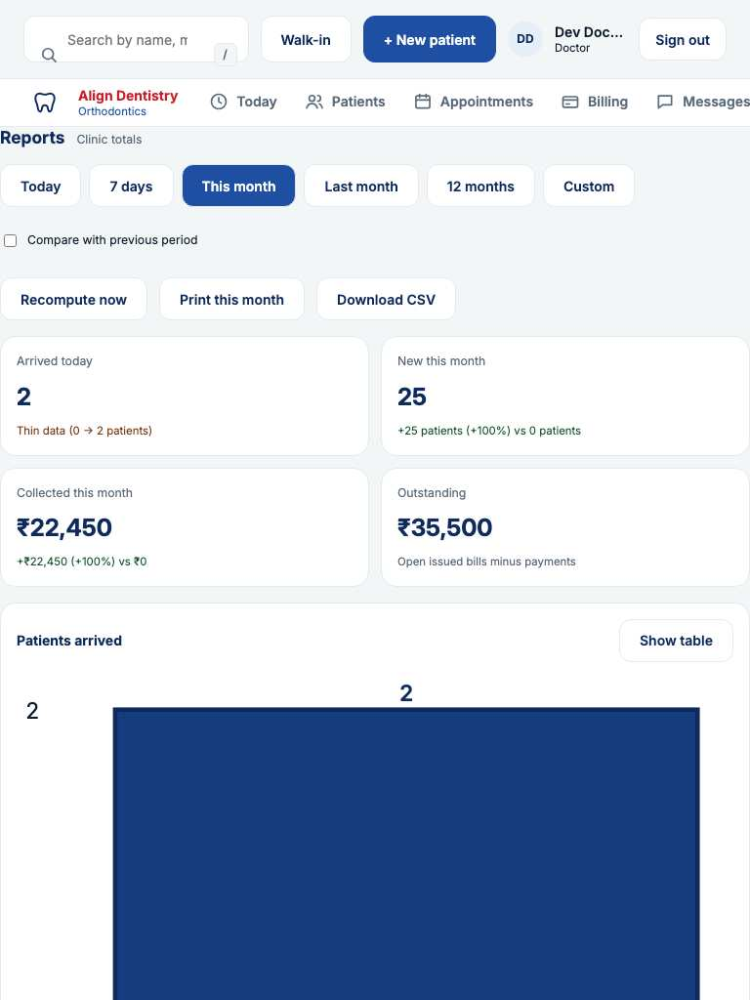

Note: MEASURE Reports: horizontal scroll=no; tap targets under 44px=4 e.g. INPUT 13x13, Outstanding dues over 60 207x17, Incomplete visits 111x17 `/app/reports`
**49.** Settings (doctor) `/app/settings/clinic`

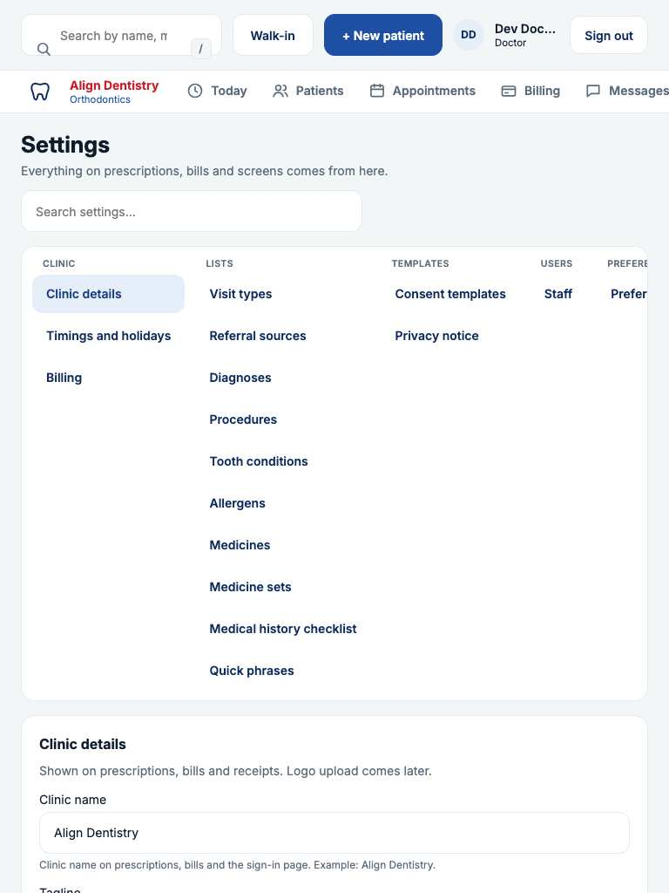

Note: MEASURE Settings: horizontal scroll=no; tap targets under 44px=0 `/app/settings/clinic`
