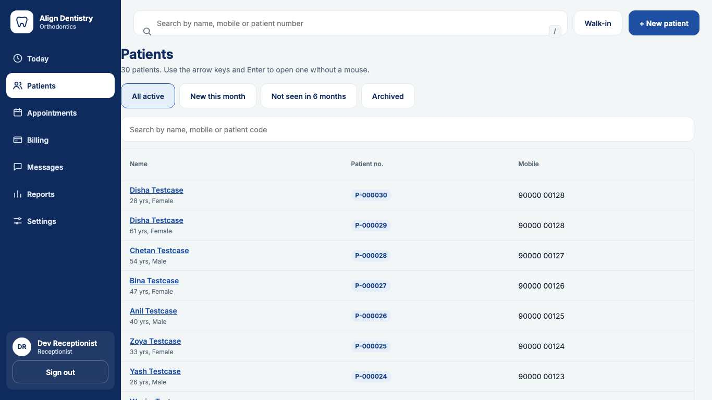
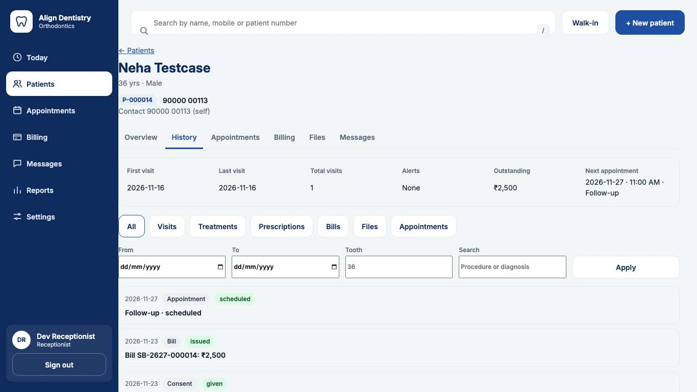
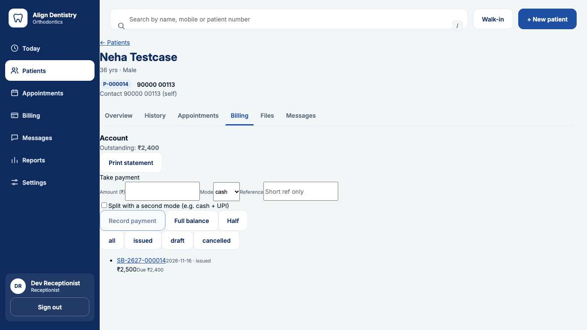
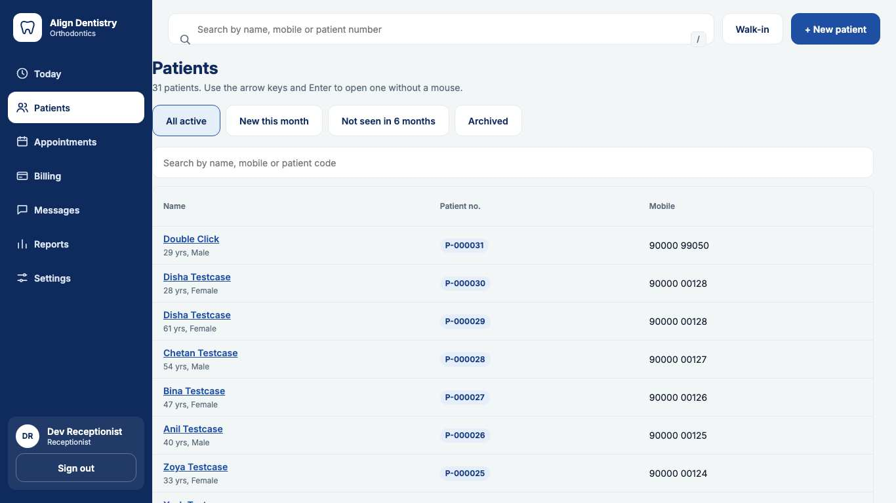
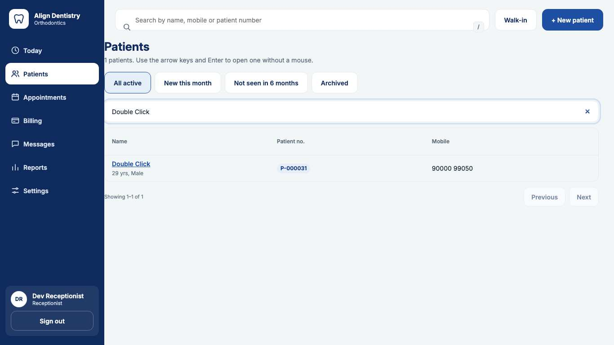
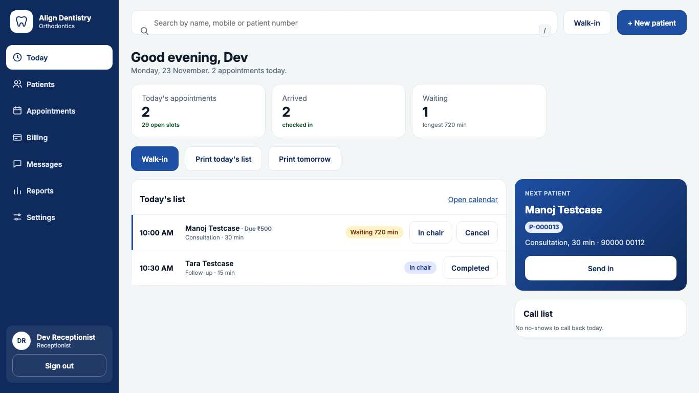
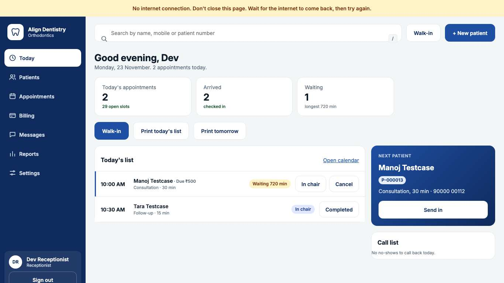
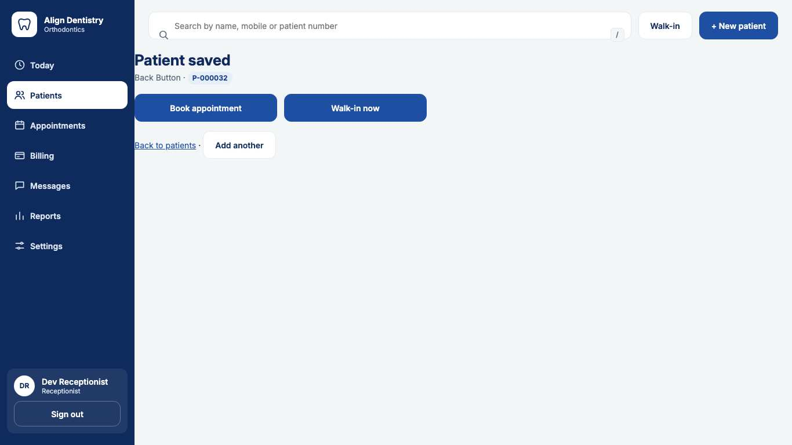
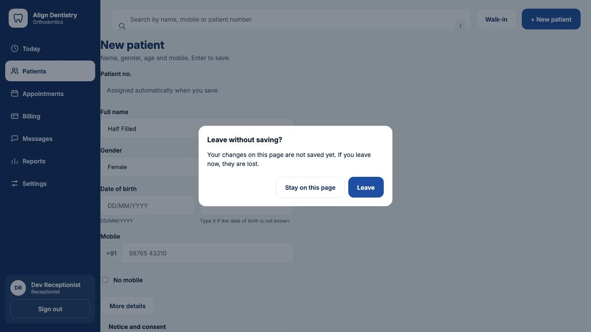

# F04-double-click-offline-back-and-reload: Real-life slips: double click, internet drops, Back button, leaving a half-filled form

**Aim:** Check what protects the clinic from everyday mistakes: a nervous double click on Record payment and on Save patient (could create two payments or two patients), the clinic's internet dropping, the browser Back button after saving, and leaving a half-filled form by clicking another menu item.

**Who / device:** Receptionist, laptop. Browser: Chromium 1366 px. Fake data only.

**Starting state:** Fresh local database. Neha Testcase owes ₹2,500.

**Result: WORKS (best protected area of the app).** A double click on Record payment recorded one payment (₹2,500 to ₹2,400, not ₹2,300) and a double click on Save patient created one patient. An offline banner appears with a plain sentence. Leaving a half-filled form asks 'Leave without saving?'. The weak spot is what the screens do while offline: the sidebar click did nothing and the page stayed blank apart from the banner.

| Measure | Value |
|---|---|
| Steps recorded | 37 |
| Clicks / key presses to finish | 5 |
| Fields typed or chosen | 11 |
| Distinct pages used | 5 (/app/patients, /app/patients/:id, /app/patients/new, /app, /) |
| Calls that would fail for a real user because of bug C1 | 0 (the test harness repaired them so the flow could continue) |
| Failed server calls | none |

## Problems found in this flow

| # | Priority | Step | Problem | Why it matters | Suggested fix |
|---|---|---|---|---|---|
| F4-1 | Medium | 20-23 | While offline, clicking another menu item (Patients) does nothing visible and the Patients page content is empty; only the banner explains why. | The user keeps clicking and may not link the empty screen to the banner. Typed work on the current page is safe, but nothing says that. | Keep the current screen and add 'Your work on this page is kept' to the banner; disable actions that need the server. |
| F4-2 | Low | 32 | After saving a new patient and pressing the browser Back button the user lands on Today (/app), not on the empty New patient form or the patient list. No harm, but it was not obvious that the 'Patient saved' screen has no Back step. | Mild surprise. | None needed; consider a link to the new patient's profile (see G01 P10). |

## Worked well

- Double click on Record payment: only one ₹100 payment recorded (Outstanding ₹2,400).
- Double click on Save patient: one patient created.
- Offline banner: 'No internet connection. Don't close this page. Wait for the internet to come back, then try again.' and it goes away when the connection returns.
- Half-filled form + menu click: dialog 'Leave without saving? Your changes on this page are not saved yet. If you leave now, they are lost.' with 'Stay on this page' and 'Leave'.

## Not covered by this run

- Double click on Book appointment, Issue bill, Finalise (these also need duplicate protection).
- Reload of the visit page while typing before the autosave ran (blocked by C1 in a real browser).
- Session expiry in the middle of a form.
- Submitting while offline and then reconnecting.

## Step by step (what the user does, and what the screen did)

Evidence labels: every line is [seen] in the browser unless marked otherwise. Screenshots exist only where the screen changed.

**1.** CASE 1: a nervous double click on Record payment `/app/patients`

**2.** Open Neha (owes ₹2,500) `/app/patients/01M84FVD7HF5AE7M79J4VTRK5M`

**3.** Billing tab `/app/patients/01M84FVD7HF5AE7M79J4VTRK5M`
**4.** Amount 100 `/app/patients/01M84FVD7HF5AE7M79J4VTRK5M`
Note: Before: Outstanding: ₹2,500 `/app/patients/01M84FVD7HF5AE7M79J4VTRK5M`
Note: After a double click on Record payment of ₹100: Outstanding: ₹2,400 (one payment = ₹2,400, two = ₹2,300) `/app/patients/01M84FVD7HF5AE7M79J4VTRK5M`
**7.** After the double click `/app/patients/01M84FVD7HF5AE7M79J4VTRK5M`

**8.** CASE 2: double click on Save patient `/app/patients/new`

**9.** Name `/app/patients/new`
**10.** Gender `/app/patients/new`
**11.** Age `/app/patients/new`
**12.** Mobile `/app/patients/new`
**13.** Patients list: how many 'Double Click' patients exist now? `/app/patients`

**14.** Search `/app/patients`
Note: Patients named Double Click after one double click on Save: 1 `/app/patients`
**16.** Search result `/app/patients`

**17.** CASE 3: the clinic's internet drops `/app`

**18.** Offline: is there a banner? `/app`  
   → error shown: No internet connection. Don't close this page. Wait for the internet to come back, then try again.

Note: Banner text: No internet connection. Don't close this page. Wait for the internet to come back, then try again. `/app`
Note: Navigation failed while offline (expected: single-page app may still work) `/app`
Note: Click failed `/`
**22.** Patients list while offline `/`

Note: Patients page offline shows: `/`
**24.** Back online `/`

**25.** CASE 4: Back button right after saving a patient `/app/patients/new`

**26.** Name `/app/patients/new`
**27.** Gender `/app/patients/new`
**28.** Age `/app/patients/new`
**29.** Mobile `/app/patients/new`
**30.** Save patient `/app/patients/new`

**31.** After pressing the browser Back button on the 'Patient saved' screen `/app`

Note: Back button leads to: http://localhost:8787/app / form is n/a `/app`
**33.** CASE 5: half-filled new patient form, then click another menu item `/app/patients/new`

**34.** Name `/app/patients/new`
**35.** Click Billing in the sidebar with a half-filled form `/app/patients/new`  
   → dialog open: Leave without saving? / Your changes on this page are not saved yet. If you leave now, they are lost. / Stay o

Note: After leaving a half-filled form: url http://localhost:8787/app/patients/new; dialog: Leave without saving? / Your changes on this page are not saved yet. If you leave now, they are lost. / Stay on this page / Leave `/app/patients/new`
**37.** What happened to the half-filled form? `/app/patients/new`  
   → dialog open: Leave without saving? / Your changes on this page are not saved yet. If you leave now, they are lost. / Stay o

