# G01-first-patient-lifecycle: A brand-new patient from first phone call to first payment

**Aim:** Follow one new patient through the whole clinic the way a real day goes: receptionist registers and books the patient, the clinic day happens (arrive, chair, doctor writes the visit, chart, procedure, diagnosis, prescription, finalise), the bill is made, and the receptionist takes the money. Find every place where the user has to guess where to go, where the screens do not connect, and where something breaks.

**Who / device:** Receptionist (register, book, walk-in, payment), then Doctor (visit, bill), then Receptionist again. Browser: Chromium 1366 px. Fake data only.

**Starting state:** Fresh local database with 30 fake patients, 3 appointments today. The test clock is 8:45 PM on Mon 23 Nov 2026, after clinic hours, so every slot today has passed. Because of this the 'arrival' part uses an emergency walk-in instead of tomorrow's booking (the server clock cannot be moved). The flow runner repairs bug C1 (double-encoded request bodies) so later steps can be reached.

**Result: BROKEN at two points, CONFUSING in several.** The chain can be finished only because the test harness repairs bug C1 (otherwise the doctor cannot even open the visit). Inside the visit the prescription cannot be issued (new bug C3), yet Finalise still goes through with no warning. The receptionist can register, book and take money in few clicks, but nothing tells her the visit is ready to bill, no receipt is offered after taking money, and 'Full balance' records money in one click with no confirm.

| Measure | Value |
|---|---|
| Steps recorded | 61 |
| Clicks / key presses to finish | 30 |
| Fields typed or chosen | 14 |
| Distinct pages used | 8 (/app, /app/patients/new, /app/appointments, /app/messages, /app/visits/:id, /app/bills/:id, /app/patients/:id, /app/print/statement/:id) |
| Calls that would fail for a real user because of bug C1 | 9 (the test harness repaired them so the flow could continue) |
| Failed server calls | 400 /api/staff/appointments/walk-in; 409 /api/staff/prescriptions/01M84GBPKWMS5ZQXGE6HQPN00E/issue |

## Problems found in this flow

| # | Priority | Step | Problem | Why it matters | Suggested fix |
|---|---|---|---|---|---|
| C1 | Critical | 28-44 | Opening the visit, autosaving notes, adding procedure, adding diagnosis, adding medicine and finalising go through API files that double-encode the body (9 calls in this flow). | A real doctor gets 'Invalid input: expected object, received string' at the first click (see AUDIT.md C1). | Pass plain objects to api() in the six feature api.ts files. |
| C3 (new) | Critical | 40-41 | Clicking Issue on the prescription always fails: 'Someone else changed this record while you were editing. Reload...' although nobody else was there. Cause: onIssue saves advice first (version goes up), then issues with the old version still held in memory. Reloading does not help; the same two calls repeat. | The doctor can never issue a prescription. The message blames another person, so the doctor will reload and retry in vain. | Use the version returned by the save (or skip the save when nothing changed) before calling issue. Add a browser test: add a medicine, press Issue. |
| P1 | High | 42-43 | Finalise is allowed with an unissued prescription and the dialog does not mention it. | The visit locks with a draft prescription, so the patient may leave without a printable prescription. | Add 'Prescription not issued' to the Finalise warnings. |
| P2 | High | 47 | After the doctor finalises, the receptionist's Today still shows Riya as 'In chair' with a 'Completed' button. The only cue that money is due is a small grey 'Due ₹1,500' next to the name. There is no 'Bill' or 'Take payment' action on the row. | The receptionist has to remember to search the patient and open the Billing tab. This is the busiest hand-off in the clinic. | When a visit is finalised show 'Ready to bill' on the row with a Take payment button (mockup S01 has Bill/Finish buttons). |
| P3 | High | 53-54 | After 'Record payment' the balance changes, but there is no toast, no receipt number and no Print receipt button. The Billing tab lists the bill (still 'issued') but no payments. The receipt numbers (SR-2627-000019/20) only appear on the printed statement and in History. | A patient who pays at the desk gets no paper receipt unless the receptionist knows to open History or the statement. | After payment show a toast 'Payment ₹500 recorded. Receipt SR-... [Print]' and list payments under the bill. |
| P4 | High | 58-59 | 'Full balance' (and 'Half') record the payment immediately when clicked: no amount check, no confirm, mode defaults to cash. The form then disappears. | A mis-click records ₹1,000 of cash that was not received. Payments cannot be edited, only reversed (RUN_PROMPT). | Make Full balance and Half fill the Amount field only; the user presses Record payment. |
| P5 | Medium | 44-45 | Draft bill screen is unstyled: bullets, bare inputs, the mixed labels, 'Cancel bill' next to 'Issue bill', and the internal text 'gst_mode off — DRAFT accountant'. A bill is created as a draft and must be issued with a separate click. | Looks unfinished on the most important money screen. Extra step with no explanation of why a draft exists. | Rebuild to mockup S09; create the bill as issued when the doctor finalises, or explain Draft. |
| P6 | Medium | 33 | On the Chart tab 'Scaling' is pre-selected in the Procedure list, so pressing Add procedure after clicking a tooth silently adds a ₹1,500 billable item. | Accidental billable items. The flow author did it without choosing. | Start on 'Choose procedure' and keep Add disabled until chosen. |
| P7 | Medium | 16 | After booking with 'SMS reminders allowed' ticked, Messages stays empty (all four lists show 'None'). No confirm message was created or queued. | The user cannot tell whether the patient will get a confirmation. Possibly created later by the cron job (not checked in this flow, see H-flows). | Show 'Confirmation will be created at <time>' on the booking toast or create it at booking. |
| P8 | Medium | 25 | Today says '29 open slots' while the walk-in dialog says 'No free slot left today for a walk-in'. The count includes slots that have already passed. | Two numbers on the same page disagree. | Count only slots from now until closing time. |
| P9 | Medium | 61 | The patient's 'Next appointment' strip shows today's 8:45 PM walk-in (already in the chair) instead of tomorrow's booked 11:15 AM consultation. Raw dates (2026-11-24) and 'scheduled' in a green chip in the feed. | Misleading summary; the receptionist cannot confirm the booking at a glance. | Next appointment = the next one that has not started. |
| P10 | Low | 9 | The 'Patient saved' screen shows two equal blue primary buttons (Book appointment, Walk-in now) and has no link to open the new patient's profile; 'Back to patients' goes to the list. | One main button per screen is the design rule; the user must search to open the profile they just created. | Add 'Open patient' as the third option. |
| P11 | Medium | - | Whole chain costs 30 clicks, 14 typed fields and 8 different screens, including searching for the same patient twice and switching tabs 5 times in the visit. | Slow for a 100-200 patients a month clinic. | See AUDIT.md H6 (one-screen visit) and P2/P3 above. |

## Worked well

- Registering a patient needs only name, gender, age and mobile (6 typed fields, 2 ticks); errors in the form are plain sentences.
- After saving, the screen offers the next step (Book appointment / Walk-in now) and the booking dialog already has the patient filled in.
- Booking: pick type, date, a time chip; a toast says 'Booked for 24/11/2026, 11:15 AM' and the calendar opens on that date.
- Walk-in after hours is refused with a clear sentence, and the Emergency tick lets it through.
- Top-bar search: type 'Riya', press Enter, the profile opens. Result rows show age, last 4 digits of the mobile, and patient number.
- The patient History feed lists the payments and the booking, so the record is traceable.
- Tooth chart, procedure add, diagnosis add and medicine search-and-Enter are fast once the visit is open.

## Not covered by this run

- Real arrival of tomorrow's booking (clock cannot be moved).
- Second visit and follow-up (flow G02).
- Consent form, estimate, treatment plan, certificate.
- Printing the prescription (it could not be issued) and a real receipt print.
- Whether Messages get a confirm message later via the cron job (flow H1).

## Step by step (what the user does, and what the screen did)

Evidence labels: every line is [seen] in the browser unless marked otherwise. Screenshots exist only where the screen changed.

**1.** Receptionist starts on Today `/app`

**2.** Click + New patient in the top bar `/app/patients/new`

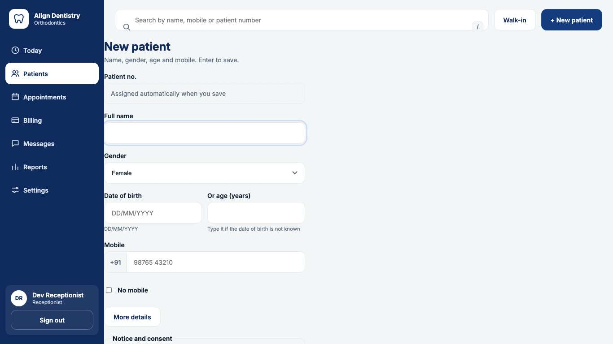

**3.** Type the name `/app/patients/new`
**4.** Choose gender `/app/patients/new`
**5.** Type age (date of birth not known) `/app/patients/new`
**6.** Type mobile number `/app/patients/new`
**7.** Tick Privacy notice shown `/app/patients/new`
**8.** Tick SMS reminders allowed `/app/patients/new`
**9.** Click Save patient (result: Patient saved screen) `/app/patients/new`

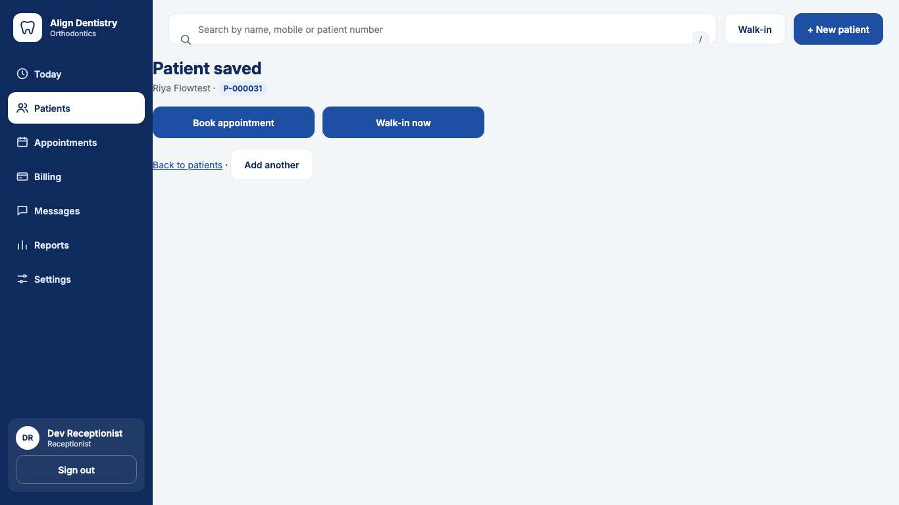

**10.** Click Book appointment on the saved screen `/app/appointments?patient=01M84GB5HZY9TR4FQ554V00AR5`  
   → dialog open: Book appointment / Riya Flowtest · P-000031 / Change / Visit type / Choose… / Consultation / Follow-up / Clean

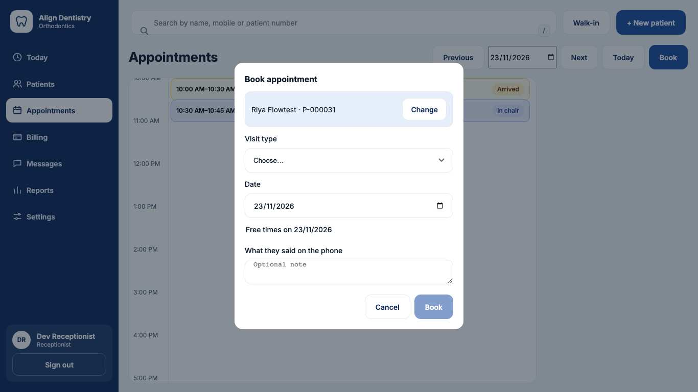

**11.** Choose visit type Consultation `/app/appointments?patient=01M84GB5HZY9TR4FQ554V00AR5`  
   → dialog open: Book appointment / Riya Flowtest · P-000031 / Change / Visit type / Choose… / Consultation / Follow-up / Clean
**12.** Date set to tomorrow: free times appear `/app/appointments?patient=01M84GB5HZY9TR4FQ554V00AR5`  
   → dialog open: Book appointment / Riya Flowtest · P-000031 / Change / Visit type / Choose… / Consultation / Follow-up / Clean

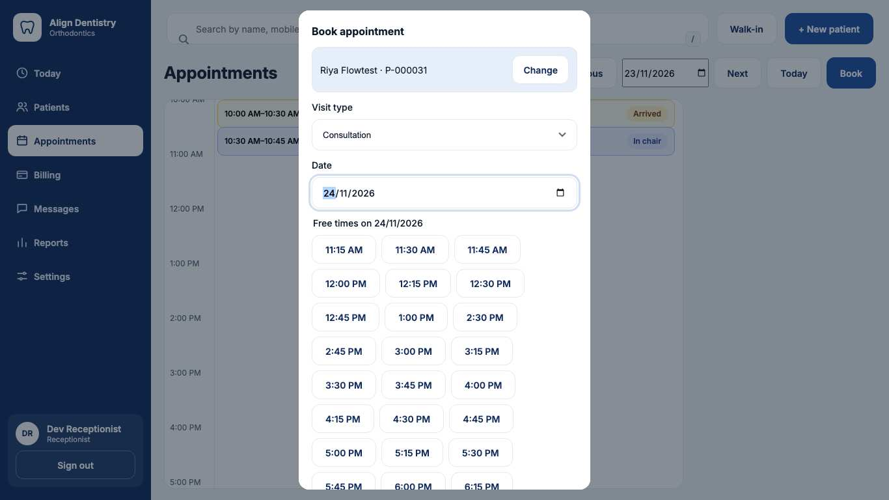

**13.** Pick the 11:15 AM time `/app/appointments?patient=01M84GB5HZY9TR4FQ554V00AR5`  
   → dialog open: Book appointment / Riya Flowtest · P-000031 / Change / Visit type / Choose… / Consultation / Follow-up / Clean
**14.** Type the phone note `/app/appointments?patient=01M84GB5HZY9TR4FQ554V00AR5`  
   → dialog open: Book appointment / Riya Flowtest · P-000031 / Change / Visit type / Choose… / Consultation / Follow-up / Clean
**15.** Click Book (result: toast, calendar opens on that date) `/app/appointments`  
   → toast: Booked for 24/11/2026, 11:15 AM

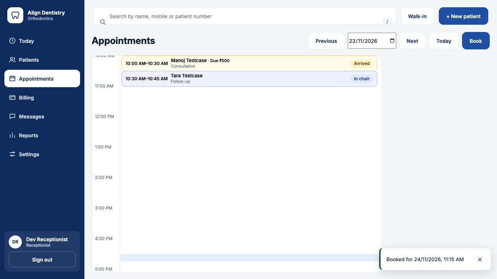

**16.** Open Messages to look for the confirm message `/app/messages`  
   → toast: Test mode is ON. Nothing is sent by SMS. Use Open WhatsApp to send by hand.

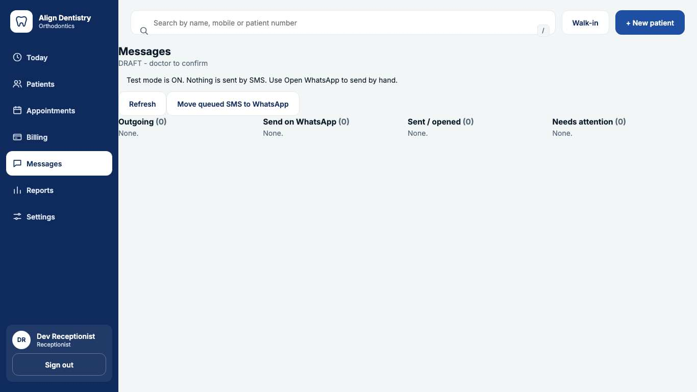

**17.** Back on Today. Tomorrow's booking is not in today's list `/app`

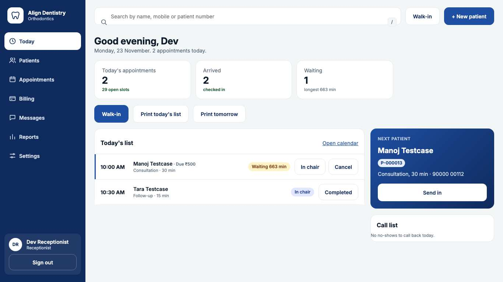

**18.** Click Walk-in on Today `/app`  
   → dialog open: Walk-in / Patient / Visit type / Choose… / Consultation / Follow-up / Cleaning / RCT sitting / Extraction / Or

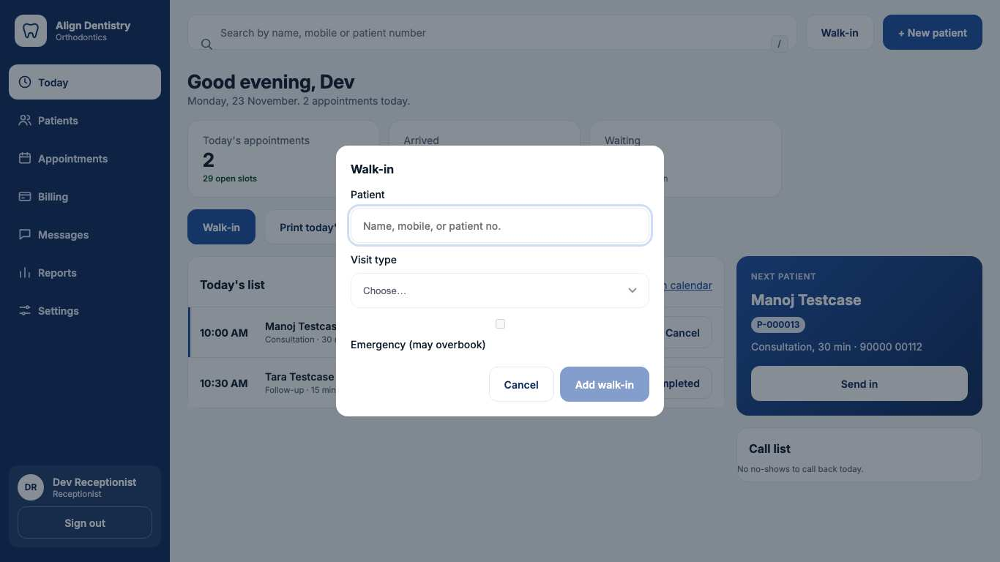

**19.** Type patient name `/app`  
   → dialog open: Walk-in / Patient / Riya Flowtest / P-000031 / Visit type / Choose… / Consultation / Follow-up / Cleaning / RC
**20.** Pick the patient from the list `/app`  
   → dialog open: Walk-in / Riya Flowtest · P-000031 / Change / Visit type / Choose… / Consultation / Follow-up / Cleaning / RCT

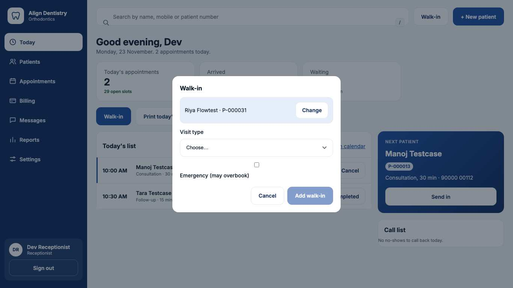

**21.** Choose Consultation `/app`  
   → dialog open: Walk-in / Riya Flowtest · P-000031 / Change / Visit type / Choose… / Consultation / Follow-up / Cleaning / RCT
**22.** Click Add walk-in (no free slot today, so expect an error) `/app`  
   → error shown: No free slot left today for a walk-in. Try a later booking, or mark as emergency.; dialog open: Walk-in / Riya Flowtest · P-000031 / Change / Visit type / Choose… / Consultation / Follow-up / Cleaning / RCT; server replied: 400 /api/staff/appointments/walk-in

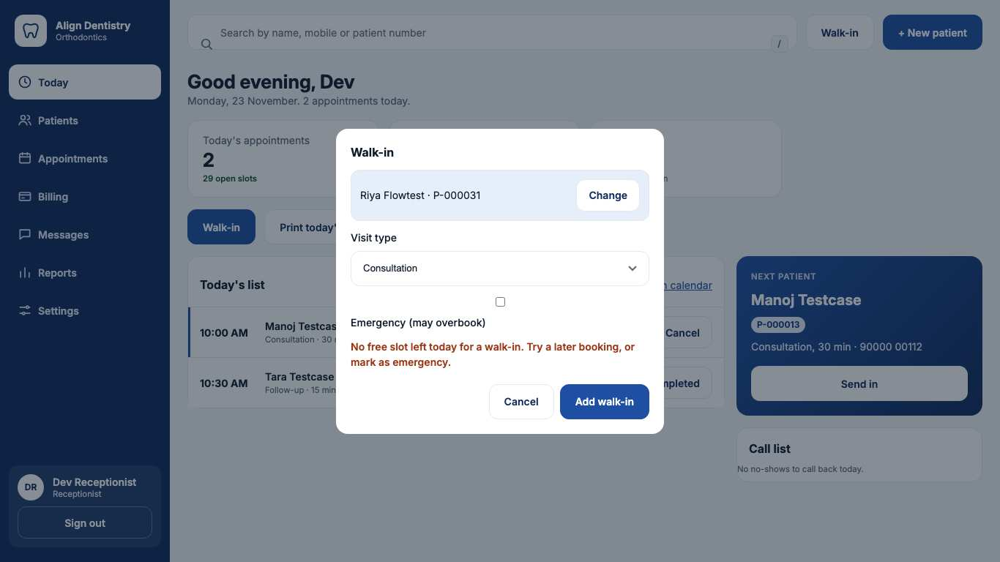

**23.** Tick Emergency (may overbook) `/app`  
   → error shown: No free slot left today for a walk-in. Try a later booking, or mark as emergency.; dialog open: Walk-in / Riya Flowtest · P-000031 / Change / Visit type / Choose… / Consultation / Follow-up / Cleaning / RCT
**24.** Click Add walk-in again with Emergency ticked `/app`

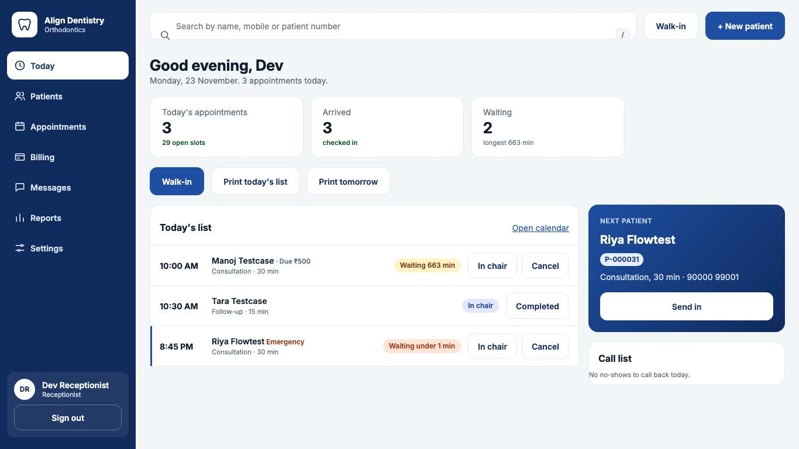

**25.** Today list after the walk-in `/app`

**26.** Click In chair on Riya's row `/app`
**27.** Switch to the doctor `/app`
**28.** Doctor clicks Open visit on Riya's row `/app/visits/01M84GBGMAR3895J2HM7R2M9WZ`  
   → toast: Saved

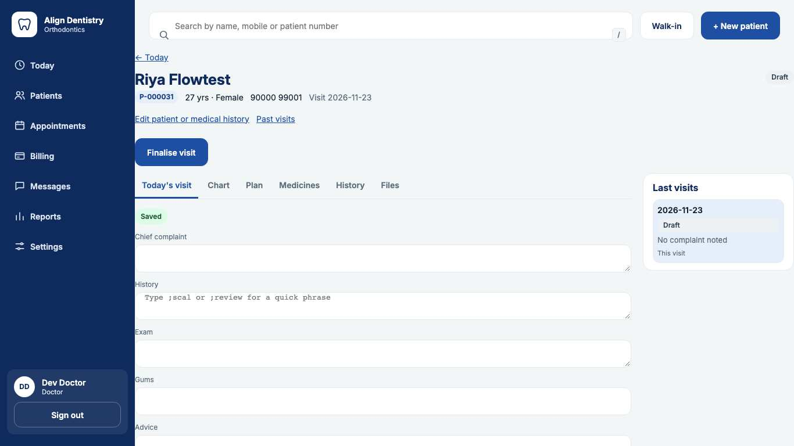

**29.** Type chief complaint `/app/visits/01M84GBGMAR3895J2HM7R2M9WZ`  
   → toast: Not saved
**30.** Type exam `/app/visits/01M84GBGMAR3895J2HM7R2M9WZ`  
   → toast: Not saved
**31.** Open the Chart tab `/app/visits/01M84GBGMAR3895J2HM7R2M9WZ`

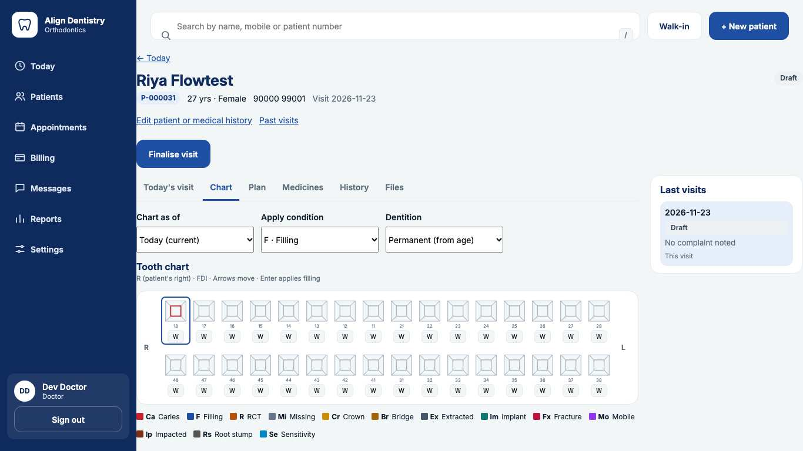

**32.** Click tooth 36 on the chart `/app/visits/01M84GBGMAR3895J2HM7R2M9WZ`
**33.** Click Add procedure (Scaling is pre-selected) `/app/visits/01M84GBGMAR3895J2HM7R2M9WZ`
**34.** Back to the first tab to add a diagnosis `/app/visits/01M84GBGMAR3895J2HM7R2M9WZ`  
   → toast: Saved

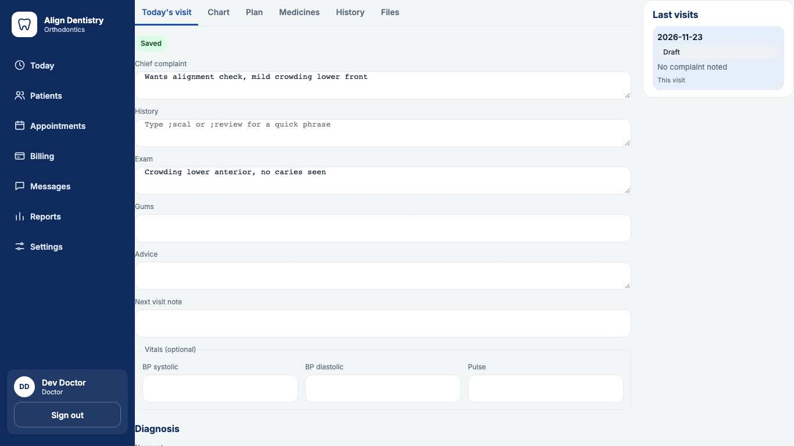

**35.** Type diagnosis `/app/visits/01M84GBGMAR3895J2HM7R2M9WZ`  
   → toast: Saved
**36.** Click Add (diagnosis) `/app/visits/01M84GBGMAR3895J2HM7R2M9WZ`  
   → toast: Saved
**37.** Open the Medicines tab `/app/visits/01M84GBGMAR3895J2HM7R2M9WZ`

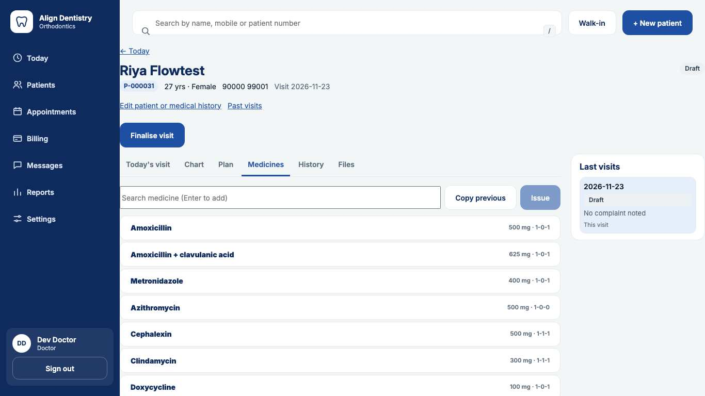

**38.** Search Amox `/app/visits/01M84GBGMAR3895J2HM7R2M9WZ`
**39.** Press Enter to add Amoxicillin `/app/visits/01M84GBGMAR3895J2HM7R2M9WZ`
**40.** Click Issue (prescription) `/app/visits/01M84GBGMAR3895J2HM7R2M9WZ`  
   → error shown: Someone else changed this record while you were editing. Reload to see the latest version, then make your change again.; server replied: 409 /api/staff/prescriptions/01M84GBPKWMS5ZQXGE6HQPN00E/issue

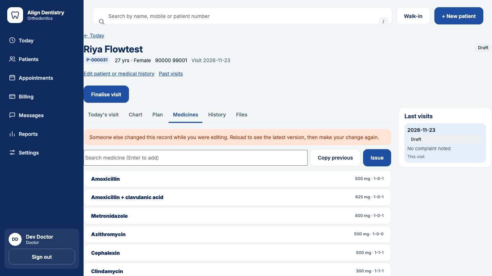

**41.** After Issue: error shown `/app/visits/01M84GBGMAR3895J2HM7R2M9WZ`  
   → error shown: Someone else changed this record while you were editing. Reload to see the latest version, then make your change again.

**42.** Click Finalise visit `/app/visits/01M84GBGMAR3895J2HM7R2M9WZ`  
   → error shown: Someone else changed this record while you were editing. Reload to see the latest version, then make your change again.; dialog open: Finalise this visit? / After finalise, notes become read-only. Warnings: Procedures were added. Check the trea

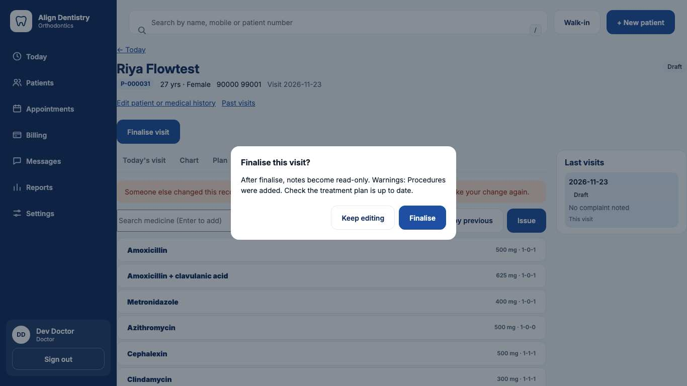

**43.** Confirm Finalise in the dialog `/app/visits/01M84GBGMAR3895J2HM7R2M9WZ`  
   → error shown: Someone else changed this record while you were editing. Reload to see the latest version, then make your change again.

**44.** Click Create bill `/app/bills/01M84GBRKMBASGN08NZ4S6SAEX`

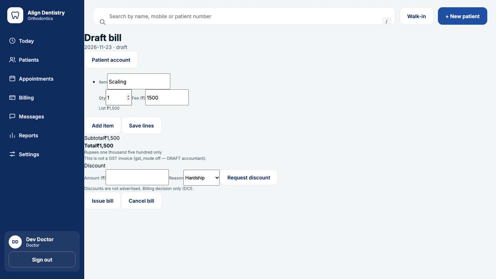

**45.** Click Issue bill (bill is a draft until issued) `/app/bills/01M84GBRKMBASGN08NZ4S6SAEX`

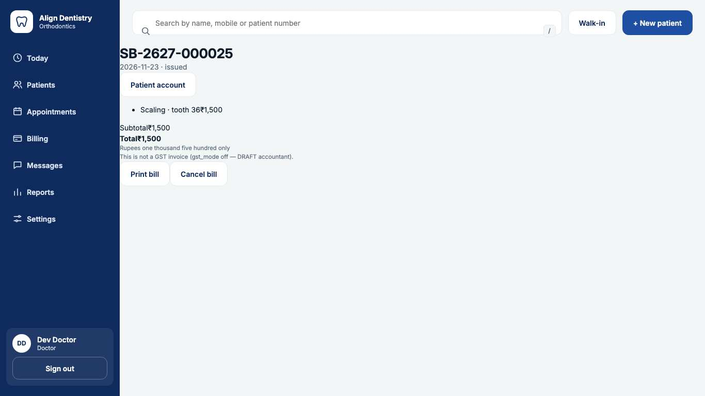

**46.** Switch to the receptionist to take payment `/app`

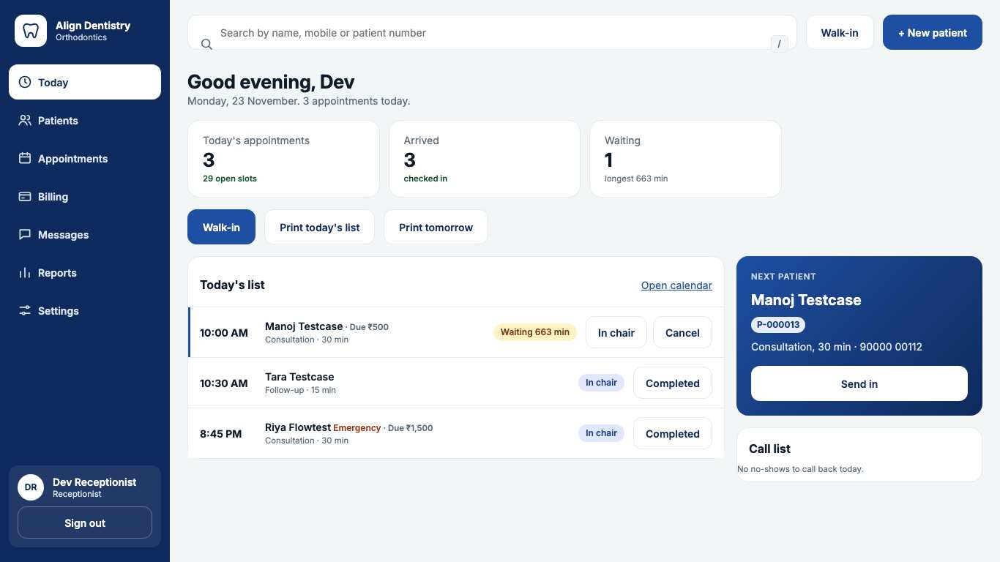

**47.** Receptionist Today after the doctor finalised: is there a cue that Riya is ready to bill? `/app`

**48.** Search Riya in the top bar `/app`
**49.** Search results dropdown `/app`

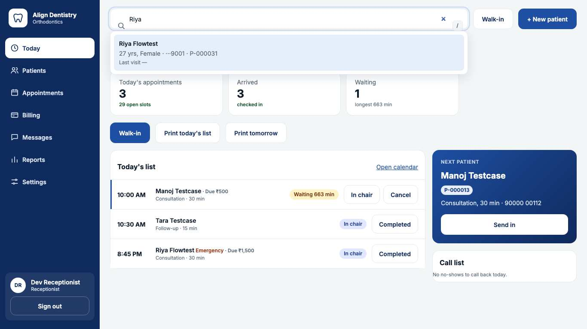

**50.** Press Enter on the first result `/app/patients/01M84GB5HZY9TR4FQ554V00AR5`

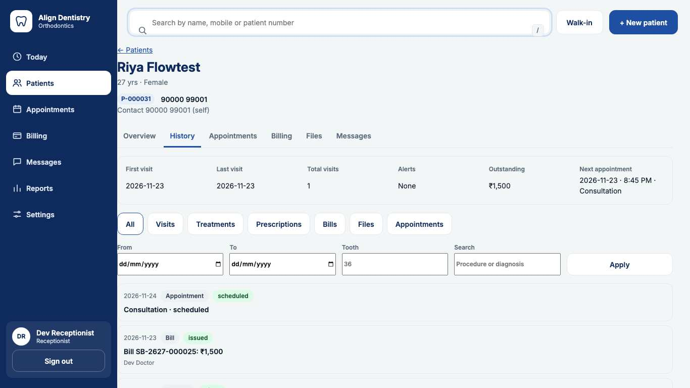

**51.** Open the Billing tab of Riya `/app/patients/01M84GB5HZY9TR4FQ554V00AR5`
**52.** Type amount 500 `/app/patients/01M84GB5HZY9TR4FQ554V00AR5`
**53.** Click Record payment `/app/patients/01M84GB5HZY9TR4FQ554V00AR5`
**54.** After Record payment: balance changed, is there a toast or receipt? `/app/patients/01M84GB5HZY9TR4FQ554V00AR5`

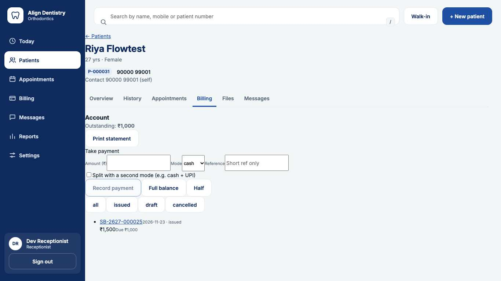

**55.** Open the bill to look for a receipt `/app/bills/01M84GBRKMBASGN08NZ4S6SAEX`

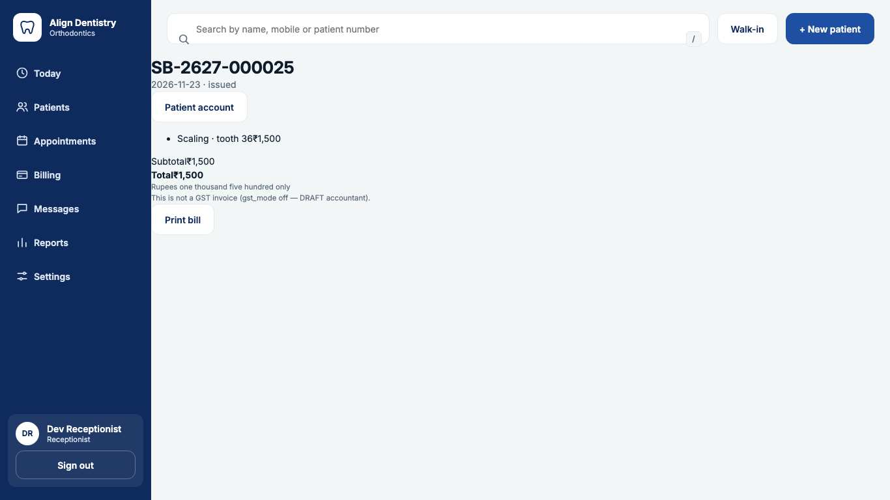

**56.** Go back to the patient profile (the bill page has no link back to the patient except Patient account) `/app/patients/01M84GB5HZY9TR4FQ554V00AR5`

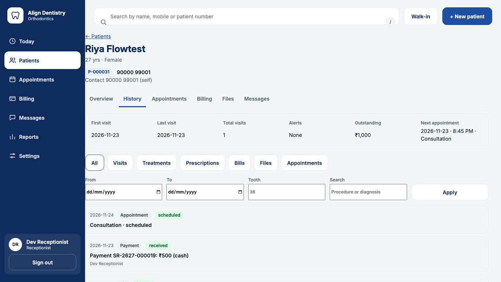

**57.** Billing tab again `/app/patients/01M84GB5HZY9TR4FQ554V00AR5`
**58.** Click Full balance (it records the payment straight away, no confirm) `/app/patients/01M84GB5HZY9TR4FQ554V00AR5`
**59.** After Full balance: form gone, bill still says issued `/app/patients/01M84GB5HZY9TR4FQ554V00AR5`

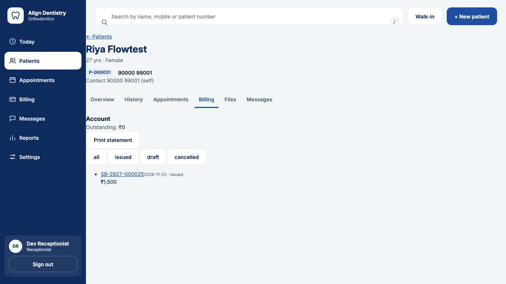

**60.** Open the patient statement print page `/app/print/statement/01M84GB5HZY9TR4FQ554V00AR5`

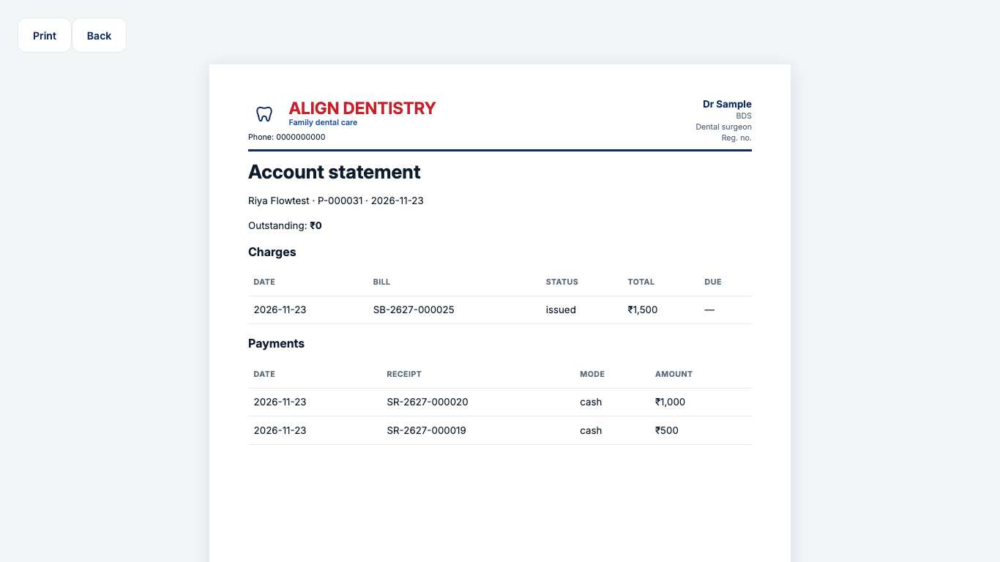

**61.** Open the patient profile (History tab) to see what the record looks like now `/app/patients/01M84GB5HZY9TR4FQ554V00AR5`

## Gate A re-run (2026-11-24)
Re-run without harness repair after Part 2 and Part 3: passed. Evidence: `GATE-A-g01/`. Summary and what changed: [GATE-A.md](GATE-A.md). The findings above describe the app before Phase Q.
