# G02-returning-patient-second-visit: A returning patient: second visit, new bill, paying old and new dues together

**Aim:** Check what the doctor and receptionist see when the patient already has history and money due. Can the doctor see the earlier visit while writing the new one? Does the new bill add to the old balance clearly? When the patient pays one amount that covers the old bill and part of the new one, does the screen show where the money went?

**Who / device:** Doctor (open patient, New visit, procedure, finalise, create and issue bill), then Receptionist (dues list, take payment). Browser: Chromium 1366 px. Fake data only.

**Starting state:** Fresh local database. Patient Neha Testcase (P-000014) already has one finalised visit from 16 Nov and an issued bill SB-2627-000014 of ₹2,500 fully unpaid. No appointment today, so the doctor starts the visit from the patient's profile.

**Result: WORKS, but CONFUSING about money.** Starting a second visit from the profile is quick (3 clicks) and the doctor sees the old visit in a side card and in the History tab with the outstanding amount. The new bill is created and issued, the dues total goes up correctly (₹13,500 to ₹16,000). Paying ₹3,000 settles the older bill first and leaves ₹2,000 on the newer one, but nothing on screen says so: there is no payment list, no reference shown, no receipt. The visit side card and the chart do not reflect the earlier visit's findings.

| Measure | Value |
|---|---|
| Steps recorded | 30 |
| Clicks / key presses to finish | 13 |
| Fields typed or chosen | 5 |
| Distinct pages used | 6 (/app/patients, /app/patients/:id, /app/visits/:id, /app/bills/:id, /app, /app/billing) |
| Calls that would fail for a real user because of bug C1 | 4 (the test harness repaired them so the flow could continue) |
| Failed server calls | none |

## Problems found in this flow

| # | Priority | Step | Problem | Why it matters | Suggested fix |
|---|---|---|---|---|---|
| G2-1 | High | 29-30 | After paying ₹3,000 (UPI, reference UPI123456) the Billing tab only shows: Outstanding ₹2,000, bill SB-...25 'Due ₹2,000' and bill SB-...14 with no due. The payment itself, the reference, the allocation (old bill first) and the receipt are not shown anywhere on the tab. | The receptionist cannot explain to the patient how the money was applied or hand a receipt. A wrong amount cannot be spotted. | Under the bills list add 'Payments': date, amount, mode, reference, receipt number with Print, and 'applied to SB-14 ₹2,500, SB-25 ₹500'. |
| G2-2 | Medium | 29-30 | The Mode drop-down keeps the last choice (UPI) after a payment. The next payment starts as UPI, not cash. | Cash is the most common mode; a silent carry-over leads to the wrong mode on the next patient's payment if the form is reused (it resets only on reload). | Reset the form after each payment, default to the clinic's most used mode (cash). |
| G2-3 | Medium | 5, 8 | The 'Last visits' side card says 'No complaint noted' for the draft although a complaint was typed, and it stays like that. (Same stale card seen in G01 after finalising.) | The doctor cannot trust the card that is meant to show the visit history. | Refresh the card when the visit saves. |
| G2-4 | Medium | 10 | The tooth chart for the returning patient is blank. The previous visit has a diagnosis on tooth 16 but nothing is marked on the chart. (The seed data stores that as a diagnosis, not a chart event, so this may be a data artefact.) | Doctors expect the chart to carry the history of treated teeth. Not verified with real chart events. | Re-check with a patient whose earlier visit had chart conditions (flow G3, later). |
| G2-5 | Low | 8 | Inside the visit, the History tab opens the full patient history with filter boxes (From, To, Tooth, Search, Apply). Raw dates (2026-11-27) and a green 'scheduled' chip. | Too heavy for a quick look at 'what did we do last time'. | Show the last 3 visits as short cards above the form. |
| C1 | Critical | 4-18 | 4 calls in this flow are the double-encoded ones (open visit, autosave, procedure, diagnosis or finalise). | Same bug as G01; with C1 a real doctor cannot do this flow at all. | See AUDIT.md C1. |

## Worked well

- Starting a visit without an appointment is possible from the patient profile (New visit) and takes 3 clicks.
- The side card shows the previous visit with its complaint summary; the History tab shows the first visit, last visit, total visits, alerts, outstanding amount and the next appointment (2026-11-27 11:00 AM Follow-up).
- Finalise without a prescription works and goes straight to Create bill and Issue bill.
- Dues list on Billing shows the new total correctly (₹16,000).

## Not covered by this run

- A visit with a prescription (blocked by C3).
- Which bill a later payment is applied to if the older bill is not the first (only one order tested).
- Whether the doctor can see the dues amount on purpose (the History tab shows it).

## Step by step (what the user does, and what the screen did)

Evidence labels: every line is [seen] in the browser unless marked otherwise. Screenshots exist only where the screen changed.

**1.** Doctor opens the Patients list `/app/patients`

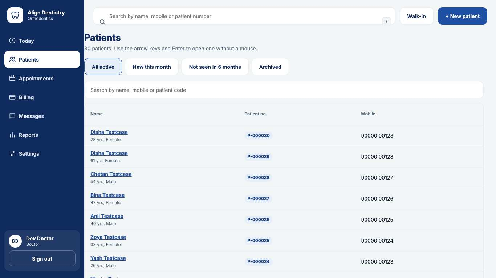

**2.** Open Neha Testcase (old finalised visit, ₹2,500 still due) `/app/patients/01M84FVD7HF5AE7M79J4VTRK5M`

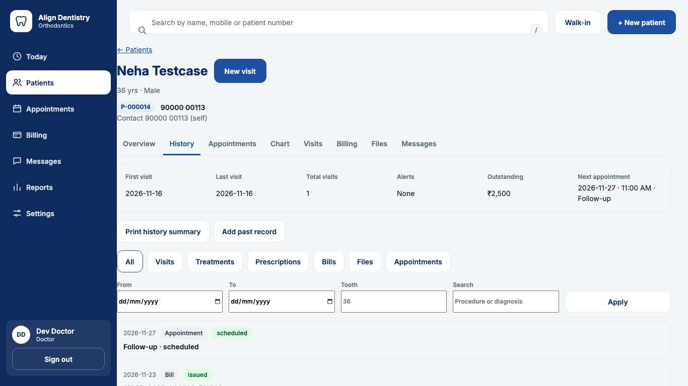

**3.** Profile of a returning patient: what does the doctor see first? `/app/patients/01M84FVD7HF5AE7M79J4VTRK5M`

**4.** Click New visit (no appointment today) `/app/visits/01M84GW0W6SQTRWW1NMRF8QFRV`  
   → toast: Saved

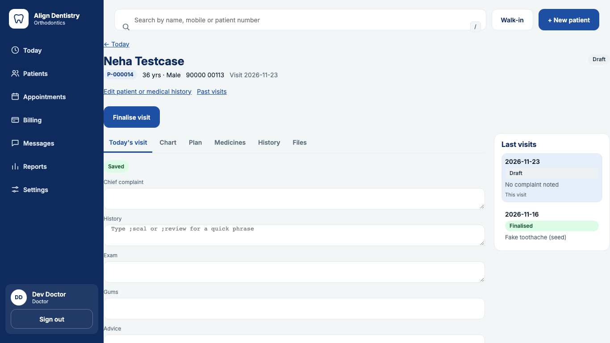

**5.** New visit opens; side card 'Last visits' shows the previous visit `/app/visits/01M84GW0W6SQTRWW1NMRF8QFRV`  
   → toast: Saved

**6.** Type chief complaint `/app/visits/01M84GW0W6SQTRWW1NMRF8QFRV`  
   → toast: Not saved
**7.** Open the visit's History tab to see the old visit `/app/visits/01M84GW0W6SQTRWW1NMRF8QFRV`

**8.** History tab inside the visit `/app/visits/01M84GW0W6SQTRWW1NMRF8QFRV`

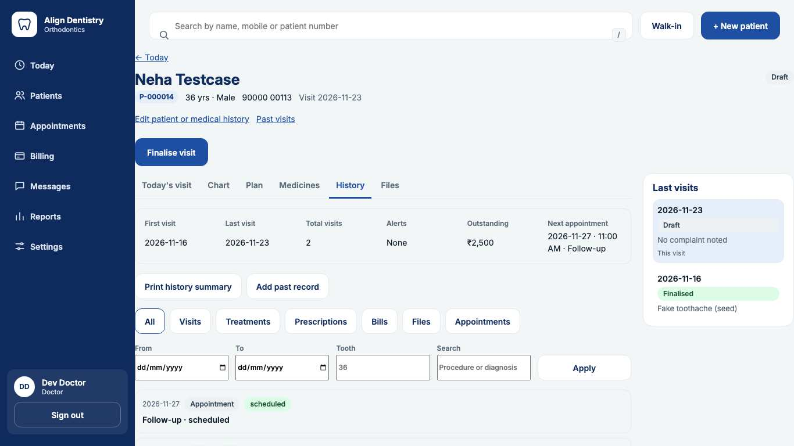

**9.** Open Chart tab `/app/visits/01M84GW0W6SQTRWW1NMRF8QFRV`
**10.** Chart: does it show the earlier finding on tooth 16? `/app/visits/01M84GW0W6SQTRWW1NMRF8QFRV`

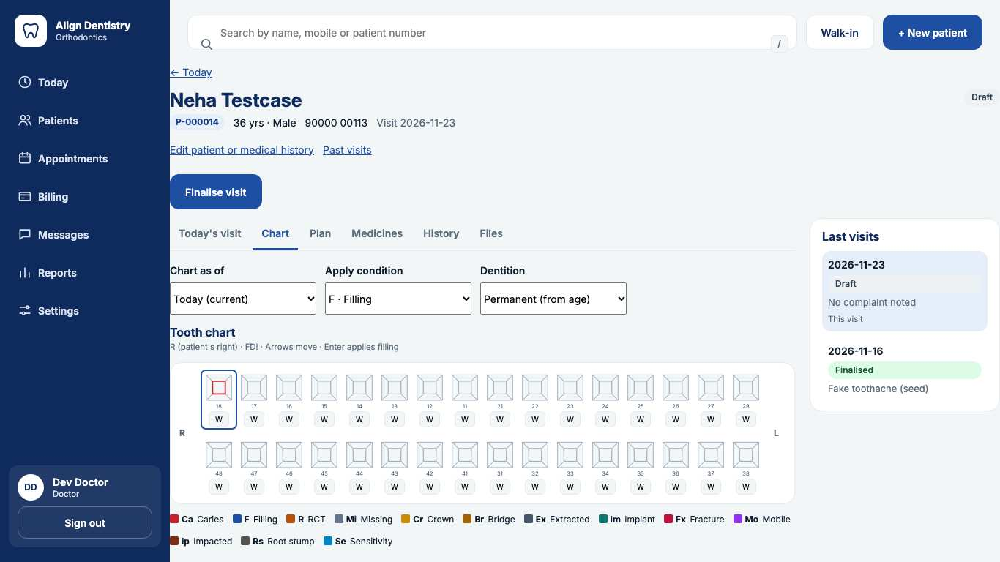

**11.** Click tooth 46 `/app/visits/01M84GW0W6SQTRWW1NMRF8QFRV`
**12.** Choose the procedure Extraction `/app/visits/01M84GW0W6SQTRWW1NMRF8QFRV`
**13.** Click Add procedure `/app/visits/01M84GW0W6SQTRWW1NMRF8QFRV`
**14.** Procedure added to the visit `/app/visits/01M84GW0W6SQTRWW1NMRF8QFRV`

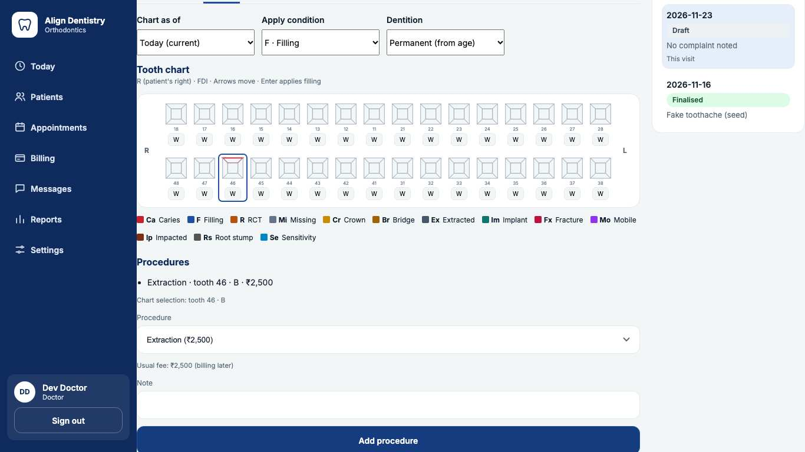

**15.** Click Finalise visit (no prescription this time) `/app/visits/01M84GW0W6SQTRWW1NMRF8QFRV`  
   → dialog open: Finalise this visit? / After finalise, notes become read-only. Warnings: No diagnosis is recorded yet. Procedu

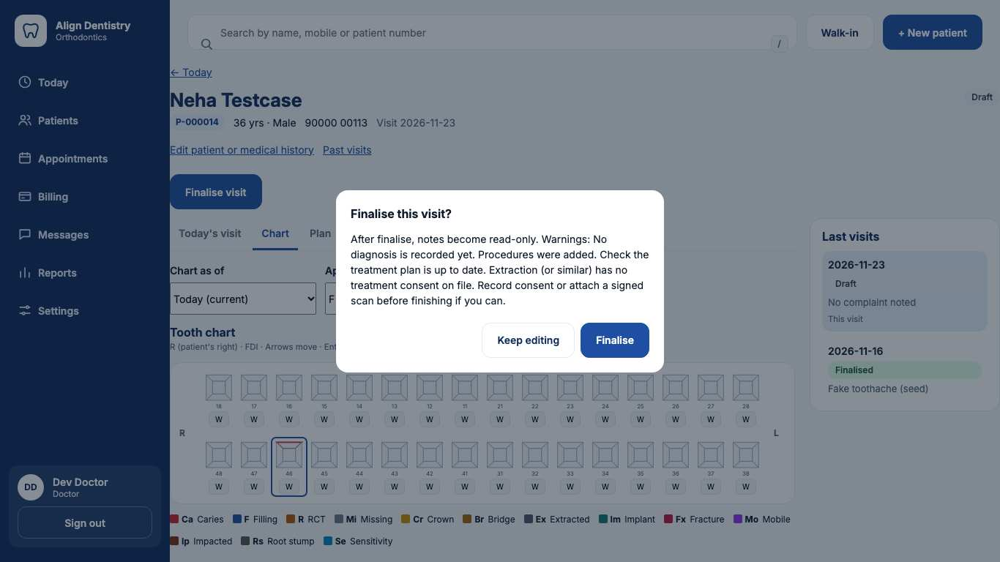

**16.** Confirm Finalise `/app/visits/01M84GW0W6SQTRWW1NMRF8QFRV`

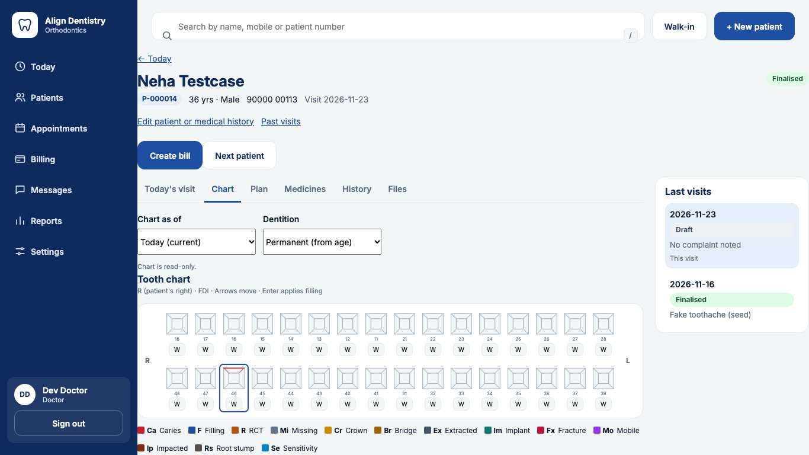

**17.** Click Create bill `/app/bills/01M84GW7KX923DJM5B6V1F0302`

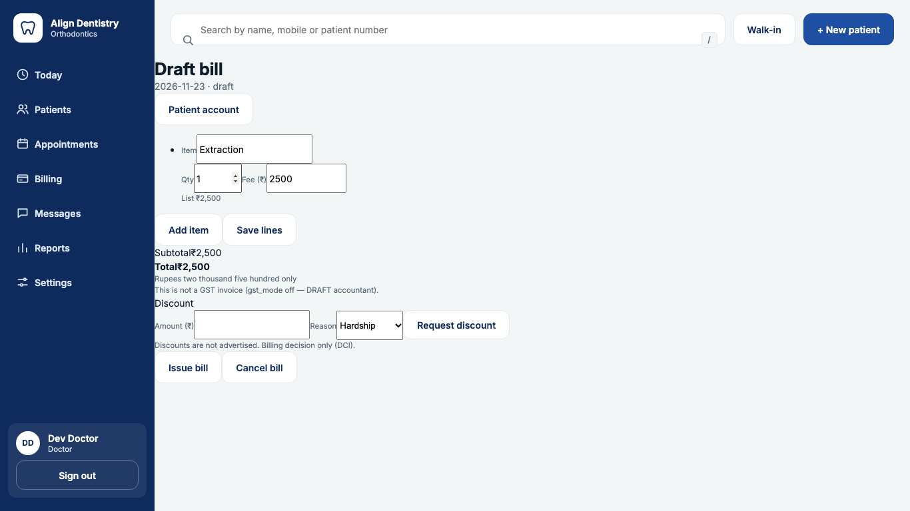

**18.** Click Issue bill `/app/bills/01M84GW7KX923DJM5B6V1F0302`

**19.** Issued bill `/app/bills/01M84GW7KX923DJM5B6V1F0302`

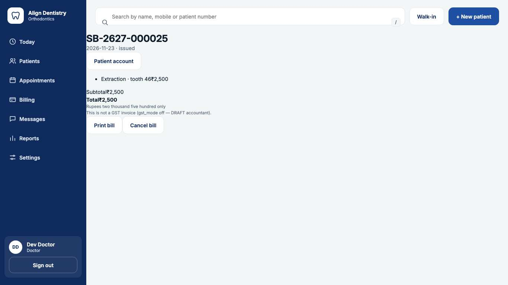

**20.** Switch to the receptionist `/app`

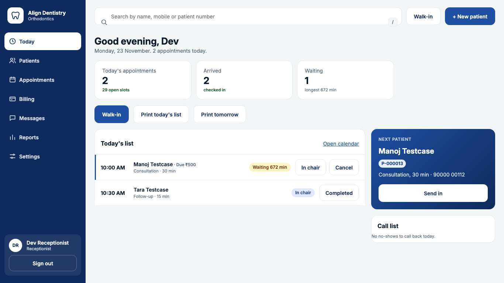

**21.** Receptionist opens Billing (dues list) `/app/billing`

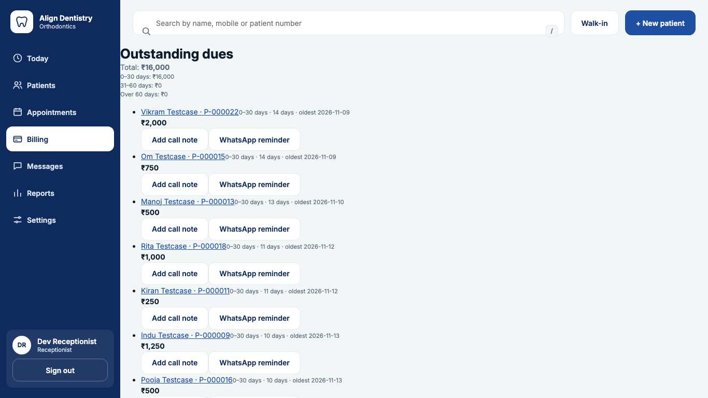

**22.** Dues list: is Neha's new bill included? How much does she owe? `/app/billing`

**23.** Click Neha in the dues list `/app/patients/01M84FVD7HF5AE7M79J4VTRK5M?tab=billing`

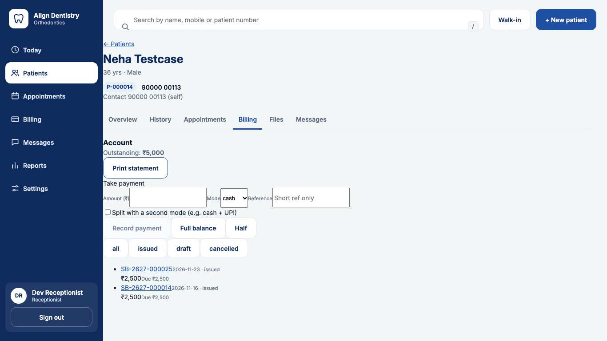

**24.** Open Billing tab `/app/patients/01M84FVD7HF5AE7M79J4VTRK5M?tab=billing`
**25.** Billing tab: two bills, balance `/app/patients/01M84FVD7HF5AE7M79J4VTRK5M?tab=billing`

**26.** Type amount 3000 (more than the older bill, less than both) `/app/patients/01M84FVD7HF5AE7M79J4VTRK5M?tab=billing`
**27.** Choose mode upi `/app/patients/01M84FVD7HF5AE7M79J4VTRK5M?tab=billing`
**28.** Type short reference `/app/patients/01M84FVD7HF5AE7M79J4VTRK5M?tab=billing`
**29.** Click Record payment `/app/patients/01M84FVD7HF5AE7M79J4VTRK5M?tab=billing`
**30.** After a payment that covers one bill and part of the other `/app/patients/01M84FVD7HF5AE7M79J4VTRK5M?tab=billing`

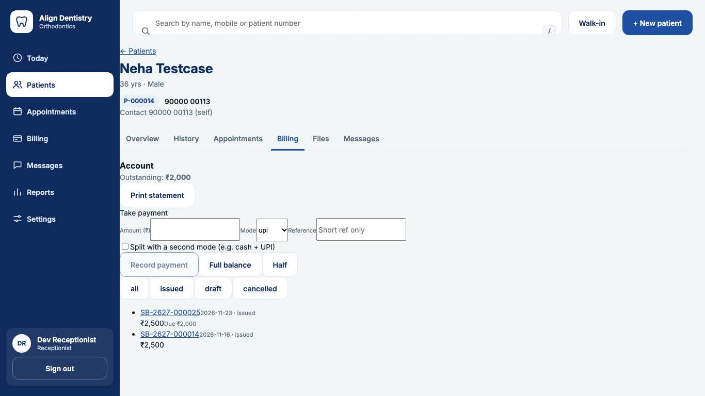

## Gate A re-run (2026-11-24)
Re-run without harness repair after Part 2 and Part 3: passed. Evidence: `GATE-A-g02/`. Summary and what changed: [GATE-A.md](GATE-A.md). The findings above describe the app before Phase Q.
