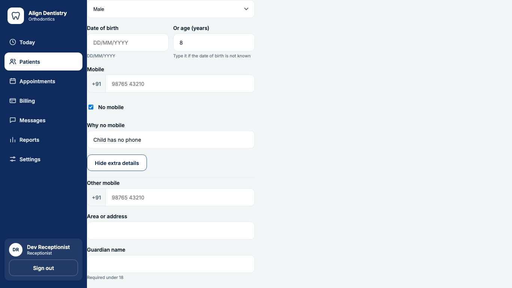
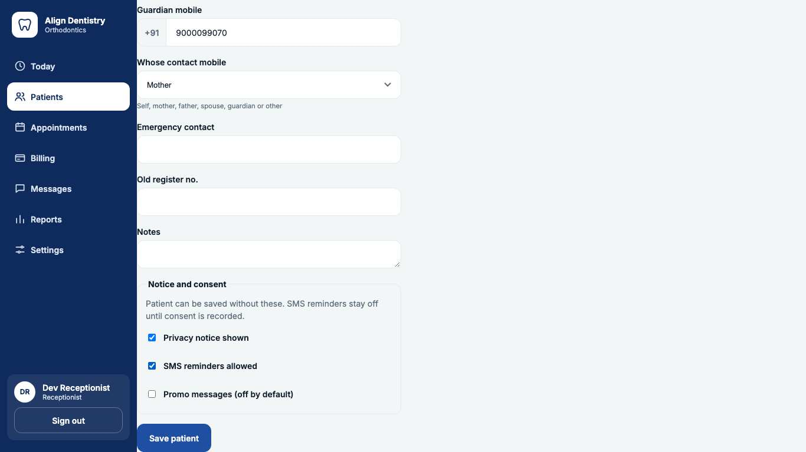
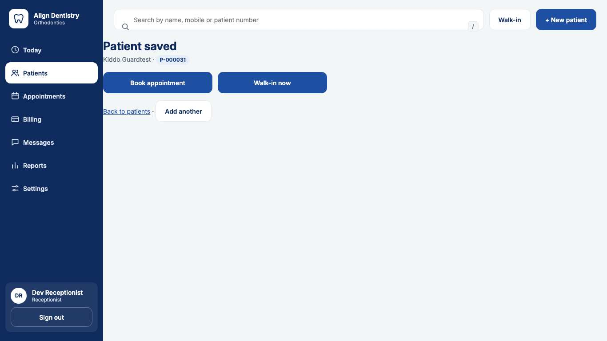
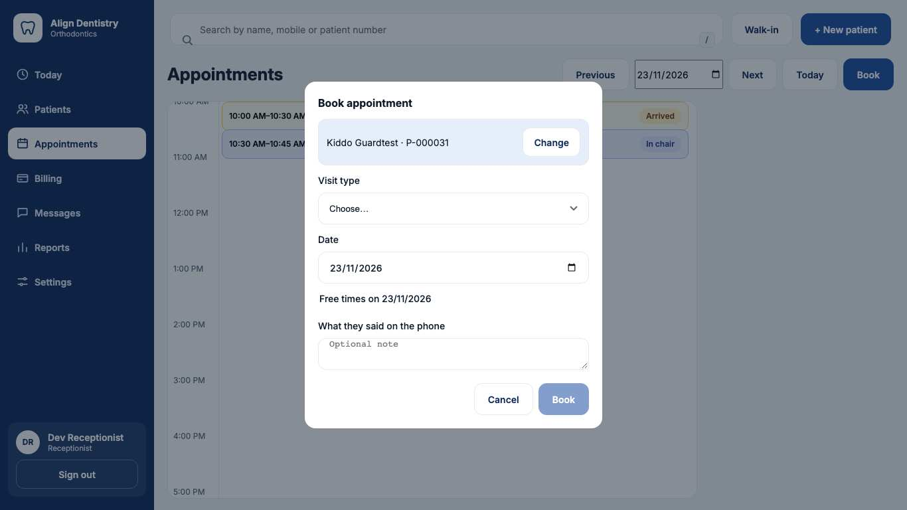
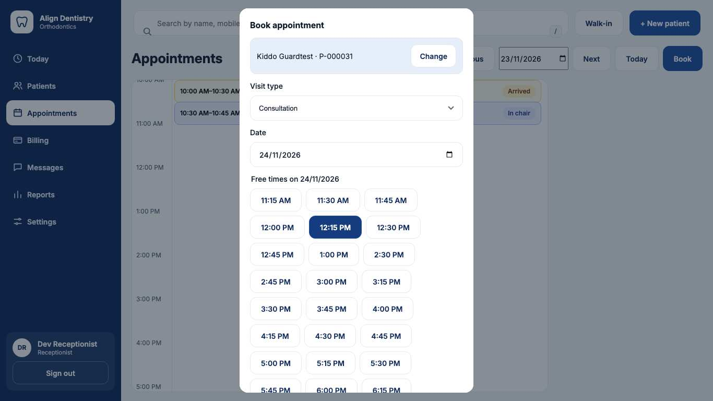
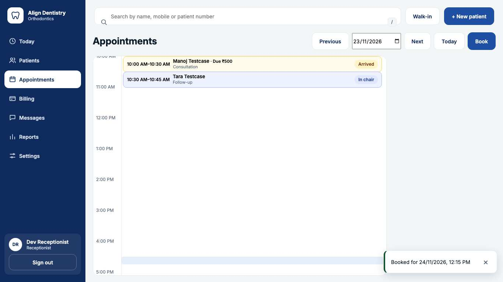
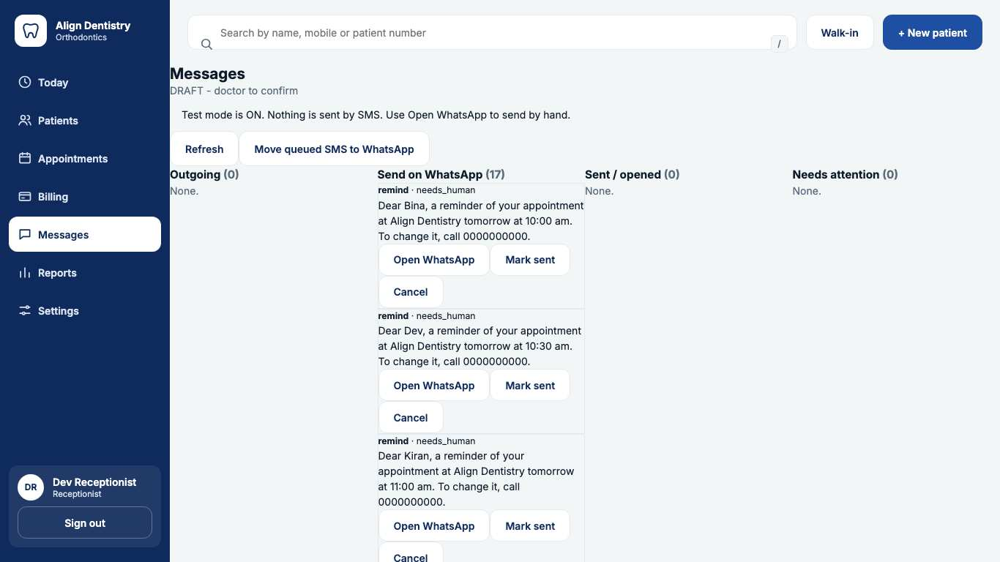
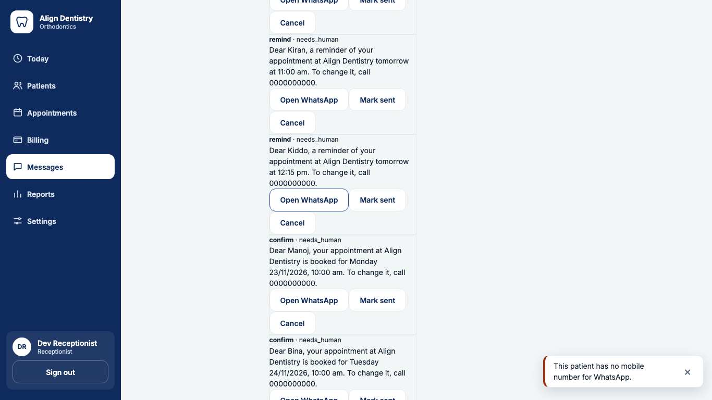
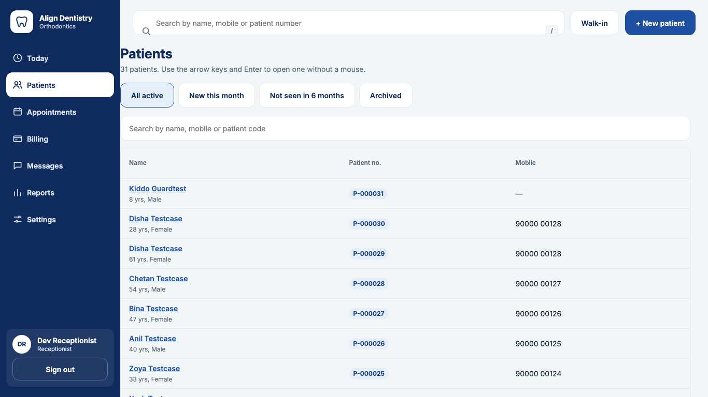
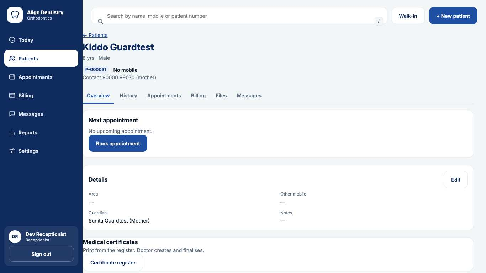

# G08-child-with-guardian-and-shared-mobile: An 8-year-old whose mother's phone is the contact: registration, booking, reminder

**Aim:** This is an orthodontic clinic with many children. Register a child who has no phone, enter the mother as guardian and as the owner of the contact mobile, ask for SMS consent, book him, and see whether the reminder can reach the mother. Also check how the profile shows who to call.

**Who / device:** Receptionist, laptop. Browser: Chromium 1366 px. Fake data only.

**Starting state:** Fresh local database. Child Kiddo Guardtest, age 8, 'No mobile' ticked with reason; guardian Sunita Guardtest, relation Mother, guardian mobile 9000099070, contact mobile belongs to Mother; privacy notice and SMS consent ticked; booked tomorrow 12:15 PM.

**Result: Registration WORKS; the reminder is BROKEN for children.** The form handles the case well: 'No mobile' opens a 'Why no mobile' box, the guardian fields sit under More details, and the profile shows 'No mobile' and 'Contact 90000 99070 (mother)'. But the reminder created for the child cannot be sent: Open WhatsApp says 'This patient has no mobile number for WhatsApp.' The system ignores the guardian's contact number it shows on the profile, so children whose parent's phone is the contact never get reminders.

| Measure | Value |
|---|---|
| Steps recorded | 29 |
| Clicks / key presses to finish | 10 |
| Fields typed or chosen | 7 |
| Distinct pages used | 5 (/app/patients/new, /app/appointments, /app/messages, /app/patients, /app/patients/:id) |
| Calls that would fail for a real user because of bug C1 | 0 (the test harness repaired them so the flow could continue) |
| Failed server calls | 400 /api/staff/messages/01M84M9A1ZM7HVZR96P1K2CN0S/open-whatsapp |

## Problems found in this flow

| # | Priority | Step | Problem | Why it matters | Suggested fix |
|---|---|---|---|---|---|
| G8-1 | High | 23-25 | The reminder for the child ('Dear Kiddo, a reminder of your appointment ...') is in the Messages list but pressing Open WhatsApp fails with 'This patient has no mobile number for WhatsApp.' (HTTP 400). The profile of the same child says 'Contact 90000 99070 (mother)'. | Children are exactly the patients whose parents need reminders. The record has the number and the consent, but the message cannot be sent. It also sits in the queue as if it could. | Send to the contact mobile when the patient has none, and address it 'Dear Sunita, a reminder for Kiddo's appointment ...'. |
| G8-2 | Medium | 23 | The text says 'Dear Kiddo' even though the reader would be the mother. | A message to a parent addressed to a child's first name reads wrong. | Use the guardian's first name when the contact owner is not 'Self'. |
| G8-3 | Medium | 10 | For a child the guardian fields (name, relation, mobile, who the contact is) are inside the collapsed 'More details', although age under 18 requires a guardian (seen in A02: error appears at the bottom of the form). | The required fields are hidden until the user clicks More details. | Open the guardian group automatically when age is under 18. |
| G8-4 | Low | 10 | 'Whose contact mobile' with options Self, Mother, Father, Spouse, Guardian, Other must be set by hand; entering a guardian mobile does not set it. | One more field to forget; the profile would show 'Contact 90000 99070 (self)' if left on Self. | Default it to the guardian's relation when a guardian mobile is typed. |

## Worked well

- Ticking 'No mobile' immediately shows a 'Why no mobile' field (so the A02 doubt is answered: the reason box opens at once).
- Profile header for the child: 'No mobile' and 'Contact 90000 99070 (mother)'.
- The consent and the guardian are stored; saving worked with all fields.

## Not covered by this run

- Two patients sharing the same contact mobile (siblings): which one a message is for.
- A child who turns 18 (guardian no longer required).
- Consent given by the guardian vs the patient: how it is recorded.

## Step by step (what the user does, and what the screen did)

Evidence labels: every line is [seen] in the browser unless marked otherwise. Screenshots exist only where the screen changed.

**1.** A mother brings her 8-year-old son. The boy has no phone; the mother's phone is the contact `/app/patients/new`

**2.** Child's name `/app/patients/new`
**3.** Gender `/app/patients/new`
**4.** Age 8 `/app/patients/new`
**5.** Tick No mobile (the child has none) `/app/patients/new`
**6.** Type why there is no mobile `/app/patients/new`
Note: After ticking No mobile: fields visible = Full name / Gender / Date of birth / Or age (years) / Mobile / No mobile / Why no mobile / Privacy notice shown / SMS reminders allowed / Promo messages (off by defau `/app/patients/new`
**8.** Open More details (guardian fields) `/app/patients/new`
**9.** More details opened `/app/patients/new`

Note: More details fields: Full name / Gender / Date of birth / Or age (years) / Mobile / No mobile / Why no mobile / Other mobile / Area or address / Guardian name / Guardian relation / Guardian mobile / Whose contact mobile / Emergency contact / Old register no. / Notes / Privacy notice shown / SMS reminders allowed / Promo messages (off by default `/app/patients/new`
**11.** Contact mobile belongs to: Mother `/app/patients/new`
**12.** Tick Privacy notice shown `/app/patients/new`
**13.** Tick SMS reminders allowed `/app/patients/new`
**14.** Child form filled with guardian `/app/patients/new`

**15.** Save patient `/app/patients/new`

Note: Save result: Patient saved / Kiddo Guardtest · P-000031 / Book appointment / Walk-in now / Back to patients · Add another / `/app/patients/new`
**17.** Book appointment `/app/appointments?patient=01M84M96HXXJRKPJA1JM4WNQ72`  
   → dialog open: Book appointment / Kiddo Guardtest · P-000031 / Change / Visit type / Choose… / Consultation / Follow-up / Cle

**18.** Consultation `/app/appointments?patient=01M84M96HXXJRKPJA1JM4WNQ72`  
   → dialog open: Book appointment / Kiddo Guardtest · P-000031 / Change / Visit type / Choose… / Consultation / Follow-up / Cle
**19.** Pick 12:15 PM `/app/appointments?patient=01M84M96HXXJRKPJA1JM4WNQ72`  
   → dialog open: Book appointment / Kiddo Guardtest · P-000031 / Change / Visit type / Choose… / Consultation / Follow-up / Cle

**20.** Note `/app/appointments?patient=01M84M96HXXJRKPJA1JM4WNQ72`  
   → dialog open: Book appointment / Kiddo Guardtest · P-000031 / Change / Visit type / Choose… / Consultation / Follow-up / Cle
**21.** Book `/app/appointments`  
   → toast: Booked for 24/11/2026, 12:15 PM

**22.** Run the cron and open Messages `/app/messages`  
   → toast: Test mode is ON. Nothing is sent by SMS. Use Open WhatsApp to send by hand.

Note: Message for the child: remind · needs_human / Dear Kiddo, a reminder of your appointment at Align Dentistry tomorrow at 12:15 pm. To change it, call 0000000000. / Open WhatsApp / Mark sent / Cancel `/app/messages`
**24.** Click Open WhatsApp on the child's message `/app/messages`  
   → toast: Test mode is ON. Nothing is sent by SMS. Use Open WhatsApp to send by hand.; server replied: 400 /api/staff/messages/01M84M9A1ZM7HVZR96P1K2CN0S/open-whatsapp

Note: WhatsApp opens for number/text: no tab opened `/app/messages`
**26.** Open the child's profile to see how the contact is shown `/app/patients`

**27.** Open Kiddo `/app/patients/01M84M96HXXJRKPJA1JM4WNQ72`

**28.** Profile of a child with guardian `/app/patients/01M84M96HXXJRKPJA1JM4WNQ72`

Note: Profile header: ← Patients / Kiddo Guardtest / 8 yrs · Male / P-000031 / No mobile / Contact 90000 99070 (mother) / Overview / History / Appointments / Billing / Files / Messages / Next appointment / No upcoming appointment. / Book appo `/app/patients/01M84M96HXXJRKPJA1JM4WNQ72`
