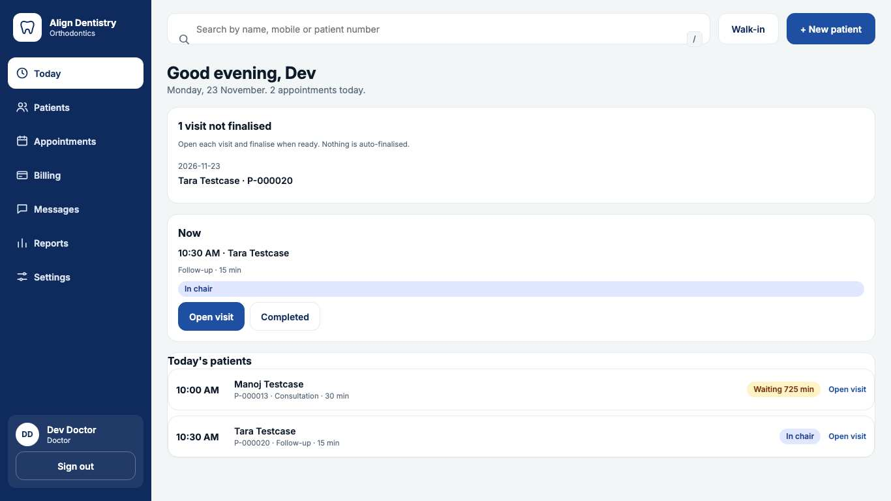
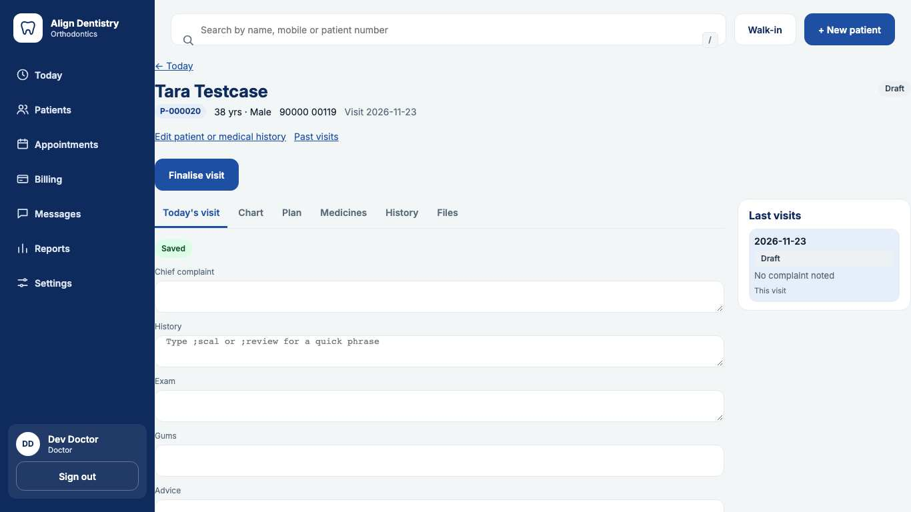
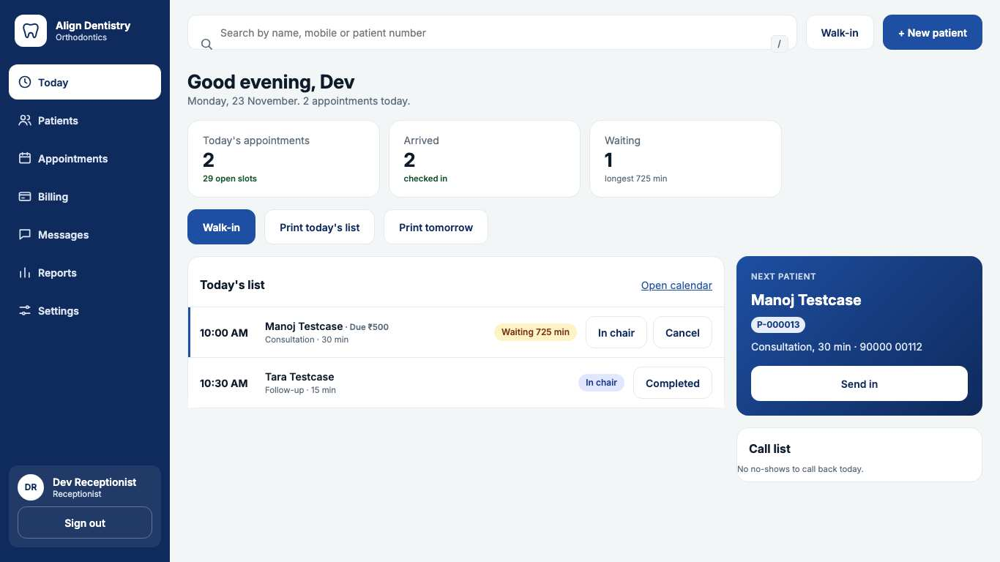
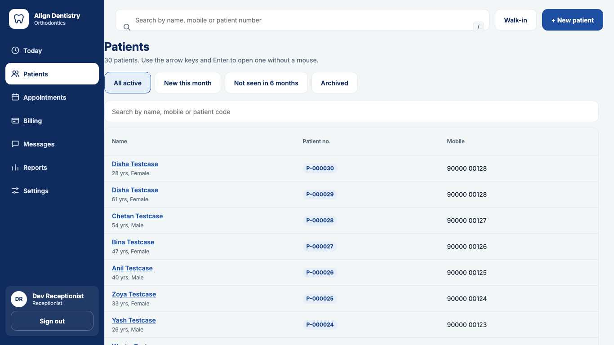
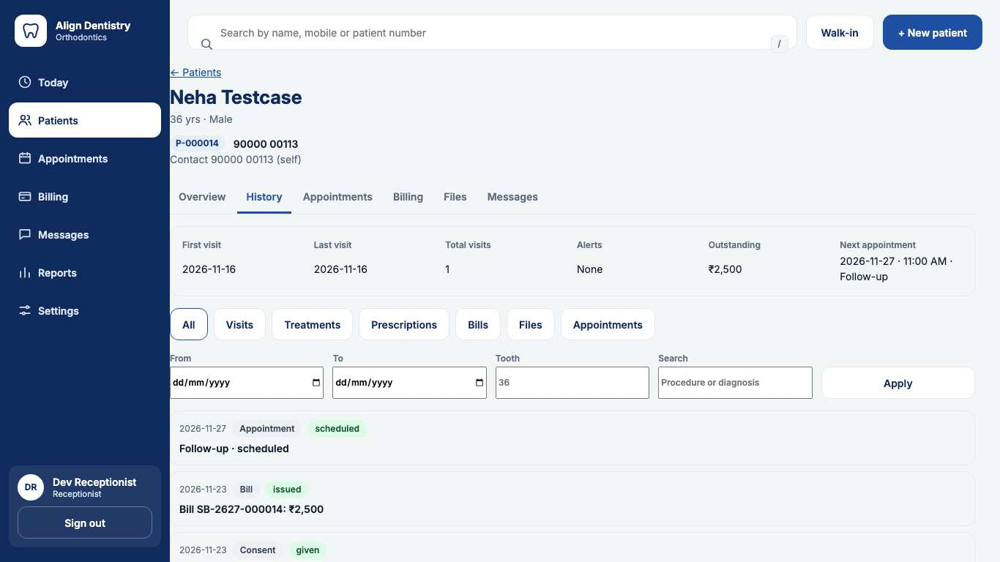

# G10-two-screens-same-record: Two tabs on the same record: visit notes, and two payments on a stale balance

**Aim:** In a clinic two screens often show the same patient: the doctor leaves a visit open in two tabs, or the receptionist has the same billing page open twice, or the doctor and receptionist work on the same patient. Find out what happens to what is typed, what the user is told, and whether money can be recorded against an out-of-date balance.

**Who / device:** Doctor (two tabs of the same visit), then Receptionist (two tabs of the same patient's Billing tab), laptop. Browser: Chromium 1366 px. Fake data only.

**Starting state:** Fresh local database. Tara's visit is a draft. Neha owes ₹2,500. The second tab is opened BEFORE the first tab changes anything, so it holds old data. Bug C1 is repaired by the test harness on both tabs.

**Result: CONFUSING and it can lose typing.** Typing in a tab that holds an old copy of the visit never saves: a red chip 'Not saved — retrying' appears and keeps retrying, with no explanation. After a reload the text typed in that tab is gone. In the billing case a stale tab happily recorded ₹1,000 against ₹500 that was really due and silently created ₹500 of advance.

| Measure | Value |
|---|---|
| Steps recorded | 14 |
| Clicks / key presses to finish | 4 |
| Fields typed or chosen | 2 |
| Distinct pages used | 4 (/app, /app/visits/:id, /app/patients, /app/patients/:id) |
| Calls that would fail for a real user because of bug C1 | 2 (the test harness repaired them so the flow could continue) |
| Failed server calls | none |

## Problems found in this flow

| # | Priority | Step | Problem | Why it matters | Suggested fix |
|---|---|---|---|---|---|
| G10-1 | High | 5-6 | Tab B (opened before tab A saved) typed 'Exam typed in tab B'. The chip says 'Not saved — retrying' and stays that way; the text remains in the box. Reloading the page shows the exam empty: the note is lost. No sentence says 'someone saved this visit in another tab, reload to get the latest'. | A doctor can write several lines, believe the retry will work, finalise or leave, and lose the clinical note. The screen knows it cannot save but does not say why or how to fix it. | On a version conflict show: 'This visit was changed in another tab or by someone else. Your text is kept below. [Reload and merge]'. Never retry forever. |
| G10-2 | High | 13-14 | Tab B showed ₹2,500 due; tab A had already recorded ₹2,000, leaving ₹500. Recording ₹1,000 in tab B was accepted at once: Outstanding became ₹0 with 'Advance ₹500'. No message said the balance had changed. | Out-of-date screens create wrong advances and wrong cash totals; the receptionist does not notice. | The server should reject a payment above the current due unless 'extra as advance' is confirmed; show the fresh balance in the answer. |
| G10-3 | Medium | 4 | The red chip 'Not saved — retrying' is small, sits above the first field and uses the same chip as 'Saved'. | Easy to miss while typing lower down the page. | Make it a sticky banner when saving fails for more than 5 seconds. |

## Worked well

- The visit shows 'Saved' when it saves and a clear red 'Not saved' when it does not.
- Typed text is not wiped from the box when saving fails.
- The first tab saved fine and its text survived (complaint 'Complaint typed in tab A').

## Not covered by this run

- Doctor and receptionist editing the same patient details at the same time.
- What happens to the retry when the connection returns.
- Two tabs finalising the same visit, or issuing the same bill.
- Two receptionists booking the same slot at the same moment.

## Step by step (what the user does, and what the screen did)

Evidence labels: every line is [seen] in the browser unless marked otherwise. Screenshots exist only where the screen changed.

**1.** PART 1: the doctor has the same visit open in two browser tabs (A and B) `/app`

**2.** Tab A: open the visit `/app/visits/01M84FVM8RX59FPGK83NY5Q9YQ`  
   → toast: Saved

**3.** Tab A: type the chief complaint `/app/visits/01M84FVM8RX59FPGK83NY5Q9YQ`  
   → toast: Not saved
Note: Tab A after 2 s: Saved `/app/visits/01M84FVM8RX59FPGK83NY5Q9YQ`
Note: Tab B (opened before A typed) after typing and 2 s: Not saved — retrying `/app/visits/01M84FVM8RX59FPGK83NY5Q9YQ`
Note: After reloading tab B the saved values are: complaint='Complaint typed in tab A', exam='' `/app/visits/01M84FVM8RX59FPGK83NY5Q9YQ`
**7.** PART 2: the receptionist has Neha's Billing tab open in two tabs (both show ₹2,500 due) `/app`

**8.** Patients `/app/patients`

**9.** Tab A: open Neha `/app/patients/01M84FVD7HF5AE7M79J4VTRK5M`

**10.** Tab A: Billing tab `/app/patients/01M84FVD7HF5AE7M79J4VTRK5M`
**11.** Tab A: type 2000 `/app/patients/01M84FVD7HF5AE7M79J4VTRK5M`
**12.** Tab A: Record payment ₹2,000 `/app/patients/01M84FVD7HF5AE7M79J4VTRK5M`
Note: Tab A now: Outstanding: ₹500 `/app/patients/01M84FVD7HF5AE7M79J4VTRK5M`
Note: Tab B (stale, still thought ₹2,500 was due) recorded ₹1,000: Outstanding: ₹0 · Advance: ₹500 / msg: `/app/patients/01M84FVD7HF5AE7M79J4VTRK5M`
