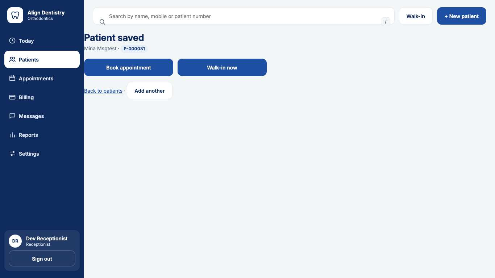
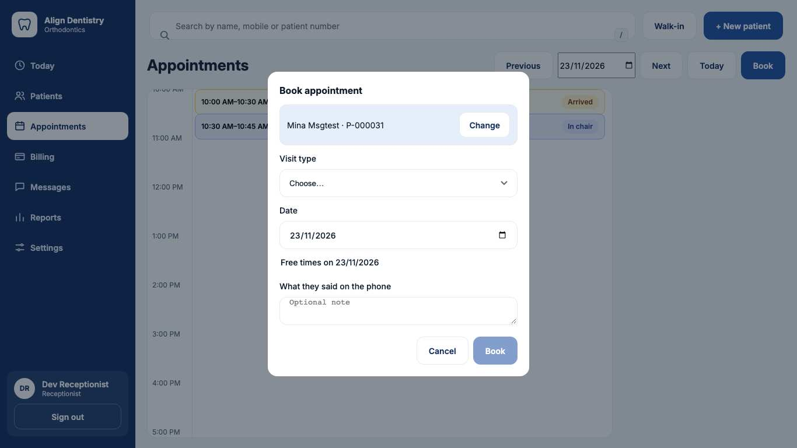
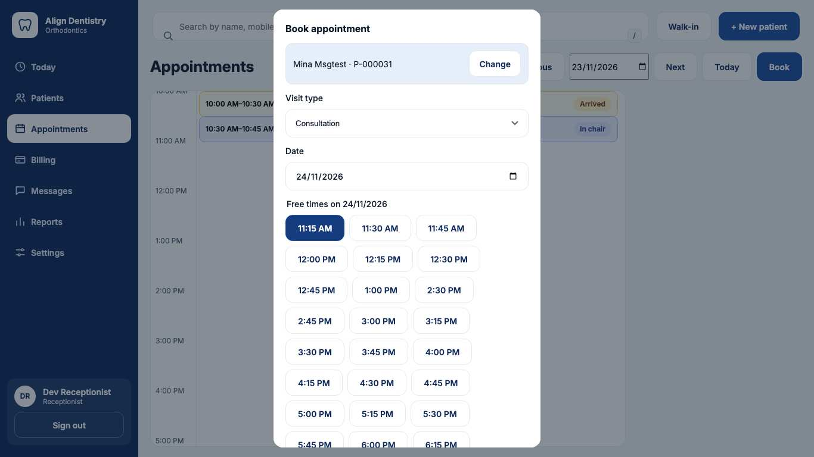
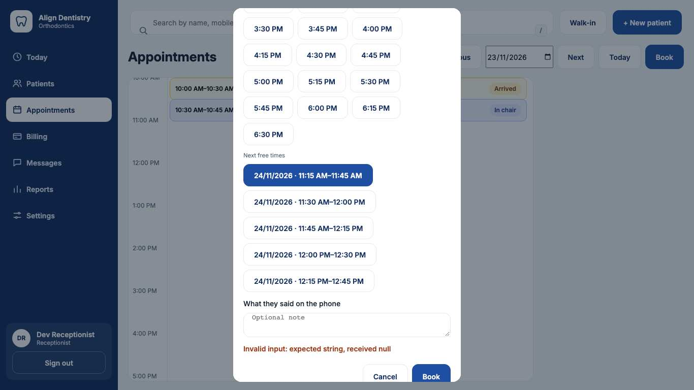
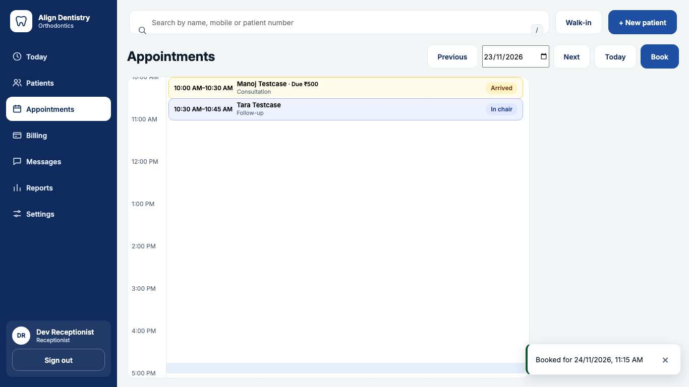
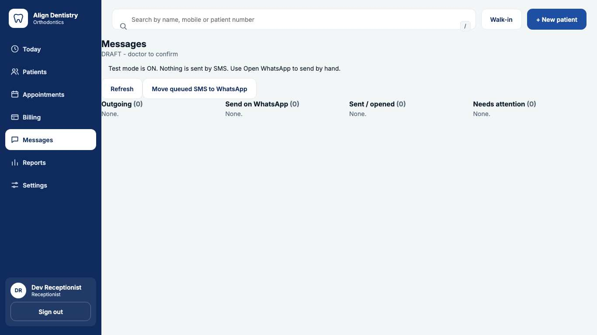
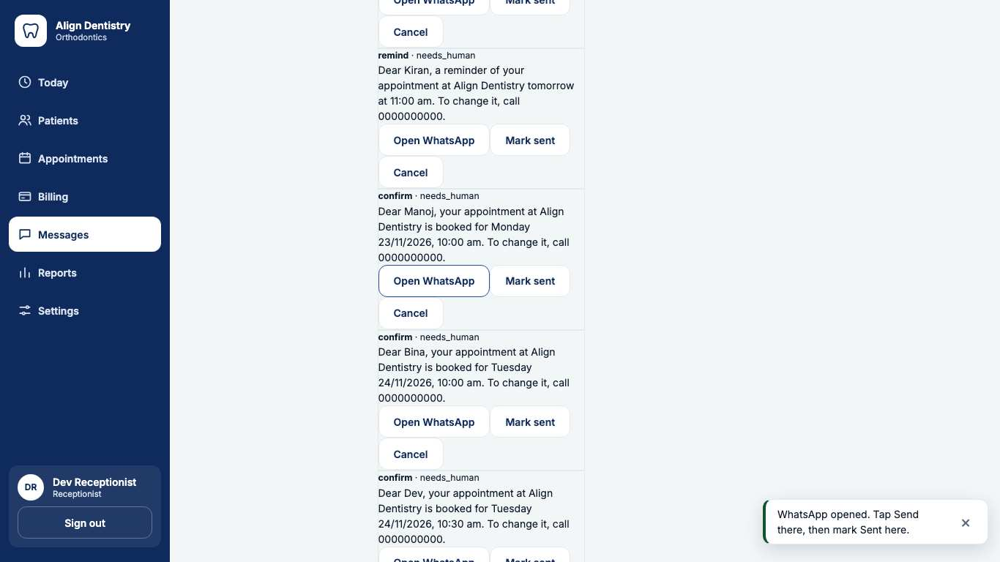

# H01-booking-confirm-and-reminder-messages: Booking a patient and what messages the system creates (confirm and reminder), and how staff send them

**Aim:** Follow a booking all the way to the patient's phone: does the booking work without an optional note, when do the confirm and day-before reminder messages appear, what do they say, how does the receptionist send them, and what happens to a message after she taps Open WhatsApp. Messages are in test mode: nothing is sent by SMS, staff open WhatsApp by hand.

**Who / device:** Receptionist, laptop. The 5-minute cron job was triggered by hand through the local test endpoint, the same job Cloudflare runs every 5 minutes.. Browser: Chromium 1366 px. Fake data only.

**Starting state:** Fresh local database. New patient Mina Msgtest, mobile 9000099010, with 'Privacy notice shown' and 'SMS reminders allowed' ticked. Booking is for tomorrow 24 Nov 11:15 AM. Clock 9:50 PM IST (inside quiet hours 21:00-08:00).

**Result: BROKEN at booking without a note; messages work but are hard to use.** Booking without typing the optional note fails with 'Invalid input: expected string, received null' (critical, new bug C4). With a note the booking succeeds. No message exists right after booking; the confirm and reminder appear only after the 5-minute cron. Texts are short, use only first name, clinic, date and time, and open the right WhatsApp chat. But the Messages screen is one long narrow list with raw words, no full patient name, and it also contains confirm messages for appointments in the past.

| Measure | Value |
|---|---|
| Steps recorded | 20 |
| Clicks / key presses to finish | 8 |
| Fields typed or chosen | 6 |
| Distinct pages used | 3 (/app/patients/new, /app/appointments, /app/messages) |
| Calls that would fail for a real user because of bug C1 | 0 (the test harness repaired them so the flow could continue) |
| Failed server calls | 400 /api/staff/appointments |

## Problems found in this flow

| # | Priority | Step | Problem | Why it matters | Suggested fix |
|---|---|---|---|---|---|
| C4 (new) | Critical | 12-13 | Clicking Book with the optional note left empty fails: the red line 'Invalid input: expected string, received null' appears under the note. The dialog sends complaint: null, the server's schema accepts only a string or nothing. | Most bookings have no note. The receptionist sees a technical message, does not know what to fix, and may think the slot is gone. It only works if she happens to type something. | Send nothing (or an empty string) when the note is empty, or accept null in the schema. Add a browser test for booking without a note. |
| H1-1 | Medium | 15, 17 | No message exists right after booking (Messages shows 0 / 0 / 0 / 0). The confirm and the reminder appear only after the cron (up to 5 minutes later). The booking toast does not mention a message. | The receptionist cannot tell whether the patient will be told. | Toast: 'Booked. Confirmation message will appear in Messages in a few minutes.' or create it at once. |
| H1-2 | High | 17 | The cron also creates a confirm message for an appointment that has already happened: 'Dear Manoj, your appointment at Align Dentistry is booked for Monday 23/11/2026, 10:00 am' (it is 9:50 PM). It also creates confirm messages for every older booking that has no confirm yet, 15 messages in all. | Staff may send a confirmation for a visit that is over, or spend time on messages that should never exist. | Do not create confirm messages for past appointments; show only messages due now. |
| H1-3 | Medium | 17 | The reminder says 'tomorrow' but is created and listed up to two days early (Rita, Zoya, Bharat, Indu have appointments on Wed 25/11 and already show 'a reminder ... tomorrow at 10:00 am'). | If staff send it now the word 'tomorrow' is wrong. (Not confirmed whether the item is meant to be sent only the day before at 17:00.) | Show a 'due at' time on each message and hide it until then. |
| H1-4 | Medium | 17 | The Messages page is one narrow column of 15+ cards. Each card shows 'remind · needs_human' (raw words), the text, and three buttons (Open WhatsApp, Mark sent, Cancel). The patient is only 'Dear Bina': no surname, number or mobile. | With two patients named Bina it is impossible to be sure whom a message is for. Raw status words are jargon. | Show full name, patient number and time of appointment as a heading; use words: 'Reminder', 'Needs sending'. Group by day. |
| H1-5 | Low | 18-20 | After Open WhatsApp the toast says 'WhatsApp opened. Tap Send there, then mark Sent here.' but the message has already moved to 'Sent / opened (1)'. 'Mark sent' stays as a separate step. | The state 'opened but maybe not sent' is merged with 'sent'. | Keep it under 'Opened, waiting for you to confirm sent' until Mark sent. |
| H1-6 | Medium | 17 | All messages end with 'call 0000000000' because the clinic phone in Settings is still the sample value. | A real clinic could send this to patients if Settings are not filled. | Block 'Open WhatsApp' until the clinic phone is set (and show a Settings warning). |
| H1-7 | Low | 11-12 | After choosing a date the Book dialog is taller than the 768 px laptop screen. 25 time chips plus 5 long 'Next free times' buttons push the note, the error and the Book button down; the error line appeared below the fold. | The user may not see the error and the Book button is cut at the bottom. | Show 8 time chips with 'More times'; keep Book fixed at the bottom of the dialog. |

## Worked well

- Message wording is short and clean: only first name, clinic name, day, date and time and the clinic number. No health words, as the privacy rule requires.
- Open WhatsApp opens the correct chat with the text already filled (https://api.whatsapp.com/send/?phone=919000099010&text=Dear+Mina...), and a toast tells the user what to do next.
- A reminder says 'tomorrow at 11:15 am' for tomorrow's booking: the wording matches for correct days.

## Not covered by this run

- Quiet-hours behaviour (21:00 to 08:00): reminders were listed, but a real send is manual so the rule could not be seen.
- Patients without SMS consent (flow H7), without a mobile, or with a wrong number.
- Reschedule or cancel message (blocked: no cancel for future bookings, flow B02).
- Same-day reminder (setting is off by default), recall, incomplete-treatment and dues messages.
- Settings > Messages (template editing).

## Step by step (what the user does, and what the screen did)

Evidence labels: every line is [seen] in the browser unless marked otherwise. Screenshots exist only where the screen changed.

**1.** Receptionist registers a patient WITH sms consent `/app/patients/new`

**2.** Type the name `/app/patients/new`
**3.** Gender `/app/patients/new`
**4.** Age `/app/patients/new`
**5.** Mobile `/app/patients/new`
**6.** Tick Privacy notice shown `/app/patients/new`
**7.** Tick SMS reminders allowed `/app/patients/new`
**8.** Save patient `/app/patients/new`

**9.** Book appointment `/app/appointments?patient=01M84H8BD982XC4EWKDDJ8V9PB`  
   → dialog open: Book appointment / Mina Msgtest · P-000031 / Change / Visit type / Choose… / Consultation / Follow-up / Cleani

**10.** Consultation `/app/appointments?patient=01M84H8BD982XC4EWKDDJ8V9PB`  
   → dialog open: Book appointment / Mina Msgtest · P-000031 / Change / Visit type / Choose… / Consultation / Follow-up / Cleani
**11.** Pick 11:15 AM tomorrow `/app/appointments?patient=01M84H8BD982XC4EWKDDJ8V9PB`  
   → dialog open: Book appointment / Mina Msgtest · P-000031 / Change / Visit type / Choose… / Consultation / Follow-up / Cleani

**12.** Click Book WITHOUT typing the optional note `/app/appointments?patient=01M84H8BD982XC4EWKDDJ8V9PB`  
   → error shown: Invalid input: expected string, received null; dialog open: Book appointment / Mina Msgtest · P-000031 / Change / Visit type / Choose… / Consultation / Follow-up / Cleani; server replied: 400 /api/staff/appointments

**13.** Now type a note (the field says optional) `/app/appointments?patient=01M84H8BD982XC4EWKDDJ8V9PB`  
   → error shown: Invalid input: expected string, received null; dialog open: Book appointment / Mina Msgtest · P-000031 / Change / Visit type / Choose… / Consultation / Follow-up / Cleani
**14.** Click Book again, this time with a note `/app/appointments`  
   → toast: Booked for 24/11/2026, 11:15 AM

**15.** Messages right after booking `/app/messages`  
   → toast: Test mode is ON. Nothing is sent by SMS. Use Open WhatsApp to send by hand.

Note: Ran the 5-minute cron by hand (like Cloudflare does): HTTP 200 `/app/messages`
**17.** Messages after the cron ran `/app/messages`  
   → toast: Test mode is ON. Nothing is sent by SMS. Use Open WhatsApp to send by hand.
**18.** Click Open WhatsApp on Mina's confirm message `/app/messages`  
   → toast: Test mode is ON. Nothing is sent by SMS. Use Open WhatsApp to send by hand.

Note: Open WhatsApp opened: https://api.whatsapp.com/send/?phone=919000099010&text=Dear+Mina%2C+a+reminder+of+your+appointment+at+Align+Dentistry+tomorrow+at+11%3A15+am.+To+change+it%2C+call+0000000000.&type=phone_number&app_absent=0 `/app/messages`
**20.** Messages after Open WhatsApp: where did the message go? `/app/messages`  
   → toast: Test mode is ON. Nothing is sent by SMS. Use Open WhatsApp to send by hand.

## Gate A re-run (2026-11-24)
Re-run without harness repair after Part 2 and Part 3: passed. Evidence: `GATE-A-h01/`. Summary and what changed: [GATE-A.md](GATE-A.md). The findings above describe the app before Phase Q.
