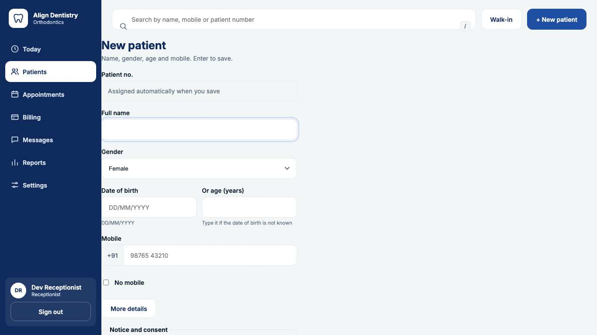
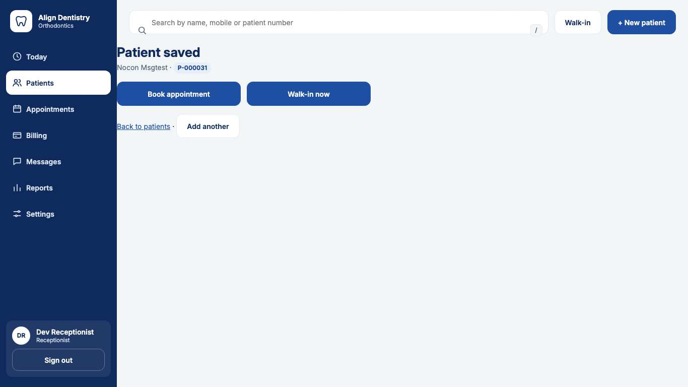
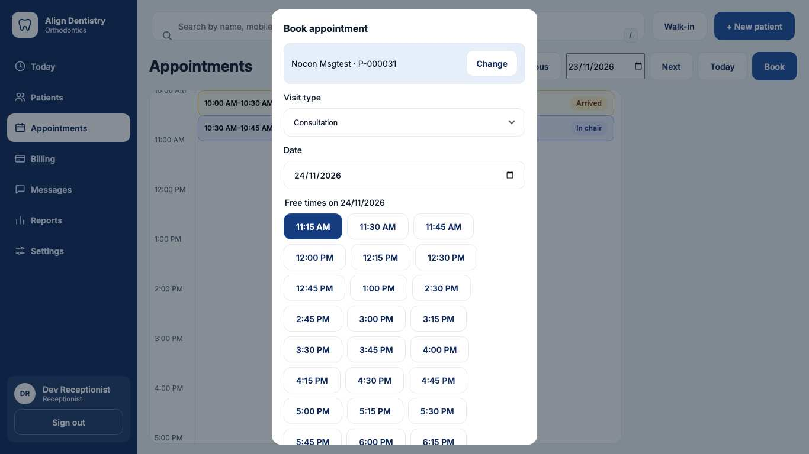
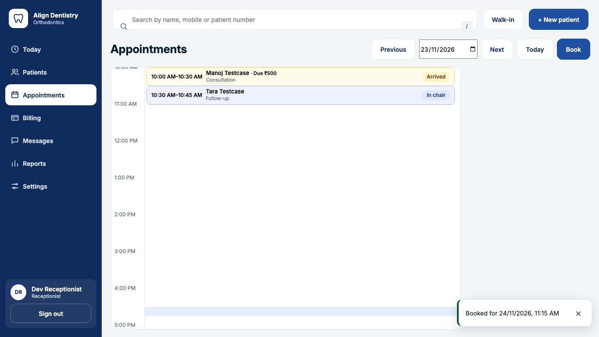
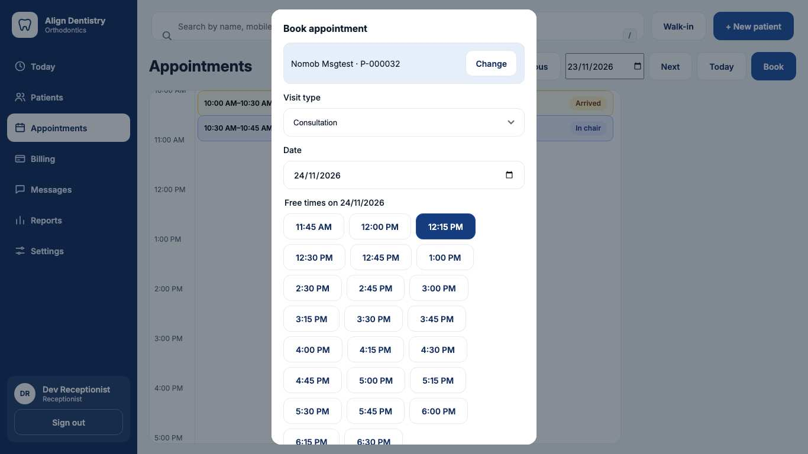
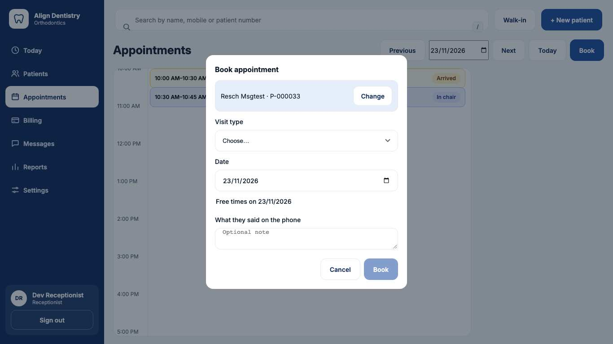
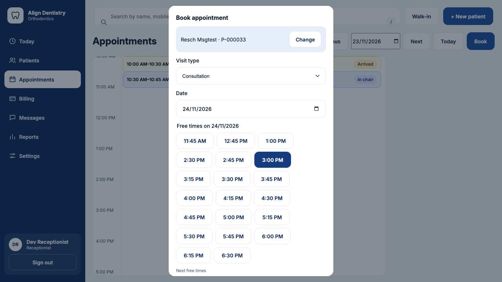
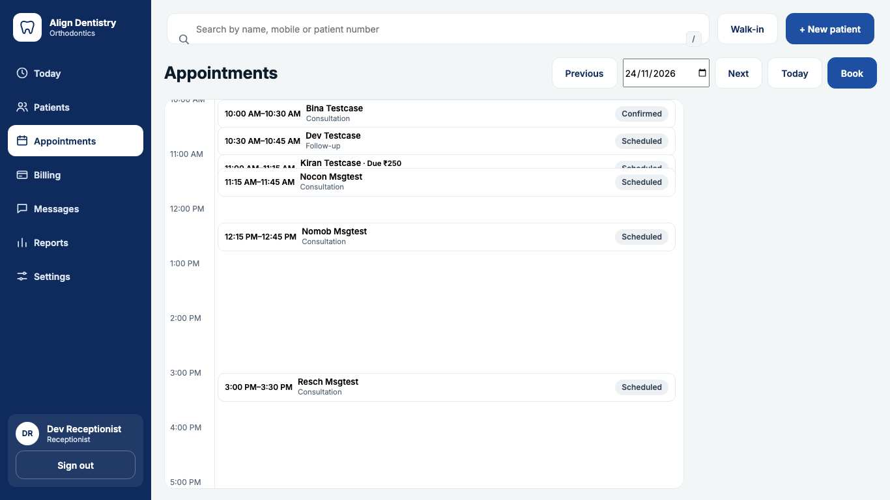
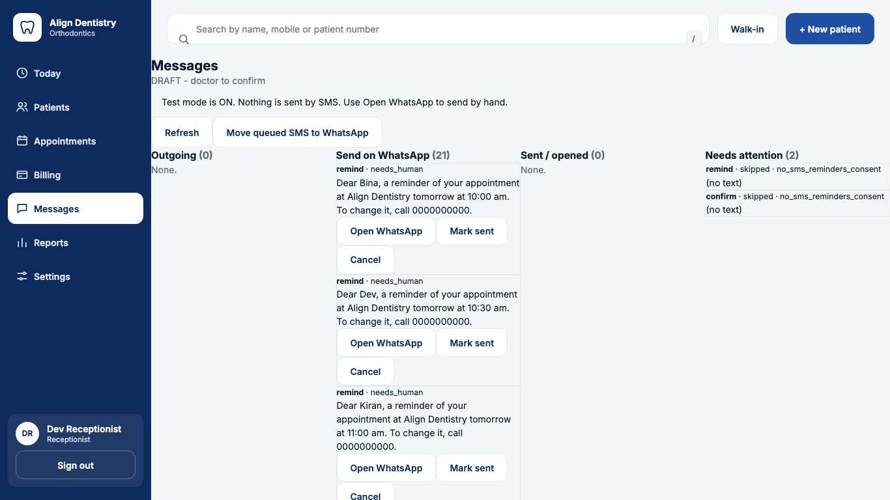

# H02-messages-no-consent-no-mobile-and-reschedule: Messages for awkward patients: no SMS consent, no mobile number, and an appointment that is moved

**Aim:** The privacy rule says no message without SMS consent. Check that, then check two cases the clinic meets often: a patient with no mobile number, and an appointment that is moved after its confirm and reminder messages were already created. Look at what is queued and whether a wrong time could be sent to a patient.

**Who / device:** Receptionist, laptop. The 5-minute cron job was started by hand after the bookings.. Browser: Chromium 1366 px. Fake data only.

**Starting state:** Fresh local database. Three new patients, each booked for tomorrow: Nocon (no SMS consent), Nomob (consent ticked, 'No mobile' ticked), Resch (consent, mobile 9000099061, booked 3:00 PM). Resch is then moved to 4:15 PM by dragging on the calendar.

**Result: RULE HOLDS for consent; BROKEN for moved appointments; CONFUSING for no mobile.** Without SMS consent no message is created: the rule works. A patient with no mobile number still gets a confirm and a reminder in the queue. When an appointment is moved, the old confirm and reminder (3:00 pm) stay in the list next to the new ones (4:15 pm), and no 'reschedule' message is made, although a reschedule template exists. Staff can easily send the old, wrong time.

| Measure | Value |
|---|---|
| Steps recorded | 50 |
| Clicks / key presses to finish | 17 |
| Fields typed or chosen | 17 |
| Distinct pages used | 3 (/app/patients/new, /app/appointments, /app/messages) |
| Calls that would fail for a real user because of bug C1 | 0 (the test harness repaired them so the flow could continue) |
| Failed server calls | none |

## Problems found in this flow

| # | Priority | Step | Problem | Why it matters | Suggested fix |
|---|---|---|---|---|---|
| H2-1 | High | 49 | After moving Resch's appointment from 3:00 PM to 4:15 PM the Messages list holds four messages: remind 3:00 pm, remind 4:15 pm, confirm 3:00 pm, confirm 4:15 pm. The two 3:00 pm messages are still there with 'Open WhatsApp'. | A receptionist working down the list can send 'Your appointment is tomorrow at 3:00 pm' after the patient was moved to 4:15. The patient comes at the wrong time. | When an appointment is moved or cancelled, cancel its queued messages automatically (or mark them 'Out of date') and create one 'rescheduled' message. |
| H2-2 | Medium | 47-49 | Moving an appointment produces a second 'confirm' ('is booked for Tuesday 24/11/2026, 4:15 pm'), not a 'reschedule' message. The reschedule template exists in Settings > Messages but was not used. | The patient gets two 'booked' messages and is not told it was a change. | Use the reschedule template: 'Your appointment has moved to ...'. |
| H2-3 | Medium | 43 | A patient with no mobile number ('No mobile' ticked, reason typed) and SMS consent ticked still gets a confirm and a reminder message, queued as 'Open WhatsApp'. | No number, so the message cannot reach anyone. It clutters the list and a click on Open WhatsApp has no phone to open. | Do not create messages for patients without a mobile, or show 'No number: call or tell in person'. (The 'consent' tick should also be disabled when 'No mobile' is ticked.) |
| H2-4 | Low | 40-44 | The Messages list gives no clue which messages belong to which patient beyond 'Dear Resch'. With four messages per patient it is hard to see which to send. | See H1-4 in flow H01. | Group by patient, newest first, and grey out outdated ones. |

## Worked well

- A patient without SMS reminders consent gets no message: the privacy rule is enforced in the queue.
- The no-mobile registration is accepted with a reason; the form handled the 'No mobile' + reason combination.
- The drag-move asks 'Move Resch Msgtest to 4:15 PM on this day?' before changing the time.

## Not covered by this run

- Cancelling an appointment (no way to cancel a future one, flow B02) and its message.
- Quiet hours (21:00-08:00): the cron produced messages at about 10:30 PM, so queueing is not blocked by quiet hours; sending is manual so the rule could not be seen.
- Same-day reminder, recall, incomplete-treatment, dues messages created by the cron.
- Editing a template in Settings > Messages.

## Step by step (what the user does, and what the screen did)

Evidence labels: every line is [seen] in the browser unless marked otherwise. Screenshots exist only where the screen changed.

**1.** Register Nocon Msgtest: NO SMS consent `/app/patients/new`

**2.** Name `/app/patients/new`
**3.** Gender `/app/patients/new`
**4.** Age `/app/patients/new`
**5.** Mobile `/app/patients/new`
**6.** Save patient `/app/patients/new`

Note: Save result: Patient saved / Nocon Msgtest · P-000031 / Book appointment / Walk-in now / Back to patients · Add another / `/app/patients/new`
**8.** Book appointment `/app/appointments?patient=01M84M39H1BSBBED4GV0A75TDV`  
   → dialog open: Book appointment / Nocon Msgtest · P-000031 / Change / Visit type / Choose… / Consultation / Follow-up / Clean

**9.** Consultation `/app/appointments?patient=01M84M39H1BSBBED4GV0A75TDV`  
   → dialog open: Book appointment / Nocon Msgtest · P-000031 / Change / Visit type / Choose… / Consultation / Follow-up / Clean
**10.** Pick 11:15 AM `/app/appointments?patient=01M84M39H1BSBBED4GV0A75TDV`  
   → dialog open: Book appointment / Nocon Msgtest · P-000031 / Change / Visit type / Choose… / Consultation / Follow-up / Clean

**11.** Note `/app/appointments?patient=01M84M39H1BSBBED4GV0A75TDV`  
   → dialog open: Book appointment / Nocon Msgtest · P-000031 / Change / Visit type / Choose… / Consultation / Follow-up / Clean
**12.** Book `/app/appointments`  
   → toast: Booked for 24/11/2026, 11:15 AM

**13.** Register Nomob Msgtest: SMS consent ticked, NO mobile `/app/patients/new`

**14.** Name `/app/patients/new`
**15.** Gender `/app/patients/new`
**16.** Age `/app/patients/new`
**17.** Tick No mobile `/app/patients/new`
**18.** Tick privacy `/app/patients/new`
**19.** Tick SMS `/app/patients/new`
**20.** Save patient `/app/patients/new`

Note: Save result: Patient saved / Nomob Msgtest · P-000032 / Book appointment / Walk-in now / Back to patients · Add another / `/app/patients/new`
**22.** Book appointment `/app/appointments?patient=01M84M3G778XYX1P9Y8EGKHD2P`  
   → dialog open: Book appointment / Nomob Msgtest · P-000032 / Change / Visit type / Choose… / Consultation / Follow-up / Clean

**23.** Consultation `/app/appointments?patient=01M84M3G778XYX1P9Y8EGKHD2P`  
   → dialog open: Book appointment / Nomob Msgtest · P-000032 / Change / Visit type / Choose… / Consultation / Follow-up / Clean
**24.** Pick 12:15 PM `/app/appointments?patient=01M84M3G778XYX1P9Y8EGKHD2P`  
   → dialog open: Book appointment / Nomob Msgtest · P-000032 / Change / Visit type / Choose… / Consultation / Follow-up / Clean

**25.** Note `/app/appointments?patient=01M84M3G778XYX1P9Y8EGKHD2P`  
   → dialog open: Book appointment / Nomob Msgtest · P-000032 / Change / Visit type / Choose… / Consultation / Follow-up / Clean
**26.** Book `/app/appointments`  
   → toast: Booked for 24/11/2026, 12:15 PM

**27.** Register Resch Msgtest: SMS consent ticked `/app/patients/new`

**28.** Name `/app/patients/new`
**29.** Gender `/app/patients/new`
**30.** Age `/app/patients/new`
**31.** Mobile `/app/patients/new`  
   → toast: Possible match — check before saving: Nocon Msgtest (P-000031) · 90000 99060 — Same name and similar age Nomob Msgtest (P-000032) — Same name and similar age
**32.** Tick privacy `/app/patients/new`  
   → toast: Possible match — check before saving: Nocon Msgtest (P-000031) · 90000 99060 — Same name and similar age Nomob Msgtest (P-000032) — Same name and similar age
**33.** Tick SMS `/app/patients/new`  
   → toast: Possible match — check before saving: Nocon Msgtest (P-000031) · 90000 99060 — Same name and similar age Nomob Msgtest (P-000032) — Same name and similar age
**34.** Save patient `/app/patients/new`

Note: Save result: Patient saved / Resch Msgtest · P-000033 / Book appointment / Walk-in now / Back to patients · Add another / `/app/patients/new`
**36.** Book appointment `/app/appointments?patient=01M84M3PRKHZ595J5WPK0RQSAF`  
   → dialog open: Book appointment / Resch Msgtest · P-000033 / Change / Visit type / Choose… / Consultation / Follow-up / Clean

**37.** Consultation `/app/appointments?patient=01M84M3PRKHZ595J5WPK0RQSAF`  
   → dialog open: Book appointment / Resch Msgtest · P-000033 / Change / Visit type / Choose… / Consultation / Follow-up / Clean
**38.** Pick 3:00 PM `/app/appointments?patient=01M84M3PRKHZ595J5WPK0RQSAF`  
   → dialog open: Book appointment / Resch Msgtest · P-000033 / Change / Visit type / Choose… / Consultation / Follow-up / Clean

**39.** Note `/app/appointments?patient=01M84M3PRKHZ595J5WPK0RQSAF`  
   → dialog open: Book appointment / Resch Msgtest · P-000033 / Change / Visit type / Choose… / Consultation / Follow-up / Clean
**40.** Book `/app/appointments`  
   → toast: Booked for 24/11/2026, 3:00 PM

**41.** Run the cron, then open Messages `/app/messages`  
   → toast: Test mode is ON. Nothing is sent by SMS. Use Open WhatsApp to send by hand.

Note: Messages for the patient WITHOUT consent: none created `/app/messages`
Note: Messages for the patient WITHOUT mobile: remind · needs_human / Dear Nomob, a reminder of your appointment at Align Dentistry tomorrow at 12:15 pm. To change it, call 0000000000. // confirm · needs_human / Dear Nomob, your appointment at Align Dentistry is booked for Tuesday 24/11/2026, 12:15 pm. To change it, call 0000000000. `/app/messages`
Note: Messages for the consenting patient: remind · needs_human / Dear Resch, a reminder of your appointment at Align Dentistry tomorrow at 3:00 pm. To change it, call 0000000000. // confirm · needs_human / Dear Resch, your appointment at Align Dentistry is booked for Tuesday 24/11/2026, 3:00 pm. To change it, call 0000000000. `/app/messages`
**45.** Messages list after the cron `/app/messages`  
   → toast: Test mode is ON. Nothing is sent by SMS. Use Open WhatsApp to send by hand.

**46.** Move Resch's appointment from 11:45 to a later time by dragging `/app/appointments?date=2026-11-24`

Note: Drag dialog: Move appointment? / Move Resch Msgtest to 4:15 PM on this day? / Cancel / Move `/app/appointments`
**48.** Messages after the appointment was moved and the cron ran again `/app/messages`  
   → toast: Test mode is ON. Nothing is sent by SMS. Use Open WhatsApp to send by hand.

Note: Messages for Resch after moving the appointment: remind · needs_human / Dear Resch, a reminder of your appointment at Align Dentistry tomorrow at 3:00 pm. To change it, call 0000000000. // remind · needs_human / Dear Resch, a reminder of your appointment at Align Dentistry tomorrow at 4:15 pm. To change it, call 0000000000. // confirm · needs_human / Dear Resch, your appointment at Align Dentistry is booked for Tuesday 24/11/2026, 3:00 pm. To change it, call 0000000000. // confirm · needs_human / Dear Resch, your appointment at Align Dentistry is booked for Tuesday 24/11/2026, 4:15 pm. To change it, call 0000000000. `/app/messages`
**50.** Messages after reschedule `/app/messages`  
   → toast: Test mode is ON. Nothing is sent by SMS. Use Open WhatsApp to send by hand.

